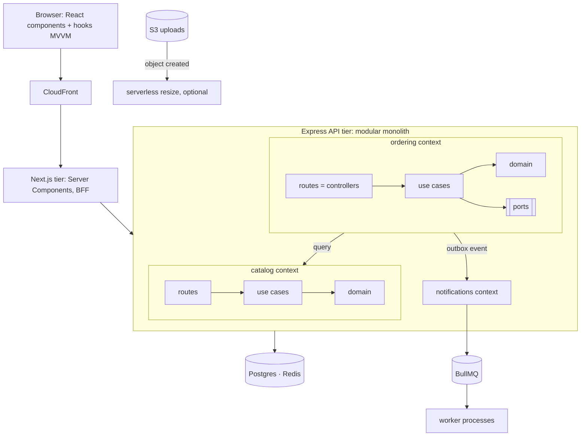

# CQRS, event sourcing, serverless, decisions, and combining styles
[← Overview](00-overview.md)

## Why it matters
- A team adopts event sourcing for a CRUD admin panel. Simple questions ("current price of product 42") require replaying events, and every schema change needs event upcasters.
- The product dashboard runs 14 joins on the transactional tables and slows down checkout. A separate read model would have fixed it.
- "Clean or DDD or microservices?" debates go in circles because the team treats them as alternatives instead of answers to different questions.

## Concepts

### CQRS and event sourcing
| Style | Idea | Use when | Cost |
|:--|:--|:--|:--|
| CQRS-lite | separate code paths (and maybe models) for writes and reads in one database | read screens differ a lot from write models | little: query modules beside the domain |
| CQRS with read models | write side updates projections (tables, Redis, search) asynchronously | heavy reads, dashboards, search | eventual consistency, projection code |
| Event sourcing | store events as the source of truth; derive state by replaying | audit-heavy domains, temporal queries, complex workflows | high: versioning, snapshots, replays, tooling |

Event sourcing implies CQRS; CQRS doesn't require event sourcing. Details: [07-distributed-systems lesson 04](../../07-distributed-systems/docs/04-sagas-cqrs-event-sourcing.md).

### Serverless, BFF, API gateway
| Style | Idea | Fits | Watch out |
|:--|:--|:--|:--|
| Serverless functions (FaaS) | functions run per event, managed scaling | spiky or event-driven work (image resize on upload, webhooks, cron) | cold starts, time limits, local testing, cost at steady high load |
| Backend for frontend (BFF) | an API layer per client type (web, mobile) | clients with different needs | duplicated logic if rules leak into BFFs |
| API gateway | one entry point: routing, auth, rate limits | many services or public APIs | a single point to scale and secure |
| Next.js server as BFF | Server Components and route handlers shape data for the web UI | our web app | keep business rules in the Express API |

### Decisions and fitness functions
| Tool | Use |
|:--|:--|
| ADR | record context, decision, consequences, alternatives |
| Fitness function | an automated check that an architectural property holds: lint rules for boundaries, architecture tests, latency budgets, bundle size limits |
| Quality attribute scenarios | "when traffic doubles, p95 stays under 300 ms" |
| Architecture review | periodic look at decisions against current forces |

### Combining styles: one system, many answers
| Question | Answer in the shop |
|:--|:--|
| Where does it run? (tiers) | browser · CloudFront · Next.js (web tier) · Express API (application tier) · Postgres/Redis (data tier) · workers |
| How many deployables? | modular monolith: one API image, run as API and worker processes; media processing possibly serverless |
| What are the modules? (DDD) | bounded contexts: catalog, ordering, payments, notifications, identity |
| Which way do dependencies point? (clean/hexagonal) | inside each module: domain ← application ← adapters |
| How is each feature organized? | feature modules (vertical); read slices for simple queries |
| How do modules talk? | direct calls for queries needed now; outbox events for side effects (event-driven) |
| How are reads served? | CQRS-lite: query modules and a few read models (Redis, materialized views) |
| UI organization? | component-based React; hooks as ViewModels (MVVM); Express routes as controllers (MVC at the HTTP edge) |
| What could become a service later? | notifications or media, via ADR + strangler fig |

DDD and clean architecture don't compete: **DDD decides what the modules and the model are; clean architecture decides how code inside a module depends on itself.** N-tier says where it runs; modular monolith says how many deployables; event-driven says how modules talk.

## Example
CQRS-lite: a read model maintained from events, queried without touching the domain.
```ts
// Projection: keep a denormalized "order summaries" table for the account dashboard
export async function projectOrderEvent(tx: Tx, event: OrderEvent) {
  switch (event.type) {
    case 'order.placed':
      await tx.insert(orderSummaries).values({ orderId: event.orderId, accountId: event.accountId, totalCents: event.totalCents, status: 'pending', placedAt: new Date(event.occurredAt) });
      break;
    case 'order.paid':
    case 'order.shipped':
    case 'order.cancelled':
      await tx.update(orderSummaries).set({ status: event.type.split('.')[1] as OrderSummaryStatus }).where(eq(orderSummaries.orderId, event.orderId));
      break;
  }
}

// Query side: one cheap query per screen
export const recentOrders = (db: Db, accountId: string) =>
  db.select().from(orderSummaries).where(eq(orderSummaries.accountId, accountId)).orderBy(desc(orderSummaries.placedAt)).limit(20);
```
A fitness function for a quality attribute (API latency budget in the load-test smoke run):
```ts
// load/smoke.ts (k6): fails the pipeline if the architecture stops meeting its latency budget
export const options = { thresholds: { 'http_req_duration{name:GET /api/products/:id}': ['p(95)<300'], http_req_failed: ['rate<0.01'] } };
```
The combined picture:


## In our stack
- Read models and caches: [03-backend/06-caching](../../../03-backend/06-caching/README.md), [03-backend/09-scalability lesson 04](../../../03-backend/09-scalability/docs/04-offloading-and-capacity.md).
- Next.js as a web tier and BFF: [02-frontend/06-rendering](../../../02-frontend/06-rendering/README.md).
- ADRs and fitness functions: [03-backend/11-architecture lesson 04](../../../03-backend/11-architecture/docs/04-events-boundaries-decisions.md); the capstone applies the combined picture: [07-capstone/01-design-build](../../../07-capstone/01-design-build/README.md).

## When not to
- Event sourcing for CRUD or for domains without audit or temporal needs.
- Serverless for steady, high-throughput APIs where containers are cheaper and simpler.
- A BFF per client when one API serves all clients well.

## Production patterns
- **CQRS-lite by default** (separate query code), read models only where reads hurt.
- **Serverless for spiky, event-triggered work**, containers for the steady core.
- **Every big decision as an ADR**, every important quality attribute backed by a fitness function in CI.
- **Combine styles deliberately**: name which question each one answers in the architecture doc.

## Mistakes
Wrong: event sourcing everywhere "for audit". Right: an audit log table or outbox history covers most audit needs.

Wrong: reports querying transactional tables at peak. Right: read models, replicas, or a warehouse.

Wrong: presenting "DDD vs clean vs microservices" as one choice. Right: answer each architectural question separately and combine.

## Check yourself
1. What's the difference between CQRS and event sourcing?
2. Where does serverless fit well in this stack, and where doesn't it?
3. How do DDD, clean architecture, modular monolith, and n-tier fit together in one system?

<details>
<summary>Answers</summary>

1. CQRS separates the write path from the read path (often with different models); event sourcing stores state as a sequence of events and derives current state from them. Event sourcing needs CQRS-style projections for reads, but CQRS works fine with ordinary state tables.
2. It fits spiky or event-triggered work: resizing images after an S3 upload, scheduled jobs, low-volume webhooks. It doesn't fit the steady, high-traffic API core, where cold starts, limits, and per-invocation cost make containers on ECS the better choice.
3. N-tier describes where code runs (browser, web tier, API tier, data tier); modular monolith describes how many deployables (one API image with modules); DDD decides what the modules are (bounded contexts) and how the model looks; clean architecture governs dependencies inside each module (domain at the center, adapters outside).
</details>

## Sources
- [Martin Fowler — CQRS](https://martinfowler.com/bliki/CQRS.html)
- [Martin Fowler — Event sourcing](https://martinfowler.com/eaaDev/EventSourcing.html)
- [Sam Newman — Backends for frontends](https://samnewman.io/patterns/architectural/bff/)
- [Neal Ford et al. — Building Evolutionary Architectures (fitness functions)](https://evolutionaryarchitecture.com/)
- [AWS — Serverless application lens](https://docs.aws.amazon.com/wellarchitected/latest/serverless-applications-lens/welcome.html)
