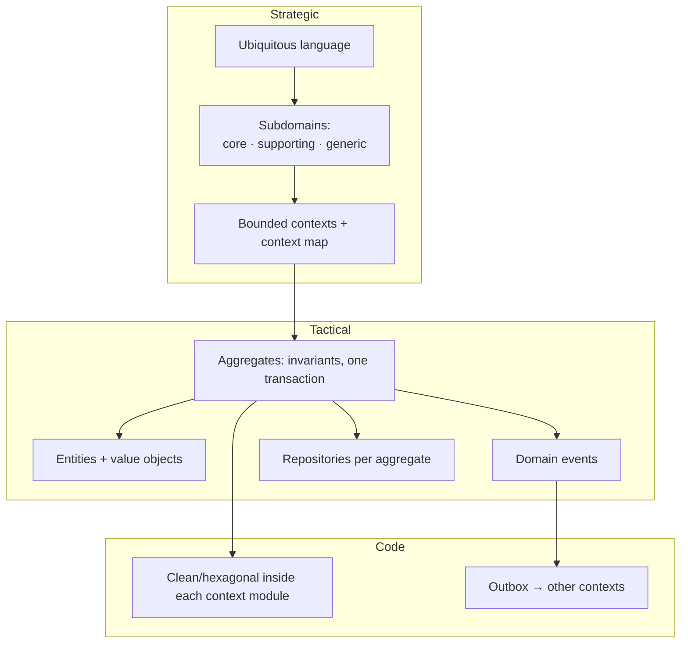

# Domain-Driven Design — Overview
[← Topic](../README.md)

**TECH:** TypeScript domain models on Node.js 26, persisted with Drizzle ORM in PostgreSQL 18 · examples from the shop: catalog, ordering, payments, fulfillment
**LEVEL:** intermediate (mid-level, has shipped production code)
**KIND:** concept topic

## Why this matters in production
- The most expensive bugs come from misunderstanding the business: "order", "customer", or "available" meaning different things to different people.
- Without clear boundaries, one giant model tries to serve sales, shipping, and accounting, and every change breaks someone.
- DDD gives you tools for both: **strategic design** (language, subdomains, bounded contexts) and **tactical design** (entities, value objects, aggregates, events).
- It also tells you where *not* to invest: generic subdomains get bought or kept simple.

## Mental model
Talk to domain experts until the **language** is precise, split the problem into **bounded contexts** where each word has one meaning, invest modeling effort in the **core domain**, and inside each context protect business rules with **aggregates** that change consistently in one transaction. Clean architecture then keeps that model independent of frameworks.

## Prerequisites
- [01-paradigms-oop lesson 04](../../01-paradigms-oop/docs/04-polymorphism-and-data.md): entities vs value objects.
- [04-architecture-styles lesson 02](../../04-architecture-styles/docs/02-clean-hexagonal-onion-slices.md): the dependency rule.
- [03-backend/11-architecture](../../../03-backend/11-architecture/README.md): modules, transactions, outbox events in our stack.

## Lesson map
| Lesson | Checklist items |
|:--|:--|
| [01 · Strategic DDD: language, subdomains, bounded contexts](01-strategic-ddd.md) | 1, 2, 3, 4 |
| [02 · Tactical building blocks: entities, value objects, aggregates, events](02-tactical-building-blocks.md) | 5, 6, 7 |
| [03 · Services, repositories, and modeling in TypeScript](03-modeling-in-typescript.md) | 8, 9 |
| [04 · Persistence, DDD with clean architecture, and when not to](04-persistence-clean-architecture.md) | 10, 11, 12 |
| [Cheatsheet](cheatsheet.md) | all |

## Suggested order
1. 01 → 04.
2. Practice the strategic part interactively: `/design "online bookstore" area=ddd`.
3. Then the [capstone](../../../07-capstone/01-design-build/README.md), which is modeled with DDD and built with clean architecture.

## Version notes
- Node's type stripping: use branded types and `#private` fields instead of decorators or ORM entity classes with decorators.
- Drizzle is a data mapper: domain objects stay plain and are mapped to rows in repositories, which suits DDD.
- PostgreSQL 18: `uuidv7()` for aggregate IDs generated in the database, or generate them in the domain with a UUIDv7 library so IDs exist before saving.

## Sources
- [Eric Evans — Domain-Driven Design Reference (PDF)](https://www.domainlanguage.com/wp-content/uploads/2016/05/DDD_Reference_2015-03.pdf)
- [Martin Fowler — Bounded context](https://martinfowler.com/bliki/BoundedContext.html)
- [Vaughn Vernon — Effective aggregate design (PDF)](https://www.dddcommunity.org/wp-content/uploads/files/pdf_articles/Vernon_2011_1.pdf)
- [DDD Crew — Context mapping and other tools (GitHub)](https://github.com/ddd-crew)
- [Alberto Brandolini — Event storming](https://www.eventstorming.com/)
