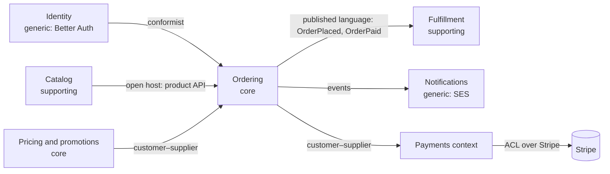

# Strategic DDD: language, subdomains, bounded contexts
[← Overview](00-overview.md)

## Why it matters
- "Product" means a catalog listing to marketing, a stock-keeping unit to the warehouse, and a tax category to accounting. One `products` table tries to be all three and nobody can change it safely.
- Developers call it "basket", the UI says "cart", support says "pending order". Bug reports get misread, and a refund rule is implemented for the wrong state.
- Six months go into building an in-house email delivery system (a generic problem) while the pricing engine (the differentiator) stays a pile of `if`s.

## Concepts

### Why DDD
DDD is for **complex domains** where the hard part is understanding the business, not the technology. It pays off when rules are many, change often, and differentiate the business. It's overkill for simple CRUD.

### Ubiquitous language
| Practice | Detail |
|:--|:--|
| One language per context | developers, experts, UI, code, and tests use the same words |
| Precise definitions | "an order is *placed* when payment is authorized" |
| Code mirrors it | `order.place()`, `OrderPlaced`, not `processData()` |
| A glossary | maintained in the repo, updated when words change |
| Listen for friction | translation between people and code signals a missing concept |

### Event storming
A workshop (or a text exercise) to discover the domain:
| Sticky | Color (convention) | Example |
|:--|:--|:--|
| Domain event | orange | `Order placed`, `Payment captured`, `Parcel shipped` |
| Command | blue | `Place order`, `Capture payment` |
| Actor | yellow (small) | customer, warehouse clerk |
| Aggregate | yellow (large) | Order, Cart, Shipment |
| Policy | lilac | "whenever payment is captured, reserve stock" |
| External system | pink | Stripe, carrier API |
| Read model | green | "order history page" |
| Hot spot | red | open questions, conflicts |

Steps: events on a timeline → commands and actors → policies → aggregates → boundaries (where language changes).

### Subdomains
| Type | Meaning | Strategy | Shop example |
|:--|:--|:--|:--|
| Core | what differentiates the business | build, best people, rich model | pricing and promotions, ordering |
| Supporting | needed and specific, not differentiating | build simply | fulfillment workflow, returns |
| Generic | solved problems | buy or use a library | identity (Better Auth), payments (Stripe), email (SES) |

### Bounded contexts and context maps
A **bounded context** is a boundary within which a model and its language are consistent. "Product" can exist in several contexts with different models. Contexts usually map to modules (in a modular monolith) or services.

| Relationship | Meaning |
|:--|:--|
| Partnership | two teams succeed or fail together, coordinate closely |
| Shared kernel | a small shared model both depend on (keep tiny) |
| Customer–supplier | downstream needs are negotiated with the upstream team |
| Conformist | downstream accepts the upstream model as is |
| Anti-corruption layer (ACL) | downstream translates the upstream model into its own |
| Open host service | upstream offers a well-defined protocol/API for many consumers |
| Published language | a documented shared format (events schema, OpenAPI) |
| Separate ways | no integration; duplicate instead |

## Example
A glossary file in the repo (`docs/domain/glossary.md` excerpt):
```markdown
| Term | Context | Meaning |
|---|---|---|
| Cart | Ordering | items a customer intends to buy; no stock reserved; expires after 7 days |
| Order | Ordering | a customer's commitment to buy, created at checkout; has a status lifecycle |
| Placed | Ordering | the order exists and payment is authorized |
| SKU | Catalog, Fulfillment | stock-keeping unit: one sellable variant (size, color) |
| Listing | Catalog | how a product is presented: title, images, description, price |
| Shipment | Fulfillment | one parcel sent to one address; an order can have several |
```
The shop's context map:

The same word, two models, two contexts:
```ts
// catalog/domain/product.ts — how a product is listed and sold
export type CatalogProduct = { id: ProductId; title: string; slug: string; listPriceCents: number; images: string[]; active: boolean };

// fulfillment/domain/sku.ts — how a product is stocked and shipped
export type StockItem = { sku: Sku; warehouseId: string; onHand: number; reserved: number; weightGrams: number; hazardous: boolean };
```

## In our stack
- Contexts become feature modules with public `index.ts` APIs: [03-backend/11-architecture lesson 01](../../../03-backend/11-architecture/docs/01-goals-layers-modules.md).
- Published language: outbox event contracts ([03-backend/11-architecture lesson 04](../../../03-backend/11-architecture/docs/04-events-boundaries-decisions.md)) and OpenAPI from Zod ([01-foundations/08-documentation](../../../01-foundations/08-documentation/README.md)).
- ACL: the Stripe and SES adapters ([03-backend/12-integrations](../../../03-backend/12-integrations/README.md)).

## When not to
- Don't run multi-day event storming for a CRUD admin tool.
- Don't split a small product into eight bounded contexts on day one; start with the contexts where language clearly differs.
- Don't build generic subdomains (auth, email, payments) yourself unless they're your business.

## Production patterns
- **A glossary per context** in the repository, used in code, UI, and tickets.
- **Event storming before big features**, recorded as events, commands, policies, and hot spots.
- **Effort by subdomain**: rich models for core, simple code for supporting, bought services for generic.
- **Context map as a living diagram** with the integration pattern on every arrow.

## Mistakes
Wrong: one enterprise-wide `Product` model with 80 fields for every department. Right: a model per context, linked by IDs and events.

Wrong: technical names (`DataProcessor`, `OrderHelper`) that experts don't recognize. Right: names from the ubiquitous language.

Wrong: a "shared kernel" that grows into a shared everything. Right: keep shared models tiny; prefer published language and translation.

## Check yourself
1. What is a bounded context, and why can "product" exist in several of them?
2. How do core, supporting, and generic subdomains change how you invest?
3. When do you need an anti-corruption layer?

<details>
<summary>Answers</summary>

1. A boundary inside which one model and one language are consistent. Different parts of the business need different information and rules about a "product" (listing vs stock vs tax), so each context has its own model, linked to the others by IDs and events.
2. Core subdomains get the best people and rich, carefully designed models because they differentiate the business; supporting subdomains get simple, pragmatic code; generic subdomains are bought or taken from libraries and services.
3. When integrating with a model you don't control and don't want to adopt (an external API like Stripe, a legacy system, another team's messy model): the ACL translates their concepts into yours so their changes and quirks don't leak into your model.
</details>

## Sources
- [Martin Fowler — Ubiquitous language](https://martinfowler.com/bliki/UbiquitousLanguage.html)
- [Martin Fowler — Bounded context](https://martinfowler.com/bliki/BoundedContext.html)
- [DDD Crew — Context mapping](https://github.com/ddd-crew/context-mapping)
- [Alberto Brandolini — Introducing event storming](https://www.eventstorming.com/)
- [Vladik Khononov — Learning Domain-Driven Design (subdomains)](https://www.oreilly.com/library/view/learning-domain-driven-design/9781098100124/)
