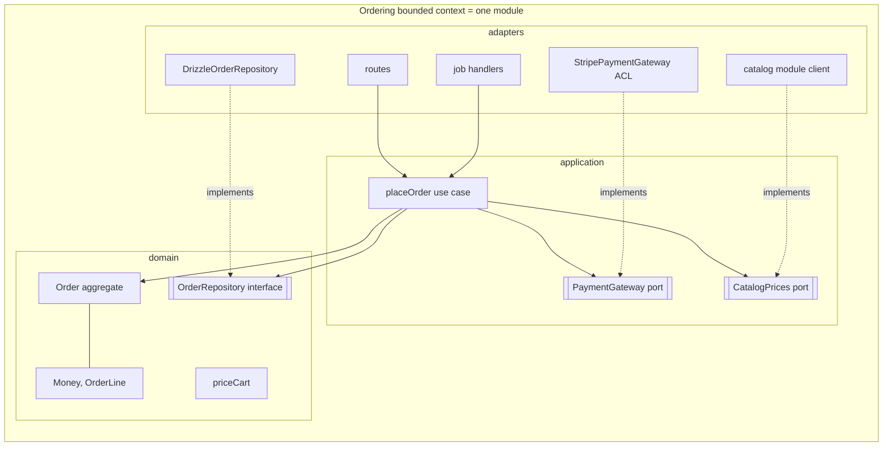

# Persistence, DDD with clean architecture, and when not to
[← Overview](00-overview.md)

## Why it matters
- Two admins edit the same order at once. The second save silently overwrites the first, and a cancellation is lost.
- The team believes they must choose "DDD or clean architecture". They pick one, and the other's benefits never arrive.
- A simple newsletter-signup feature gets aggregates, domain events, and a context map. It takes two weeks instead of two hours.

## Concepts

### Persisting aggregates
| Practice | Detail |
|:--|:--|
| Data mapper | Drizzle rows ↔ domain objects, mapped in the repository |
| Load and save whole aggregates | root + children in one transaction |
| Optimistic concurrency | `version` column; `UPDATE … WHERE id = $1 AND version = $2`; 0 rows → conflict |
| Events with the aggregate | outbox rows written in the same transaction as the aggregate |
| IDs before saving | generate UUIDv7 in the domain, or reserve with `nextId()` |
| Children replaced or diffed | delete-and-insert lines (simple) or diff (fewer writes) |
| Document storage (also seen) | an aggregate as JSONB or a MongoDB document fits naturally |

### DDD with clean architecture
They answer different questions and combine cleanly:
| Concern | DDD answers | Clean architecture answers |
|:--|:--|:--|
| What are the modules? | bounded contexts | — |
| What does the model look like? | entities, values, aggregates, events, language | — |
| Which way do dependencies point? | — | inward, toward the domain |
| Where do frameworks and databases go? | — | outer ring (adapters) |
| How do contexts talk? | context map, events, ACLs | ports and adapters for each integration |

Where each DDD building block lives in the rings:
| Ring | DDD building blocks | Shop example |
|:--|:--|:--|
| Domain (center) | entities, value objects, aggregates, domain events, domain services, repository **interfaces** | `Order`, `Money`, `priceCart`, `OrderRepository` |
| Application | application services (use cases), policies, ports for other contexts and gateways, unit of work interface | `placeOrder`, `PaymentGateway`, `CatalogPrices` |
| Adapters | repository implementations (Drizzle), ACLs over external APIs, HTTP routes, job handlers, outbox relay | `DrizzleOrderRepository`, `StripePaymentGateway` |
| Frameworks | Express, Drizzle, BullMQ, SDKs | — |



### When not to use DDD
| Situation | Use instead |
|:--|:--|
| CRUD with few rules (admin tables, settings) | vertical slices, plain types, direct queries |
| Generic subdomains | buy/library + thin adapter |
| Prototypes and experiments | simplest code; refactor once the domain is understood |
| No access to domain experts | you can't build a ubiquitous language alone; keep design simple |
| **DDD-lite** (tactical patterns only) | useful for rich modules, but without strategic design you get the cost without the main benefit |

## Example
`ordering/adapters/drizzle-order-repository.ts` — mapping, optimistic concurrency, and the outbox in one transaction.
```ts
import { and, eq } from 'drizzle-orm';
import { orders, orderLines } from './tables.ts';
import { appendOutbox } from '#src/shared/outbox.ts';
import { ConflictError, NotFoundError } from '#src/shared/errors.ts';
import { Money } from '#src/shared/money.ts';
import { Order, type OrderId, type OrderRepository } from '../domain/index.ts';

export function createDrizzleOrderRepository(): OrderRepository {
  return {
    async get(tx, id) {
      const [row] = await tx.select().from(orders).where(eq(orders.id, id));
      if (!row) throw new NotFoundError('order', id);
      const lines = await tx.select().from(orderLines).where(eq(orderLines.orderId, id));
      return Order.restore({
        id: row.id as OrderId,
        customerId: row.customerId,
        status: row.status,
        version: row.version,
        lines: lines.map((l) => ({ productId: l.productId as ProductId, unitPrice: Money.of(l.unitPriceCents, 'EUR'), quantity: l.quantity })),
      });
    },

    async save(tx, order) {
      const values = { status: order.status, totalCents: order.total.amountCents, version: order.version + 1 };
      if (order.version === 0) {
        await tx.insert(orders).values({ id: order.id, customerId: order.customerId, ...values });
      } else {
        const updated = await tx.update(orders).set(values)
          .where(and(eq(orders.id, order.id), eq(orders.version, order.version)))   // optimistic concurrency
          .returning({ id: orders.id });
        if (updated.length === 0) throw new ConflictError('order.concurrent_update', 'The order was changed by someone else; reload and retry');
      }
      await tx.delete(orderLines).where(eq(orderLines.orderId, order.id));          // simple: replace children
      if (order.lines.length > 0) {
        await tx.insert(orderLines).values(order.lines.map((l) => ({ orderId: order.id, productId: l.productId, unitPriceCents: l.unitPrice.amountCents, quantity: l.quantity })));
      }
      for (const event of order.pullEvents()) {
        await appendOutbox(tx, { topic: toTopic(event.type), payload: toIntegrationEvent(event) }); // domain → integration event
      }
    },
  };
}
```
`ordering/index.ts` — the context's public API (what other contexts may use):
```ts
export { makePlaceOrder, makeCancelOrder } from './application/index.ts';
export type { OrderId, OrderStatus } from './domain/index.ts';
export type { OrderPlacedV1, OrderPaidV1 } from './contracts/events.ts';   // published language
```

## In our stack
- Transactions, `Tx` types, outbox: [03-backend/11-architecture lesson 03](../../../03-backend/11-architecture/docs/03-domain-errors-transactions.md) and [03-backend/07-background-jobs lesson 04](../../../03-backend/07-background-jobs/docs/04-outbox-messaging-monitoring.md).
- Rings and the dependency rule: [04-architecture-styles lesson 02](../../04-architecture-styles/docs/02-clean-hexagonal-onion-slices.md).
- The capstone applies this layout per bounded context: [07-capstone/01-design-build](../../../07-capstone/01-design-build/README.md).

## When not to
- See the table above: CRUD, generic subdomains, prototypes, and missing domain experts.
- Even inside a DDD project, use plain slices for simple screens and reports.

## Production patterns
- **Repositories as data mappers** with optimistic concurrency and outbox writes in the same transaction.
- **DDD for the model and the module boundaries, clean architecture for dependencies inside each module.**
- **Published contracts** (`contracts/`) separate from internal domain events.
- **DDD where the domain is complex**, simple code everywhere else.

## Mistakes
Wrong: last write wins.
```ts
await tx.update(orders).set({ status: order.status }).where(eq(orders.id, order.id)); // overwrites a concurrent change
```
Right: include `version` in the `WHERE` clause and treat 0 updated rows as a conflict.

Wrong: domain classes annotated with ORM decorators (`@Entity`, `@Column`). The domain depends on persistence, and Node's type stripping can't run decorators. Right: plain domain classes, mapping in the adapter.

Wrong: publishing internal domain events directly to other contexts. Any internal refactor breaks consumers. Right: map to versioned integration events.

## Check yourself
1. How does optimistic concurrency prevent lost updates?
2. How do DDD and clean architecture divide the work in one codebase?
3. Name two situations where DDD is the wrong tool.

<details>
<summary>Answers</summary>

1. Each aggregate row has a version. A save updates only if the version is still the one that was loaded, and increments it. If someone else saved in between, the update matches 0 rows and the save fails with a conflict instead of silently overwriting.
2. DDD decides the bounded contexts (modules), the language, and the model (aggregates, values, events); clean architecture arranges the code inside each module so the domain is at the center, use cases around it, and frameworks, databases, and external APIs in adapters at the edge.
3. CRUD features with few rules, generic subdomains you should buy (auth, email, payments), early prototypes where the domain isn't understood yet, and projects without access to domain experts.
</details>

## Sources
- [Martin Fowler — Optimistic offline lock](https://martinfowler.com/eaaCatalog/optimisticOfflineLock.html)
- [Martin Fowler — Data mapper](https://martinfowler.com/eaaCatalog/dataMapper.html)
- [Herberto Graça — DDD, hexagonal, onion, clean, CQRS… how I put it all together](https://herbertograca.com/2017/11/16/explicit-architecture-01-ddd-hexagonal-onion-clean-cqrs-how-i-put-it-all-together/)
- [Drizzle — Transactions](https://orm.drizzle.team/docs/transactions)
- [Microsoft — Domain events: design and implementation](https://learn.microsoft.com/en-us/dotnet/architecture/microservices/microservice-ddd-cqrs-patterns/domain-events-design-implementation)
