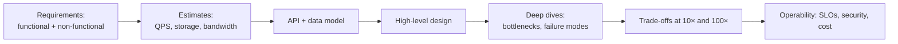

# System Design — Overview
[← Topic](../README.md)

**TECH:** designs expressed with this stack's components (PostgreSQL, Redis, BullMQ, S3, CloudFront, ECS) and with industry alternatives where they fit better (Kafka, DynamoDB, Cassandra, OpenSearch) · Mermaid diagrams
**LEVEL:** intermediate (mid-level, has shipped production code)
**KIND:** concept topic

## Why this matters in production
- Many outages and rewrites trace back to a design that ignored one number: peak QPS, fan-out, data growth, or a hot key.
- Senior engineers are expected to design a feature end to end, explain trade-offs, and estimate whether it will hold.
- System design interviews test exactly this; practicing them improves real design work too.

## Mental model
Design is **clarify → quantify → sketch → stress → trade off**: requirements become numbers, numbers pick building blocks, and deep dives target the parts that break first. Every choice is a trade-off you should be able to name.

## Prerequisites
- [03-backend/06-caching](../../../03-backend/06-caching/README.md), [07-background-jobs](../../../03-backend/07-background-jobs/README.md), [09-scalability](../../../03-backend/09-scalability/README.md).
- [07-distributed-systems](../../07-distributed-systems/README.md) goes deeper into consistency, replication, and sagas.

## Lesson map
| Lesson | Checklist items |
|:--|:--|
| [01 · The method, estimation, and communicating designs](01-method-and-estimation.md) | 1, 2, 12 |
| [02 · Building blocks, storage choices, and caching](02-building-blocks-and-storage.md) | 3, 4, 6 |
| [03 · Scaling data, async processing, limits, availability, security, cost](03-scaling-async-reliability.md) | 5, 7, 8, 9, 11 |
| [04 · Classic designs](04-classic-designs.md) | 10 |
| [Cheatsheet](cheatsheet.md) | all |

## Suggested order
1. 01 → 04.
2. Then practice one design a week: `/design "URL shortener"`, `/design "news feed"`, `/design "chat"`. Each becomes a task with a DESIGN.md you can `/review`.

## Version notes
- Numbers here are orders of magnitude for estimation, not benchmarks; measure your own system ([03-backend/09-scalability](../../../03-backend/09-scalability/README.md)).
- Cloud quotas and prices change; check current limits before relying on them in a real design.

## Sources
- [Martin Kleppmann — Designing Data-Intensive Applications](https://dataintensive.net/)
- [donnemartin — The System Design Primer](https://github.com/donnemartin/system-design-primer)
- [ByteByteGo — System design resources](https://bytebytego.com/)
- [AWS Well-Architected Framework](https://docs.aws.amazon.com/wellarchitected/latest/framework/welcome.html)
- [Simon Brown — The C4 model](https://c4model.com/)
