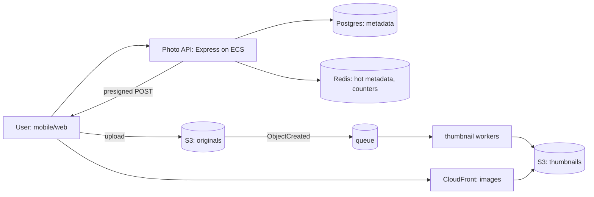

# The method, estimation, and communicating designs
[← Overview](00-overview.md)

## Why it matters
- A notification system is designed for "lots of users" with one Postgres table and a cron job. At launch it needs 40,000 writes per second, and the design is redone in a week.
- A design review spends an hour on which queue to use while nobody has agreed whether notifications may be delayed or lost.
- A good design is rejected because the doc is a wall of text without a diagram, numbers, or alternatives.

## Concepts

### The method
| Step | Output | Time (45-min interview) |
|:--|:--|:--|
| 1. Requirements | 3–5 core use cases; non-functional targets; out of scope | 5 min |
| 2. Estimates | read/write QPS (average, peak), storage per year, bandwidth, cache size | 5 min |
| 3. API | endpoints or events, request/response, pagination, idempotency | 5 min |
| 4. Data model | entities, keys, access patterns, storage choice | 5 min |
| 5. High-level design | diagram; walk one read and one write through it | 10 min |
| 6. Deep dives | the 2–3 biggest bottlenecks or failure modes | 10 min |
| 7. Wrap-up | trade-offs, what changes at 10× and 100×, operability | 5 min |

| Non-functional requirement | Ask |
|:--|:--|
| Scale | users, DAU, requests per user per day, size per item |
| Latency | p95/p99 per operation |
| Availability | target (99.9%?), which operations must stay up |
| Consistency | may reads be stale? for how long? |
| Durability | may data be lost? |
| Ordering | does order matter, per which key? |
| Cost and team | budget, team size, existing stack |
| Compliance | personal data, regions, retention |

### Estimation
| Shortcut | Value |
|:--|:--|
| Seconds per day | 86,400 ≈ 10⁵ |
| 1 million requests/day | ≈ 12 req/s |
| 1 billion requests/day | ≈ 12,000 req/s |
| Peak / average | 2–5× (10× for launches and events) |
| 1 KB × 1 million | 1 GB |
| 1 KB × 1 billion | 1 TB |
| Seconds per year | ≈ 3 × 10⁷ |

| Operation | Order of magnitude |
|:--|:--|
| Main memory reference | ~100 ns |
| SSD random read | ~10–100 µs |
| Round trip within an AZ | ~0.5 ms |
| Redis GET over the network (same AZ) | ~0.5–1 ms |
| Simple indexed Postgres query | ~1–5 ms |
| Read 1 MB from SSD | ~1 ms |
| Cross-AZ round trip | ~1–2 ms |
| Cross-continent round trip | ~100–150 ms |

Capacity rules of thumb (verify on your hardware): one Postgres primary serves thousands to tens of thousands of simple queries per second; one Redis node ~100k simple operations per second; one Node.js process hundreds to a few thousand simple requests per second.

### Communicating designs
| Tool | Use |
|:--|:--|
| C4 model | context → containers → components → code: zoom levels |
| Mermaid in markdown | diagrams versioned with the doc |
| Sequence diagrams | one request's path, timing, and failure handling |
| Design doc | problem, goals/non-goals, numeric requirements, design, alternatives, risks, rollout |
| ADRs | decisions that come out of the design |
| Interview behavior | think aloud, state assumptions, ask before assuming, summarize trade-offs |

## Example
Estimating a photo-sharing feature:
```text
Assumptions: 10M DAU; each views 50 photos/day and uploads 0.2 photos/day; photo = 2 MB original + 300 KB thumbnails.
Reads:   10M × 50 / 86,400 ≈ 5,800 req/s average → ~20,000 req/s peak (×3–4)
Writes:  10M × 0.2 / 86,400 ≈ 23 uploads/s average → ~100/s peak
Storage: 2M uploads/day × 2.3 MB × 365 ≈ 1.7 PB/year → object storage (S3) with lifecycle tiers
Egress:  20,000/s × 300 KB ≈ 6 GB/s at peak → a CDN is mandatory
Metadata: 2M rows/day × 500 B × 365 ≈ 365 GB/year → Postgres is fine; partition by month later
Cache:   hot metadata ≈ 10M × 50 × 20% × 500 B ≈ 50 GB → Redis cluster, or CDN + a small cache
```
A container diagram for the same feature:

Requirements as testable numbers:
```markdown
- Feed loads in < 300 ms p95 (cached) and < 800 ms p99 (cold)
- Uploads accepted at 100/s peak; thumbnails visible within 10 s p95
- 99.9% monthly availability for viewing; uploads may show "processing" during incidents
- An acknowledged upload is never lost (stored in S3 before the API answers)
```

## In our stack
- Load tests turn estimates into measurements: [03-backend/09-scalability lesson 01](../../../03-backend/09-scalability/docs/01-measuring-and-load-testing.md).
- Little's law and utilization headroom: [03-backend/09-scalability lesson 04](../../../03-backend/09-scalability/docs/04-offloading-and-capacity.md).
- Design docs and ADRs: [05-practice lesson 03](../../../05-practice/01-engineering-practice/docs/03-debt-design-communication.md).

## When not to
- Don't design for 100× on day one; design for the next 10× and know what you'd change at 100×.
- Don't debate technology names before requirements are agreed.

## Production patterns
- **Requirements as numbers** before any component is chosen.
- **Estimates with visible math**, re-checked against load tests later.
- **A container diagram and a sequence diagram** in every design doc.
- **Decisions and alternatives recorded** as ADRs.

## Mistakes
Wrong: starting with "Kafka and microservices". Right: requirements and numbers first; components follow.

Wrong: averages only. Peaks are 2–10× higher and decide capacity. Right: estimate average and peak.

Wrong: boxes with unlabeled arrows. Right: label arrows (protocol, sync/async, data) and walk a request through the diagram.

## Check yourself
1. Convert 50 million requests per day into average and peak requests per second.
2. Which non-functional requirements change a design the most?
3. What does the C4 model give you over one big diagram?

<details>
<summary>Answers</summary>

1. 50M / 86,400 ≈ 580 req/s on average; with a peak factor of 3–5, design for roughly 2,000–3,000 req/s.
2. Scale (storage and partitioning), latency (caching and data locality), consistency (replication and cache strategy), availability (redundancy and degradation), and durability (where and when data is acknowledged). They decide which building blocks are possible at all.
3. Zoom levels: a context diagram for non-technical readers, a container diagram for deployables and data stores, and component diagrams for one container's internals, each readable on its own.
</details>

## Sources
- [Colin Scott — Latency numbers every programmer should know (interactive)](https://colin-scott.github.io/personal_website/research/interactive_latency.html)
- [Simon Brown — The C4 model](https://c4model.com/)
- [donnemartin — System Design Primer](https://github.com/donnemartin/system-design-primer)
- [Mermaid — Diagram syntax](https://mermaid.js.org/)
