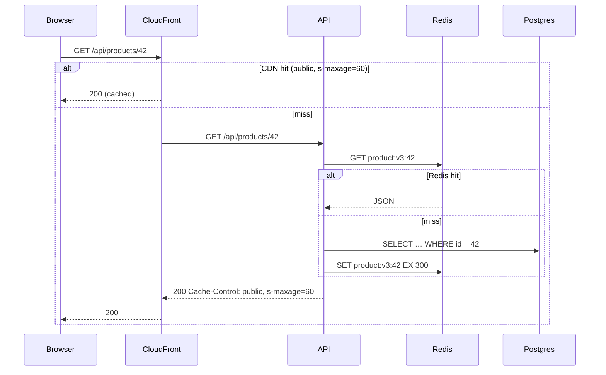

# Building blocks, storage choices, and caching
[← Overview](00-overview.md)

## Why it matters
- Product search runs `LIKE '%term%'` on 5 million rows. It works in staging and takes 4 seconds in production.
- A team picks a NoSQL database "for scale", then needs joins and transactions for orders and reimplements them badly in application code.
- A cache in front of a personalized page serves one user's cart to another user.

## Concepts

### Building blocks
| Block | Purpose | In this stack / also seen |
|:--|:--|:--|
| DNS | name → address, routing policies | Route 53 |
| CDN | static and cacheable content near users | CloudFront |
| Load balancer (L7/L4) | spread traffic, TLS, health checks | ALB (L7), NLB (L4) |
| API gateway | routing, auth, rate limits, transformation | ALB + Express middleware; also seen: API Gateway, Kong |
| Stateless app servers | business logic, horizontally scaled | Express on ECS |
| Cache | fast reads, offload | Redis/Valkey; CDN; in-process LRU |
| Relational database | transactions, joins, constraints | PostgreSQL |
| Object storage | files, blobs, backups | S3 |
| Queue | async work, buffering, retries | BullMQ; SQS |
| Pub/sub / event bus | fan-out of events | SNS, EventBridge; Redis pub/sub |
| Log / stream | ordered, replayable events | also seen: Kafka, Kinesis, Redis Streams |
| Search index | full-text, facets, relevance | Postgres FTS/pg_trgm first; also seen: OpenSearch |
| Workers / schedulers | background and periodic jobs | BullMQ workers, job schedulers |
| Coordination | leader election, locks, config | Postgres advisory locks, Redis locks; also seen: etcd, ZooKeeper |

### Storage choices
| Type | Data model | Strengths | Weaknesses | Examples |
|:--|:--|:--|:--|:--|
| Relational | tables, joins, constraints | ACID, flexible queries, integrity | horizontal write scaling is harder | **PostgreSQL**, MySQL |
| Document | JSON documents | flexible schema, aggregate-shaped reads | joins and multi-document invariants are weaker | MongoDB, Postgres JSONB |
| Key-value | key → value | very fast, simple | no queries beyond keys | Redis/Valkey, DynamoDB |
| Wide-column | partition key + clustering columns | huge write throughput, predictable access | query patterns fixed up front | Cassandra, ScyllaDB, DynamoDB |
| Search | inverted index | relevance, full-text, facets | not a source of truth, eventual | OpenSearch, Elasticsearch |
| Time-series | time-indexed points | metrics, retention, downsampling | narrow use | Prometheus/Mimir, TimescaleDB |
| Graph | nodes and edges | relationship traversals | niche, scaling | Neo4j |
| Object | blobs with keys | cheap, durable, huge | no queries, higher latency | S3 |
| Columnar warehouse | column-oriented analytics | big aggregations | not for OLTP | Redshift, BigQuery, ClickHouse |

Rule of thumb: **PostgreSQL by default** for transactional data, S3 for files, Redis for caching and ephemeral state, a search engine only when Postgres search isn't enough, and specialized stores when access patterns and scale clearly demand them.

### Caching at system level
| Layer | What | Invalidation |
|:--|:--|:--|
| Browser | static assets, some API responses | hashed filenames, `max-age` |
| CDN | static files, public pages and API responses | TTL, purge, `s-maxage` |
| Application cache (Redis) | computed objects, sessions, counters | delete on write, TTL, versioned keys |
| In-process cache | tiny hot data | short TTL |
| Database | buffer cache, materialized views | automatic / refresh |

| Strategy | Use |
|:--|:--|
| Cache-aside | default for reads |
| Write-through | read-heavy data that must be fresh after writes |
| Write-behind | buffering writes (risk of loss) |
| Read-through / refresh-ahead | hot keys |

Details, stampede protection, and pitfalls: [03-backend/06-caching](../../../03-backend/06-caching/README.md).

## Example
Choosing storage for a marketplace, by access pattern:
| Data | Access pattern | Choice | Why |
|:--|:--|:--|:--|
| Orders, payments, users | transactions, joins, constraints | PostgreSQL | ACID and integrity |
| Product listings | read-heavy, filters | PostgreSQL + Redis cache + CDN for pages | simple, fast enough |
| Product search | full-text, typo tolerance, facets | Postgres `pg_trgm`/FTS → OpenSearch at scale | start simple, upgrade with evidence |
| Images | large blobs | S3 + CloudFront | cheap, durable, global |
| Sessions, rate limits | key lookups with TTL | Redis | sub-millisecond, expiry built in |
| Click events (billions/month) | append-heavy, analytics | stream → warehouse (also seen: Kafka → ClickHouse) | OLTP database would suffer |

Postgres search before a search engine:
```sql
CREATE EXTENSION IF NOT EXISTS pg_trgm;
CREATE INDEX products_title_trgm ON products USING gin (title gin_trgm_ops);

-- typo-tolerant prefix/substring search that uses the index
SELECT id, title FROM products
WHERE title ILIKE '%' || $1 || '%' OR similarity(title, $1) > 0.3
ORDER BY similarity(title, $1) DESC
LIMIT 20;
```
Read path with layered caching:


## In our stack
- Postgres modeling and indexes: [03-backend/03-databases](../../../03-backend/03-databases/README.md); MongoDB as a document store: [lesson 05](../../../03-backend/03-databases/docs/05-mongodb-and-choosing.md).
- Caching layers and invalidation: [03-backend/06-caching](../../../03-backend/06-caching/README.md).
- CDN, ALB, S3 on AWS: [04-shipping/02-cloud](../../../04-shipping/02-cloud/README.md).

## When not to
- No search engine, stream platform, or graph database until the simpler store measurably fails.
- No cache for data that must be exact (balances, stock at checkout) or that changes on nearly every read.
- No polyglot persistence for a small team without a clear need: every store is another thing to back up, secure, and operate.

## Production patterns
- **Choose storage by access pattern and consistency needs**, not by popularity.
- **Postgres as the default system of record**, other stores as derived views (caches, search indexes) rebuilt from it.
- **Caches at the right layer** with explicit invalidation rules and TTLs.
- **Every derived store rebuildable** from the source of truth.

## Mistakes
Wrong: `LIKE '%term%'` without a trigram index on a large table. Right: `pg_trgm` index, or a search engine when relevance and facets are needed.

Wrong: picking a wide-column database before knowing the query patterns. Right: model access patterns first; relational databases are forgiving while patterns change.

Wrong: caching personalized responses under shared keys or with `public` headers. Right: scope keys per user, `private, no-store` for personal data.

## Check yourself
1. When does a document store fit better than a relational database?
2. Why treat a search index as derived data rather than a source of truth?
3. Which caching layer would you use for a public product page, and which for a user's cart?

<details>
<summary>Answers</summary>

1. When data is read and written as self-contained aggregates (a product with variants, a user profile), the schema varies, and few cross-document transactions or joins are needed. Orders and payments with integrity constraints fit relational databases better.
2. Search engines are eventually consistent, optimized for relevance rather than integrity, and may lose or lag updates; keeping the truth in Postgres and rebuilding the index from it makes recovery and reindexing safe.
3. The public product page: CDN (`public, s-maxage`) plus a Redis cache of the product data. The cart is personal and changes often: no CDN or shared cache; serve it from the database or a per-user Redis key with `private, no-store` responses.
</details>

## Sources
- [Martin Kleppmann — Designing Data-Intensive Applications (ch. 2–3)](https://dataintensive.net/)
- [PostgreSQL — pg_trgm](https://www.postgresql.org/docs/current/pgtrgm.html)
- [AWS — Choosing an AWS database service](https://docs.aws.amazon.com/decision-guides/latest/databases-on-aws-how-to-choose/databases-on-aws-how-to-choose.html)
- [donnemartin — System Design Primer: database and cache sections](https://github.com/donnemartin/system-design-primer#database)
