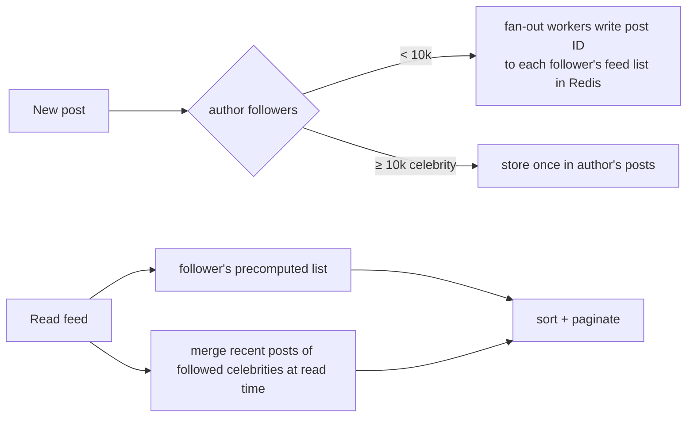

# Scaling data, async processing, limits, availability, security, cost
[← Overview](00-overview.md)

## Why it matters
- A celebrity account posts and 30 million followers' feeds are written synchronously. The write queue backs up for an hour and every other post is delayed.
- Sharding by `user_id % 4` works until a fifth shard is added; nearly every key moves, and the migration takes a weekend of downtime.
- A design meets every functional requirement but stores card numbers in logs and costs $40,000 a month in data transfer.

## Concepts

### Scaling data
| Technique | Solves | Cost |
|:--|:--|:--|
| Vertical scaling | more CPU/RAM/IOPS | ceiling, cost, failover blips |
| Read replicas | read throughput | replication lag, read-your-writes |
| Caching | hot reads | invalidation |
| Partitioning (one DB) | big tables, retention | key in every query |
| Sharding (many DBs) | write throughput, data size | routing, cross-shard queries, rebalancing |
| Denormalization / read models | expensive joins | duplicated data, update paths |

| Shard key strategy | Good | Watch out |
|:--|:--|:--|
| Hash of key | even spread | range queries span shards |
| Range | range scans | hot ranges (recent dates) |
| Directory / lookup | flexible moves | the directory is a dependency |
| Consistent hashing | adding nodes moves ~1/n of keys | uneven without virtual nodes |
| Tenant-based | tenant data together | very large tenants |

**Hot keys** (a viral post, a flash-sale product): cache with replicas, split keys (`counter:42:{0..9}`), request coalescing, rate limiting per key.

### Asynchronous processing
| Pattern | Use |
|:--|:--|
| Queue + workers | slow or retryable work (emails, thumbnails) |
| Fan-out on write (push) | precompute per-recipient results (feeds) |
| Fan-out on read (pull) | compute at read time (celebrities, rare readers) |
| Hybrid fan-out | push for normal users, pull for large accounts |
| Streams | ordered, replayable events, several consumer groups |
| Backpressure | bounded queues, rate limits, shedding when consumers lag |
| Batching | fewer, larger writes (analytics, counters) |
| Idempotent consumers | at-least-once delivery is the norm |

### Limits, idempotency, and APIs at scale
| Concern | Design answer |
|:--|:--|
| Abuse and overload | rate limits per user/IP/API key (token bucket, sliding window) at the edge and app |
| Retries from clients | idempotency keys on POST; deduplication tables |
| Large result sets | cursor pagination |
| Chatty clients | aggregate endpoints, batching, GraphQL/BFF (also seen) |
| Payload size | compression, field selection |
| Versioning | additive changes, versioned events |

### Availability and reliability
| Technique | Protects against |
|:--|:--|
| Redundancy across AZs | instance and AZ failures |
| Health checks + automatic failover | dead nodes |
| Multi-region (active/passive or active/active) | regional outages (high cost) |
| Timeouts, retries with jitter, circuit breakers | slow or failing dependencies |
| Graceful degradation | partial outages |
| Load shedding | overload |
| Backups and restore drills | data loss |
| SLOs and error budgets | knowing how reliable is enough |

Availability of components in **series multiplies** (three 99.9% services in a chain ≈ 99.7%); **redundant parallel** copies add nines (two independent 99% copies ≈ 99.99%).

### Security, privacy, and cost in designs
| Area | Checklist |
|:--|:--|
| Security | authentication and authorization per endpoint; least-privilege roles; encryption in transit and at rest; secrets management; rate limits; input validation; audit logs |
| Privacy | data minimization; personal data inventory; retention; regional residency; deletion requests |
| Cost | data transfer (egress, cross-AZ), per-request services at scale, idle capacity, storage tiers, log volume |

## Example
Consistent hashing with virtual nodes (the idea behind rebalancing-friendly sharding):
```ts
import { createHash } from 'node:crypto';

const hash = (s: string) => createHash('md5').update(s).digest().readUInt32BE(0);

export function createRing(nodes: string[], vnodes = 100) {
  const ring = nodes.flatMap((n) => Array.from({ length: vnodes }, (_, i) => ({ point: hash(`${n}#${i}`), node: n })))
    .sort((a, b) => a.point - b.point);
  return (key: string): string => {
    const h = hash(key);
    let lo = 0, hi = ring.length;
    while (lo < hi) { const mid = (lo + hi) >> 1; if (ring[mid]!.point < h) lo = mid + 1; else hi = mid; }  // first point ≥ h
    return ring[lo % ring.length]!.node;
  };
}
// Adding a node moves only ~1/(n+1) of the keys, instead of nearly all of them with `hash % n`
```
Hybrid fan-out for a feed:

Availability math for a checkout chain:
```text
CDN 99.99% × ALB 99.99% × API 99.95% × Postgres (Multi-AZ) 99.95% × Stripe 99.99%
≈ 0.9999 × 0.9999 × 0.9995 × 0.9995 × 0.9999 ≈ 99.87%  → ~56 minutes of downtime per 30 days
Ways up: fewer hops in the critical path, degrade gracefully when optional parts fail, retries for transient errors.
```

## In our stack
- Replicas, partitioning, sharding ladder: [03-backend/09-scalability lesson 03](../../../03-backend/09-scalability/docs/03-scaling-postgresql.md).
- Queues, idempotency, outbox: [03-backend/07-background-jobs](../../../03-backend/07-background-jobs/README.md); rate limits: [03-backend/05-validation-abuse](../../../03-backend/05-validation-abuse/README.md).
- Reliability patterns and SLO math: [03-backend/08-reliability](../../../03-backend/08-reliability/README.md); cost drivers on AWS: [04-shipping/02-cloud lesson 04](../../../04-shipping/02-cloud/docs/04-secrets-and-cost.md).

## When not to
- Don't shard before vertical scaling, replicas, caching, and partitioning are exhausted.
- Don't push-fan-out to millions of recipients synchronously; don't pull-fan-out for every read when most users follow few accounts.
- Don't go multi-region for an availability target a single region with Multi-AZ already meets.

## Production patterns
- **Scale reads first** (cache, CDN, replicas), writes later (partitioning, sharding).
- **Shard keys from access patterns**; consistent hashing or directories for rebalancing.
- **Async for anything slow, bursty, or fan-out heavy**, with idempotent consumers and backpressure.
- **Availability math on the critical path**, optional parts degraded instead of failing requests.
- **Security, privacy, and cost reviewed as part of every design**, not after launch.

## Mistakes
Wrong: `hash(key) % n` for shard selection. Adding a shard moves most keys. Right: consistent hashing or a lookup directory.

Wrong: synchronous fan-out inside the request. Right: enqueue and let workers fan out, with hybrid strategies for large accounts.

Wrong: designing without a cost estimate. Right: estimate storage, egress, and request costs alongside capacity.

## Check yourself
1. Why does consistent hashing move fewer keys than modulo hashing when nodes change?
2. When do you prefer fan-out on read over fan-out on write?
3. Three services each at 99.9% are called in series. What's the combined availability, and how can you improve it?

<details>
<summary>Answers</summary>

1. Keys map to points on a ring and belong to the next node clockwise; adding a node takes over only the segment before its points, about 1/(n+1) of the keys. With `hash % n`, changing n changes the result for almost every key.
2. When the author has huge numbers of followers (writing to millions of feeds is expensive and slow) or when most recipients rarely read; then compute at read time, often combined with push for normal accounts.
3. About 0.999³ ≈ 99.7%. Improve it by removing hops from the critical path, adding redundancy, retrying transient failures, caching, and making optional dependencies degrade instead of failing the request.
</details>

## Sources
- [Martin Kleppmann — Designing Data-Intensive Applications (ch. 5–6, 11)](https://dataintensive.net/)
- [Karger et al. — Consistent hashing and random trees](https://dl.acm.org/doi/10.1145/258533.258660)
- [AWS — Availability and beyond: reliability whitepaper](https://docs.aws.amazon.com/whitepapers/latest/availability-and-beyond-improving-resilience/availability-and-beyond-improving-resilience.html)
- [Stripe — Designing robust and predictable APIs with idempotency](https://stripe.com/blog/idempotency)
