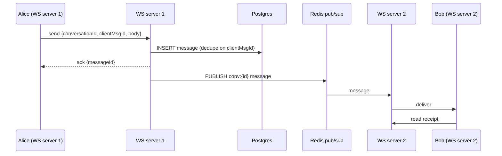

# Classic designs
[← Overview](00-overview.md)

## Why it matters
- These five problems cover most building blocks and trade-offs: key generation, fan-out, real-time delivery, async pipelines, and prefix search.
- They come up in interviews constantly, and the same shapes appear in real products (links, feeds, chat, notifications, search).
- Working through them once makes new designs feel familiar.

## Concepts
Each design: requirements → estimates → API → data → high-level design → deep dives. Practice each with `/design "<name>"`.

### 1. URL shortener
| Step | Decision |
|:--|:--|
| Requirements | create short link, redirect, optional custom alias and expiry; 100:1 read/write |
| Estimates | 100M new links/month ≈ 40 writes/s; 4,000 redirects/s avg, ~15k peak; 500 B/link → 600 GB over 10 years |
| API | `POST /links {url, alias?}` → `{code}`; `GET /:code` → 301/302 |
| Data | `links(code PK, url, owner_id, created_at, expires_at)` in Postgres |
| Key generation | base62 of a counter or ID (7 chars ≈ 3.5 trillion), or random + uniqueness check; avoid sequential guessability if links are private |
| Deep dives | cache hot codes in Redis/CDN; 302 if you need click analytics (301 is cached by browsers); click events async to analytics; abuse: spam/phishing checks, rate limits |

### 2. News feed
| Step | Decision |
|:--|:--|
| Requirements | post, follow, home feed sorted by recency; feed < 300 ms |
| Estimates | 50M DAU × 10 feed reads = 6k/s avg; 5M posts/day ≈ 60/s writes; average 300 followers |
| Data | posts in Postgres (partitioned by time); follow graph table; feed lists in Redis (`feed:{userId}` capped to 800 IDs) |
| Design | hybrid fan-out: push post IDs to followers' feed lists via workers; pull celebrities' posts at read time and merge |
| Deep dives | hot celebrity posts in cache; pagination by cursor (post ID/time); deleted or private posts filtered at read; ranking as a later step |

### 3. Chat
| Step | Decision |
|:--|:--|
| Requirements | 1:1 and group messages, delivery receipts, online presence, history |
| Estimates | 10M DAU × 40 messages ≈ 4,600 msgs/s avg; 500k concurrent connections |
| Transport | WebSockets (bidirectional); SSE + POST also works for simpler apps |
| Data | `messages(conversation_id, message_id time-ordered, sender_id, body)`; partition by conversation; Postgres at moderate scale, wide-column (also seen: Cassandra) at huge scale |
| Design | connection servers hold sockets; Redis pub/sub (or a broker) routes messages to the server holding the recipient; persist before acknowledging |
| Deep dives | ordering per conversation (time-ordered IDs, sequence numbers); offline delivery via push notifications; presence with heartbeats and TTL keys; reconnect with "messages since last ID"; end-to-end encryption as a separate concern |

### 4. Notification system
| Step | Decision |
|:--|:--|
| Requirements | email, SMS, push; templates; user preferences; rate limits; at-least-once delivery |
| Estimates | 20M notifications/day ≈ 230/s avg, bursts of 50k/s for campaigns |
| Design | API → validate + preferences → outbox → queue per channel → channel workers → providers (SES, SMS, APNs/FCM) |
| Data | `notifications(id, user_id, channel, template, status, created_at)`, `preferences`, `deliveries` (provider IDs, status) |
| Deep dives | idempotency per (event, user, channel); provider rate limits with worker limiters; retries with backoff; bounces and complaints feed back into preferences; priority queues (security alerts before marketing); quiet hours and time zones |

### 5. Search autocomplete
| Step | Decision |
|:--|:--|
| Requirements | top 10 suggestions per prefix in < 100 ms; popular queries first |
| Estimates | 10M DAU × 20 keystrokes ≈ 2,300 req/s avg (debounced in the client) |
| Data | aggregated query counts (daily batch from search logs) |
| Design | precompute top-k per prefix into Redis sorted sets or a trie service; CDN/browser cache for short prefixes; update daily or hourly |
| Deep dives | debounce and cancel stale requests in the client; filter offensive terms; personalize by merging user history; Postgres `pg_trgm` works for smaller catalogs |

## Example
URL shortener — base62 codes from a database ID:
```ts
const ALPHABET = '0123456789abcdefghijklmnopqrstuvwxyzABCDEFGHIJKLMNOPQRSTUVWXYZ';

export function toBase62(n: bigint): string {
  if (n === 0n) return '0';
  let out = '';
  while (n > 0n) { out = ALPHABET[Number(n % 62n)] + out; n /= 62n; }
  return out;
}
// IDs come from a Postgres identity column (bigint); obfuscate with a reversible permutation if codes shouldn't be guessable
```
Redirect path with caching:
```ts
router.get('/:code', async (req, res) => {
  const code = Code.parse(req.params.code);
  let url = await redis.get(`link:${code}`);
  if (!url) {
    const link = await linksRepo.findActive(code);
    if (!link) return res.status(404).send('Not found');
    url = link.url;
    await redis.set(`link:${code}`, url, { EX: 86_400 });
  }
  await clicksQueue.add('click', { code, at: Date.now(), ref: req.get('referer') ?? null }); // analytics off the hot path
  res.redirect(302, url);
});
```
Autocomplete with Redis sorted sets (precomputed per prefix):
```ts
// Batch job: for each query and each of its prefixes (up to 10 chars), keep the top 10 by count
for (const { query, count } of topQueries) {
  for (let i = 1; i <= Math.min(query.length, 10); i++) {
    const key = `ac:${query.slice(0, i).toLowerCase()}`;
    await redis.zAdd(key, { score: count, value: query });
    await redis.zRemRangeByRank(key, 0, -11);          // keep only the 10 best
  }
}

// Read: one O(log n) call
const suggestions = await redis.zRange(`ac:${prefix.toLowerCase()}`, 0, 9, { REV: true });
```
Chat message routing across connection servers:


## In our stack
- Redis structures (sorted sets, pub/sub): [03-backend/06-caching lesson 03](../../../03-backend/06-caching/docs/03-redis-structures-and-operations.md).
- SSE and pub/sub fan-out across tasks: [03-backend/09-scalability lesson 02](../../../03-backend/09-scalability/docs/02-scaling-nodejs.md).
- Notification pipeline building blocks: [03-backend/07-background-jobs](../../../03-backend/07-background-jobs/README.md) and [03-backend/12-integrations lesson 03](../../../03-backend/12-integrations/docs/03-email-with-ses.md).

## When not to
- Don't jump to Cassandra or Kafka in these designs unless the estimates demand it; say at what scale you would switch.
- Don't build a trie service when Postgres trigram search answers within budget for your catalog size.

## Production patterns
- **Hot read paths cached** (codes, feeds, suggestions) and analytics moved off them.
- **Persist before acknowledging** in messaging; deduplicate with client-generated IDs.
- **Hybrid strategies** where one approach fails at the extremes (fan-out, search).
- **Every design states its numbers** and the point where it would need to change.

## Mistakes
Wrong: synchronous analytics writes in the redirect path. Right: queue the click event.

Wrong: chat servers that acknowledge before storing. Messages are lost on crashes. Right: store, then acknowledge and deliver.

Wrong: autocomplete querying the database on every keystroke without debouncing. Right: debounce in the client, precompute, cache short prefixes.

## Check yourself
1. Why might a URL shortener return 302 instead of 301?
2. How does the chat design route a message to a user connected to another server?
3. How do precomputed sorted sets make autocomplete fast?

<details>
<summary>Answers</summary>

1. Browsers and proxies cache 301 permanently, so later clicks never reach your servers: no analytics, and no way to change or expire the destination. 302 keeps requests coming through (at the cost of more traffic).
2. The receiving server stores the message, then publishes it on a channel (Redis pub/sub or a broker); the server holding the recipient's WebSocket is subscribed and forwards it. Offline recipients get it on reconnect ("since last message ID") or via push notification.
3. The expensive work (counting queries, picking the top 10 per prefix) happens in a batch job; each request is a single `ZRANGE` on a small, precomputed key, which takes well under a millisecond.
</details>

## Sources
- [donnemartin — System Design Primer: solutions to common questions](https://github.com/donnemartin/system-design-primer#system-design-interview-questions-with-solutions)
- [Redis — Sorted sets](https://redis.io/docs/latest/develop/data-types/sorted-sets/)
- [MDN — WebSockets API](https://developer.mozilla.org/en-US/docs/Web/API/WebSockets_API)
- [Martin Kleppmann — Designing Data-Intensive Applications](https://dataintensive.net/)
