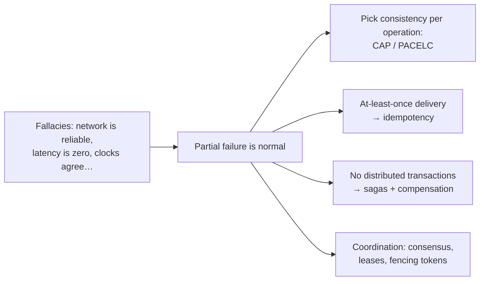

# Distributed Systems — Overview
[← Topic](../README.md)

**TECH:** the distributed parts already in this stack (Postgres primary + replicas, Redis, BullMQ, Stripe webhooks, multiple ECS tasks) as the running example; consensus systems and streams as "also seen"
**LEVEL:** intermediate (mid-level, has shipped production code)
**KIND:** concept topic

## Why this matters in production
- A web app with two API tasks, a database, a cache, a queue, and a payment provider is already a distributed system. Partial failure is normal, not exceptional.
- Bugs here are subtle and expensive: double charges, lost updates, stale reads, split-brain locks, events processed twice or out of order.
- Knowing the theory (CAP, consistency models, delivery guarantees) tells you which guarantees you actually have, and which you must build.

## Mental model
Networks drop, delay, duplicate, and reorder messages; clocks drift; nodes pause and come back. Design for it: choose the **consistency** each operation needs, make every message handler **idempotent**, replace distributed transactions with **sagas**, and use **consensus** systems only through well-tested tools.

## Prerequisites
- [06-system-design](../../06-system-design/README.md).
- [03-backend/07-background-jobs](../../../03-backend/07-background-jobs/README.md) (outbox, idempotent jobs) and [03-backend/09-scalability lesson 03](../../../03-backend/09-scalability/docs/03-scaling-postgresql.md) (replicas).

## Lesson map
| Lesson | Checklist items |
|:--|:--|
| [01 · Partial failure, CAP and PACELC, consistency models](01-failure-cap-consistency.md) | 1, 2, 3 |
| [02 · Replication, partitioning, and time](02-replication-partitioning-time.md) | 4, 5, 6 |
| [03 · Consensus, distributed locks, and delivery guarantees](03-consensus-locks-delivery.md) | 7, 8 |
| [04 · Sagas, CQRS, event sourcing, and testing distributed behavior](04-sagas-cqrs-event-sourcing.md) | 9, 10, 11 |
| [Cheatsheet](cheatsheet.md) | all |

## Suggested order
1. 01 → 04.
2. Then the [capstone](../../../07-capstone/01-design-build/README.md): checkout is a saga, notifications are at-least-once, the dashboard is a read model.

## Version notes
- PostgreSQL 18 replication: streaming (physical) replicas and logical replication; RDS read replicas are asynchronous.
- Redis/Valkey replication is asynchronous; Redis-based locks are leases, not safety guarantees.
- Consensus (Raft/Paxos) lives inside tools such as etcd, Consul, Kafka (KRaft), CockroachDB; you rarely implement it yourself.

## Sources
- [Martin Kleppmann — Designing Data-Intensive Applications (ch. 5, 7–9)](https://dataintensive.net/)
- [Peter Deutsch et al. — Fallacies of distributed computing](https://en.wikipedia.org/wiki/Fallacies_of_distributed_computing)
- [Daniel Abadi — Consistency tradeoffs in modern distributed database design (PACELC)](https://www.cs.umd.edu/~abadi/papers/abadi-pacelc.pdf)
- [Jepsen — Consistency models](https://jepsen.io/consistency)
- [Chris Richardson — Saga pattern](https://microservices.io/patterns/data/saga.html)
