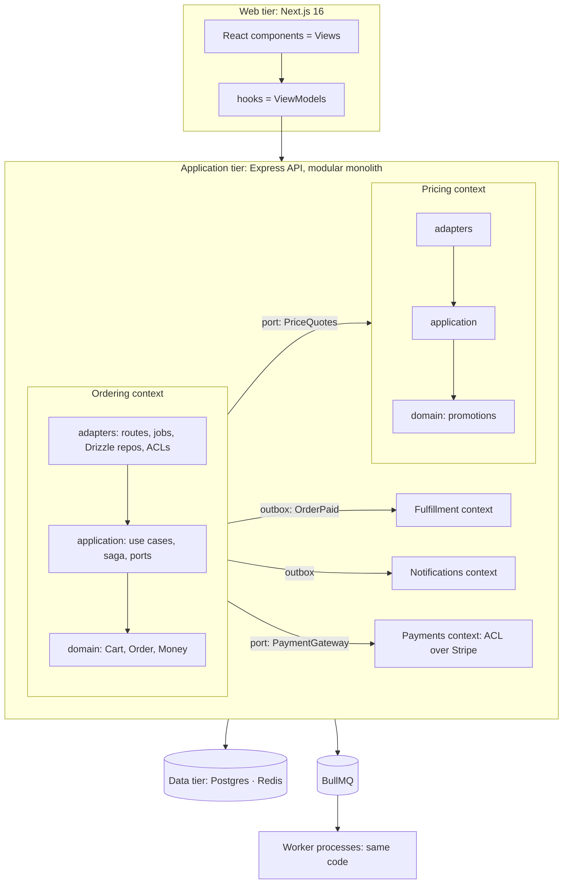

# Design & Build — Overview
[← Topic](../README.md)

**TECH:** the whole stack from STACK.md: Next.js 16 web app, Express 5 API and BullMQ workers in TypeScript, PostgreSQL 18 with Drizzle, Redis 8, Stripe, SES, S3, deployed on AWS with Terraform
**LEVEL:** intermediate → senior (this is where the modules come together)
**KIND:** capstone: these documents are the project specification; tasks are milestones

## What you build
**Roastery**: the online shop of a specialty coffee roaster. Customers browse coffees and equipment, choose variants (size, grind), apply promotions, pay with Stripe, and get their parcels; staff manage the catalog, stock, and orders. It's small enough to finish and rich enough to need every idea in the course: a real core domain (pricing and promotions, ordering), money, stock, asynchronous flows, and production operations.

## How the ideas fit together (DDD *and* clean architecture)
They don't compete; each answers a different question:
| Question | Answer in Roastery | Taught in |
|:--|:--|:--|
| Where does code run? | **n-tier**: browser · CloudFront · Next.js (web tier) · Express API (application tier) · Postgres/Redis (data tier) · workers | [06-design/04 lesson 01](../../../06-design/04-architecture-styles/docs/01-forces-layers-ntier-ui.md) |
| How many deployables? | **modular monolith**: one API image, run as API and worker processes | [06-design/04 lesson 03](../../../06-design/04-architecture-styles/docs/03-monolith-microservices-events.md) |
| What are the modules, and what's the model? | **DDD**: bounded contexts (catalog, pricing, ordering, payments, fulfillment, identity, notifications), aggregates, ubiquitous language | [06-design/05](../../../06-design/05-domain-driven-design/README.md) |
| Which way do dependencies point inside a module? | **clean/hexagonal**: domain ← application ← adapters | [06-design/04 lesson 02](../../../06-design/04-architecture-styles/docs/02-clean-hexagonal-onion-slices.md) |
| How do modules talk? | direct calls for queries needed now; **outbox events** for consequences; an orchestrated **saga** for checkout | [06-design/07 lesson 04](../../../06-design/07-distributed-systems/docs/04-sagas-cqrs-event-sourcing.md) |
| How are reads served? | **CQRS-lite**: query slices and read models (order summaries, admin dashboard) | [06-design/04 lesson 04](../../../06-design/04-architecture-styles/docs/04-cqrs-serverless-combining.md) |
| How is the UI organized? | React components + hooks (**MVVM**), Express routes as **controllers** (MVC at the HTTP edge) | [06-design/04 lesson 01](../../../06-design/04-architecture-styles/docs/01-forces-layers-ntier-ui.md) |

**DDD shapes the boxes; clean architecture shapes the arrows inside each box.**

## Rules for the project
- Every major decision gets an ADR in `docs/adr/` before or while it's implemented.
- Business rules live in domain code with unit tests; adapters are tested against real Postgres and Redis (Testcontainers) and fakes for Stripe/SES.
- Boundaries are enforced in CI (ESLint `no-restricted-imports`, an architecture test).
- Each milestone ends deployed to staging, reviewed with `/review 07-capstone/01-design-build Txx`.
- Use only STACK.md tools; anything else needs `/stack revisit`.

## Lesson map
| Document | Checklist items |
|:--|:--|
| [01 · Product and domain](01-product-and-domain.md) | 1, 2, 3, 4 |
| [02 · Architecture](02-architecture.md) | 5, 6, 7, 10, 11 |
| [03 · System design and data](03-system-design-and-data.md) | 8, 9 |
| [04 · Milestones](04-milestones.md) | 12 |
| [Cheatsheet](cheatsheet.md) | all |

## Suggested order
1. Read 01 → 04 once.
2. Run `/design "Roastery checkout" area=ddd` to rehearse the domain work in your own words.
3. Generate the milestones as tasks: `/learn 07-capstone/01-design-build mode=tasks`. Then [02-pre-launch](../../02-pre-launch/README.md).

## Version notes
- Node 26 runs the API's TypeScript directly (type stripping): no decorators, no `enum`, no parameter properties.
- Next.js 16 App Router: Server Components fetch from the API; keep business rules out of Server Actions.
- Stripe Checkout and webhooks, SES, and S3 are used through ports with fakes for tests and local development.

## Sources
- [Herberto Graça — Explicit architecture: DDD, hexagonal, onion, clean, CQRS together](https://herbertograca.com/2017/11/16/explicit-architecture-01-ddd-hexagonal-onion-clean-cqrs-how-i-put-it-all-together/)
- [Eric Evans — DDD Reference (PDF)](https://www.domainlanguage.com/wp-content/uploads/2016/05/DDD_Reference_2015-03.pdf)
- [Robert C. Martin — The clean architecture](https://blog.cleancoder.com/uncle-bob/2012/08/13/the-clean-architecture.html)
- [Alistair Cockburn — Walking skeleton](https://wiki.c2.com/?WalkingSkeleton)
- [Michael Nygard — Documenting architecture decisions](https://cognitect.com/blog/2011/11/15/documenting-architecture-decisions)
