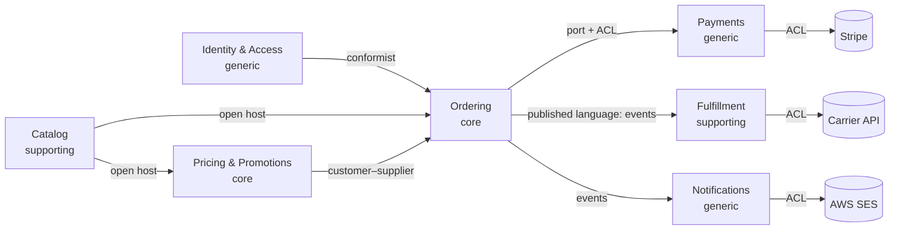
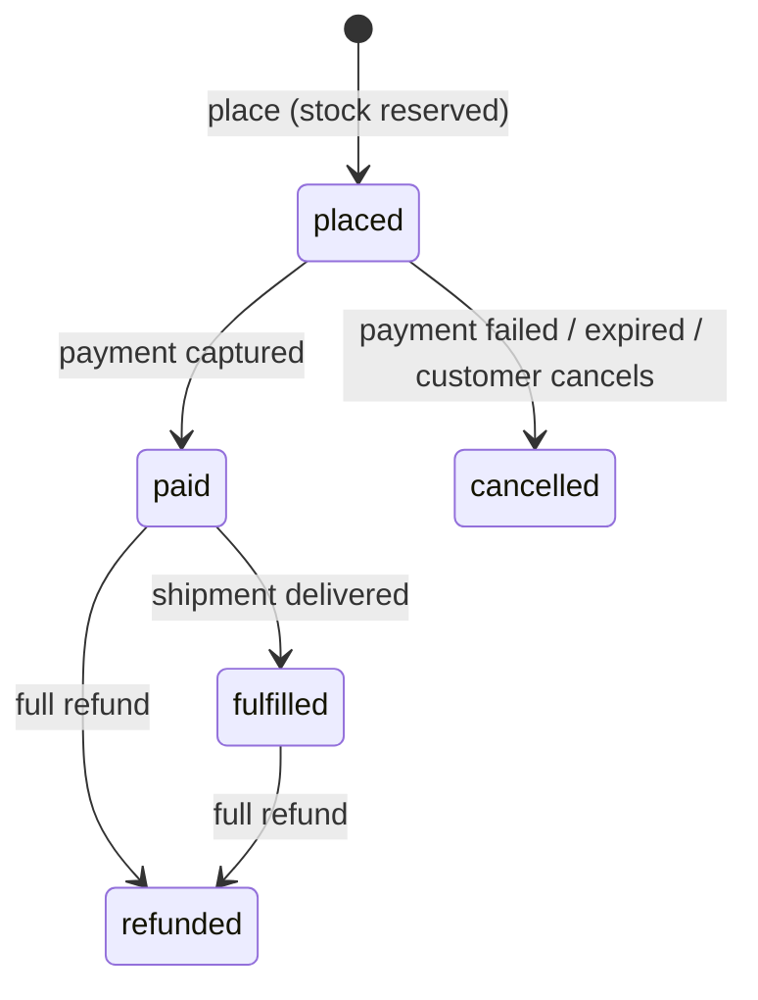

# Product and domain
[← Overview](00-overview.md)

## Why it matters
- Without written scope and numbers, the capstone grows forever or skips the hard parts.
- The domain work decides the module boundaries. Getting the bounded contexts wrong means every feature crosses every module.
- Aggregates and invariants written down first make the code obvious; discovered in code, they make it a mess.

## Product scope
| In scope (v1) | Out of scope (v1) |
|:--|:--|
| Catalog: coffees and equipment with variants (size, grind), images, categories | marketplace sellers |
| Accounts: sign-up, login, password reset, MFA for staff (Better Auth) | social login beyond one provider |
| Cart for guests and customers; merge on login | wish lists |
| Promotions: percentage and fixed coupons, automatic "free shipping over €40" | loyalty points, referral programs |
| Checkout with Stripe Checkout (cards, wallets); EU VAT included in prices | multiple currencies |
| Orders: history, status, cancellation before payment, refunds by staff | returns portal (staff handles by email) |
| Fulfillment: stock per variant, reservations, shipments with tracking from one carrier | multi-warehouse routing |
| Notifications: order confirmation, shipping, password reset (SES) | SMS, push |
| Staff admin: products, stock, orders, refunds, promotions | custom reporting builder |

### Non-functional requirements (numbers)
| Requirement | Target |
|:--|:--|
| Traffic | 20k daily visitors, peak 20 req/s API, campaign peak 100 req/s |
| Orders | 300/day, peak 30/minute during campaigns |
| Latency | product page p95 < 300 ms (API), checkout start p95 < 800 ms |
| Availability | 99.9% monthly for browsing and checkout |
| Durability | no acknowledged order or payment lost; RPO 5 min, RTO 1 h |
| Consistency | stock reservation and payment status strongly consistent; catalog and dashboards eventually consistent |
| Security and privacy | OWASP Top 10:2025 reviewed; GDPR (access, erasure, breach process); no card data touches our servers |
| Accessibility | WCAG 2.2 AA |

## Domain discovery
Event storming result for the main flow (events in time order):
| # | Domain event | Command | Actor / trigger | Policy (whenever…) |
|:--|:--|:--|:--|:--|
| 1 | Product published | Publish product | staff | — |
| 2 | Item added to cart | Add to cart | customer | — |
| 3 | Promotion applied | Apply coupon | customer | — |
| 4 | Order placed | Place order | customer (checkout) | → reserve stock |
| 5 | Stock reserved | Reserve stock | policy | → start payment |
| 6 | Payment session created | Create payment session | policy | — |
| 7 | Payment captured | (Stripe webhook) | Stripe | → mark order paid |
| 8 | Order paid | Mark paid | policy | → request shipment, send confirmation |
| 9 | Shipment requested / created | Create shipment | policy / staff | → send shipping email |
| 10 | Parcel shipped | (carrier webhook or staff) | carrier | → update order status |
| — | Payment failed / session expired | (Stripe webhook / timer) | Stripe, scheduler | → release stock, cancel order |
| — | Refund issued | Refund order | staff | → release or restock per case |

Hot spots to resolve with the "business": what happens to stock when payment takes 50 minutes? (reservation expires with the Stripe session: 60 minutes); can promotions stack? (no: the best single promotion applies); partial refunds? (staff only, per line).

## Ubiquitous language (excerpt of `docs/domain/glossary.md`)
| Term | Context | Meaning |
|:--|:--|:--|
| Product | Catalog | what's sold under one name and description ("Ethiopia Guji") |
| Variant / SKU | Catalog, Fulfillment | one buyable option of a product (250 g, whole bean); identified by a SKU |
| Listing price | Catalog | the price shown before promotions |
| Promotion | Pricing | a rule that reduces a price: coupon or automatic, with validity and limits |
| Price quote | Pricing | the computed prices of a cart at a moment, with applied promotion |
| Cart | Ordering | items a shopper intends to buy; no stock reserved |
| Order | Ordering | a committed purchase created at checkout; has a status lifecycle |
| Placed / Paid / Cancelled | Ordering | order states; *placed* = created and stock reserved, awaiting payment |
| Reservation | Fulfillment | stock held for a placed order until paid or expired |
| Shipment | Fulfillment | one parcel to one address with tracking |
| Payment | Payments | our record of a Stripe payment for an order |

## Subdomains and bounded contexts
| Context | Subdomain type | Owns | Integration |
|:--|:--|:--|:--|
| **Pricing & Promotions** | core | promotions, coupon redemptions, price quotes | called by Ordering (customer–supplier) |
| **Ordering** | core | carts, orders, checkout saga | publishes OrderPlaced/OrderPaid/OrderCancelled |
| Catalog | supporting | products, variants, listings, images | open host (product API) |
| Fulfillment | supporting | stock items, reservations, shipments | reacts to Ordering events; carrier ACL |
| Payments | generic (Stripe) | payments, refunds, webhook events | ACL over Stripe; called by Ordering |
| Identity & Access | generic (Better Auth) | users, sessions, roles | conformist to Better Auth |
| Notifications | generic (SES) | emails, preferences, deliveries | reacts to events; SES ACL |

## Aggregates and invariants (core contexts)
| Aggregate | Context | Invariants | References |
|:--|:--|:--|:--|
| Cart | Ordering | ≤ 50 lines; quantity 1–99; one line per variant; belongs to one shopper | variant IDs, customer ID |
| Order | Ordering | total = sum of priced lines − discount; status transitions only via the lifecycle; lines frozen after placement; cancel only before payment | customer ID, variant IDs, payment ID |
| Promotion | Pricing | valid window; usage limit not exceeded; one promotion per order (no stacking); minimum basket respected | — |
| CouponRedemption | Pricing | one redemption per (coupon, customer) when the coupon is single-use (unique constraint) | promotion ID, order ID |
| StockItem | Fulfillment | `onHand ≥ 0`, `reserved ≤ onHand` | SKU |
| Reservation | Fulfillment | expires after 60 min unless confirmed; released exactly once | order ID, SKU lines |
| Payment | Payments | one successful capture per order; refunds ≤ captured amount | order ID |

Order lifecycle (state machine):

## Mistakes
Wrong: one `products` model shared by catalog, pricing, and fulfillment. Right: each context models what it needs; they share IDs.

Wrong: stock as a field on the catalog product (`product.stock -= 1` at checkout). Right: Fulfillment owns stock and reservations; Ordering asks through a port.

Wrong: promotions computed in the frontend. Right: Pricing computes quotes on the server; the UI displays them.

## Check yourself
1. Why are Pricing and Ordering core subdomains, and Payments generic?
2. Which invariants force stock reservation to be strongly consistent?
3. Why does the Order aggregate reference variants by ID instead of embedding catalog products?

Answers

1. Pricing rules and the ordering experience are what differentiate the shop and change often with the business, so they deserve rich models; payments are a solved problem provided by Stripe, so they get a thin ACL.
2. `reserved ≤ onHand` and "no overselling": two concurrent checkouts for the last bag must not both succeed, so the reservation must be an atomic, consistent database operation, not an eventually consistent one.
3. Products belong to the Catalog context and change independently (names, prices, images). The order stores the variant ID plus the prices and names it was sold with (frozen at placement), so later catalog changes can't alter past orders and the contexts stay decoupled.

## Sources
- [Alberto Brandolini — Event storming](https://www.eventstorming.com/)
- [DDD Crew — Bounded context canvas](https://github.com/ddd-crew/bounded-context-canvas)
- [Martin Fowler — Ubiquitous language](https://martinfowler.com/bliki/UbiquitousLanguage.html)
- [Vaughn Vernon — Effective aggregate design (PDF)](https://www.dddcommunity.org/wp-content/uploads/files/pdf_articles/Vernon_2011_1.pdf)
