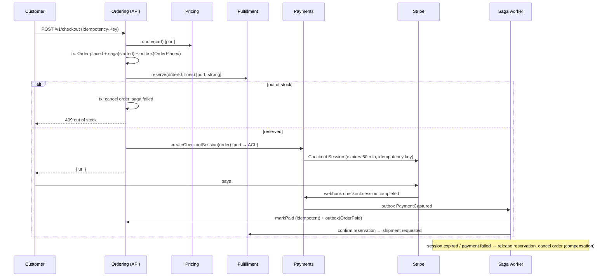

# System design and data
[← Overview](00-overview.md)

## Why it matters
- Stock, money, and payments are where small design gaps become customer-visible bugs: oversold coffee, double charges, lost orders.
- Writing the consistency choice for each operation stops "eventually consistent" from sneaking into places that must be exact.
- The checkout saga is the heart of the system; designing its states and compensations on paper is much cheaper than in production.

## Estimates
```text
Visitors: 20k/day; ~15 API requests per visit → 300k req/day ≈ 3.5 req/s avg; campaign peak ~100 req/s
Orders: 300/day avg; campaign peak 30/min (0.5/s)
Data: orders ~1 KB + lines 3 × 200 B → ~0.5 GB/year incl. indexes; events/outbox ~2 GB/year (cleaned after 30 days)
Images: 400 products × 5 images × 3 sizes × 200 KB ≈ 1.2 GB on S3, served via CloudFront
Conclusion: a single Postgres (Multi-AZ) and one small Valkey cluster are plenty; the hard parts are correctness, not scale.
```

## API outline (excerpt)
| Endpoint | Context | Notes |
|:--|:--|:--|
| `GET /v1/products?category=&cursor=` | Catalog (query slice) | cacheable (`public, s-maxage=60`), cursor pagination |
| `GET /v1/products/{slug}` | Catalog | cache-aside in Redis + CDN |
| `GET /v1/cart`, `POST /v1/cart/lines`, `DELETE /v1/cart/lines/{variantId}` | Ordering | session-bound |
| `POST /v1/cart/coupon` | Ordering → Pricing | returns a price quote |
| `POST /v1/checkout` | Ordering | idempotency key; returns Stripe Checkout URL |
| `GET /v1/me/orders?cursor=` | Ordering (read model) | `orderSummaries` |
| `POST /webhooks/stripe` | Payments | raw body, signature, enqueue |
| `POST /v1/admin/orders/{id}/refunds` | Payments | staff permission `orders:refund` |
| `POST /v1/admin/uploads` | Catalog | presigned POST to S3 |

## Data model per context (Postgres schemas or table prefixes)
| Context | Tables | Notes |
|:--|:--|:--|
| Catalog | `products`, `variants (sku unique)`, `product_images`, `categories` | soft delete; `sellable` specification |
| Pricing | `promotions`, `coupon_codes`, `coupon_redemptions (unique coupon_id, customer_id)` | rules as JSONB validated by Zod per kind |
| Ordering | `carts`, `cart_lines`, `orders (version)`, `order_lines`, `checkout_sagas`, `order_summaries` (read model) | prices frozen on order lines |
| Fulfillment | `stock_items (sku, on_hand, reserved, CHECK reserved <= on_hand)`, `reservations (expires_at)`, `shipments` | atomic conditional updates |
| Payments | `payments (order_id, stripe ids, status)`, `refunds`, `processed_webhooks` | one capture per order |
| Identity | Better Auth tables + `staff_roles` | — |
| Notifications | `email_sends (unique kind, entity_id)`, `preferences` | dedupe per email |
| Shared | `outbox`, `processed_messages (consumer, message_id)` | at-least-once delivery |

Each context owns its tables; no foreign keys **across** contexts (IDs only), foreign keys **within** a context.

## Consistency per operation
| Operation | Consistency | Mechanism |
|:--|:--|:--|
| Reserve stock | strong | `UPDATE stock_items SET reserved = reserved + $q WHERE sku = $s AND on_hand - reserved >= $q` (0 rows → out of stock) |
| Single-use coupon | strong | unique `(coupon_id, customer_id)` |
| Order status | strong | aggregate with version (optimistic concurrency) |
| Payment captured → order paid | effectively-once | webhook dedupe + idempotent `markPaid` |
| Product listing | eventual (≤ 60 s) | CDN + Redis cache, invalidated on publish |
| Order history | eventual (seconds) | `order_summaries` projection |
| Admin revenue dashboard | eventual (minutes) | aggregate queries on a read model / replica |
| Emails | at-least-once, deduped | outbox → queue → `email_sends` claim |

## The checkout saga

| Saga state | Next | Compensation if it fails |
|:--|:--|:--|
| `started` | reserve stock | cancel order |
| `stock_reserved` | create payment session | release reservation, cancel order |
| `awaiting_payment` | wait for webhook (timeout 65 min) | release reservation, cancel order |
| `paid` (pivot) | confirm reservation, request shipment | none: only forward, retries + alerts |
| `completed` / `cancelled` | — | — |

Reconciliation (daily): Stripe succeeded payments vs paid orders; expired reservations vs cancelled orders ([03-backend/12-integrations lesson 02](../../../03-backend/12-integrations/docs/02-stripe-webhooks-reconciliation.md)).

## Asynchronous flows
| Event | Producer | Consumers (one job each) |
|:--|:--|:--|
| `order.placed.v1` | Ordering | projection `order_summaries` |
| `payment.captured.v1` | Payments | Ordering saga (mark paid) |
| `order.paid.v1` | Ordering | Fulfillment (confirm reservation, create shipment), Notifications (confirmation email), projection |
| `order.cancelled.v1` | Ordering | Fulfillment (release), projection |
| `shipment.shipped.v1` | Fulfillment | Notifications (shipping email), Ordering (status), projection |
| `product.published.v1` | Catalog | cache invalidation, sitemap regeneration |

## Example
Stock reservation as an atomic conditional update (Fulfillment adapter):
```ts
export async function reserve(tx: Tx, orderId: string, lines: readonly { sku: string; quantity: number }[], expiresAt: Date) {
  for (const line of lines.toSorted((a, b) => a.sku.localeCompare(b.sku))) {     // fixed order avoids deadlocks
    const updated = await tx.update(stockItems)
      .set({ reserved: sql`${stockItems.reserved} + ${line.quantity}` })
      .where(and(eq(stockItems.sku, line.sku), sql`${stockItems.onHand} - ${stockItems.reserved} >= ${line.quantity}`))
      .returning({ sku: stockItems.sku });
    if (updated.length === 0) throw new ConflictError('stock.insufficient', `Not enough stock for ${line.sku}`); // whole tx rolls back
  }
  await tx.insert(reservations).values({ orderId, lines, expiresAt }).onConflictDoNothing();                // idempotent per order
}
```

## Mistakes
Wrong: reading stock, checking in code, then writing (check-then-act). Concurrent checkouts oversell. Right: one conditional `UPDATE`.

Wrong: marking the order paid on the success redirect. Right: only the verified webhook (or reconciliation) marks it paid.

Wrong: cross-context foreign keys. Contexts can't evolve or be extracted. Right: IDs across contexts, constraints inside.

## Check yourself
1. Why is stock reservation done with a conditional `UPDATE` instead of `SELECT` then `UPDATE`?
2. What's the pivot step of the checkout saga, and what happens after it?
3. Which reads in Roastery may be eventually consistent, and how stale may they be?

<details>
<summary>Answers</summary>

1. Two transactions can both read "1 left" and both write, overselling. A single conditional `UPDATE … WHERE on_hand - reserved >= q` checks and changes atomically; 0 updated rows means out of stock.
2. Payment captured (`paid`). Before it, failures compensate (release stock, cancel); after it, the saga only moves forward: confirming the reservation and requesting the shipment are retried until they succeed, with alerts if they don't.
3. Product listings (up to about 60 seconds via CDN and cache), order history (seconds, via the projection), and admin dashboards (minutes). Stock, coupons, order status, and payments must be strongly consistent.
</details>

## Sources
- [microservices.io — Saga](https://microservices.io/patterns/data/saga.html)
- [Stripe — Fulfill orders after Checkout](https://docs.stripe.com/checkout/fulfillment)
- [PostgreSQL — UPDATE](https://www.postgresql.org/docs/current/sql-update.html)
- [Martin Kleppmann — Designing Data-Intensive Applications](https://dataintensive.net/)
