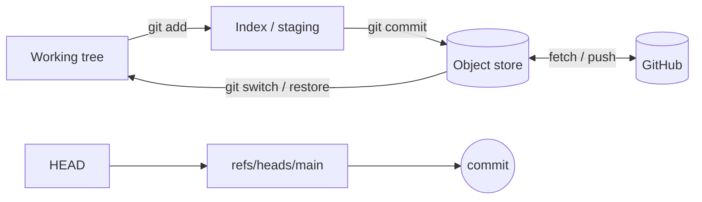

# Git & Collaboration — Overview
[← Topic](../README.md)

**TECH:** Git 2.56, GitHub.com, `gh` CLI, applied to a .NET solution (`.slnx`, `Directory.Packages.props`, `bin/` and `obj/`)
**LEVEL:** intermediate (mid-level, new to C# and .NET)

## Why this matters in production
- Every deploy, rollback, and audit trail starts at a commit. A messy history slows down every incident.
- .NET repos have their own traps: committed `bin/` and `obj/` folders, CRLF churn on Windows, merge conflicts in `Directory.Packages.props` and `.slnx`.
- A connection string pasted into `appsettings.Development.json` and pushed is found by scanners in minutes.
- Without a protected `main`, one push from a laptop skips the build, the tests, and the review.

## Mental model
Git is a **content-addressed object store** plus **movable pointers**.

- Objects (blob, tree, commit, annotated tag) are immutable and named by their hash.
- Refs (branches, tags, `HEAD`) are tiny files that point at commits.
- Almost every command either creates objects or moves a pointer. "Undo" means moving a pointer back; the old objects are still there for a while (reflog).

## Prerequisites
- Git 2.56 (Git for Windows on the host, or the distro package in WSL2). Check with `git --version`.
- A GitHub account with SSH keys, and the `gh` CLI (`gh auth login`).
- The .NET 10 SDK (`dotnet --version` → 10.0.4xx), only to create the sample solution.

## Lesson map
| Lesson | Checklist items |
|:--|:--|
| [01 · Objects, commits, and everyday commands](01-objects-commits-everyday.md) | 1, 2, 3 |
| [02 · Repo setup for .NET and keeping secrets out](02-repo-setup-and-secrets.md) | 4, 13 |
| [03 · Trunk-based work, merging, and conflicts](03-branching-and-integration.md) | 5, 6, 7 |
| [04 · Cleaning, undoing, and investigating history](04-rewrite-recover-investigate.md) | 8, 9, 10 |
| [05 · Pull requests, protected main, signing, and releases](05-prs-protection-releases.md) | 11, 12, 14, 15 |
| [Cheatsheet](cheatsheet.md) | all |

## Suggested order
1. 01 → 05. Lesson 02 is the one with the most .NET-specific setup.
2. If you already did this topic in the TypeScript stack, read 02 and the .NET parts of 03 and 05, then skim the cheatsheet.
3. Ready to build: `/learn csharp/01-foundations/01-git mode=tasks`.

## Version notes
- Git 2.56 (Sep 2026) adds `git add --resolved` (stages only previously conflicted files and refuses if markers remain) and `git branch --delete-merged`. The experimental `git history` command (2.54+) now has `reword`, `split`, `fixup`, and `drop`.
- `merge.conflictStyle = zdiff3` (2.35+) and `rebase.updateRefs` (2.38+) are stable and worth turning on.
- GitHub rulesets have replaced classic branch protection for new repos; merge queue is available on all plans for public repos and on Team/Enterprise for private ones.
- `dotnet new gitignore` writes the official Visual Studio `.gitignore`; `dotnet new editorconfig` writes a starter `.editorconfig` (see 05-code-quality).

## Sources
- [Git release notes 2.56](https://code.googlesource.com/git/+/24f082e6f45e39dc36f55a3344696d707740f56e/Documentation/RelNotes/2.56.0.adoc)
- [GitHub blog — Highlights from Git 2.56](https://github.blog/open-source/git/highlights-from-git-2-56/)
- [Pro Git book](https://git-scm.com/book/en/v2)
- [GitHub Docs — Rulesets](https://docs.github.com/en/repositories/configuring-branches-and-merges-in-your-repository/managing-rulesets/about-rulesets)
- [dotnet new templates](https://learn.microsoft.com/dotnet/core/tools/dotnet-new-sdk-templates)
