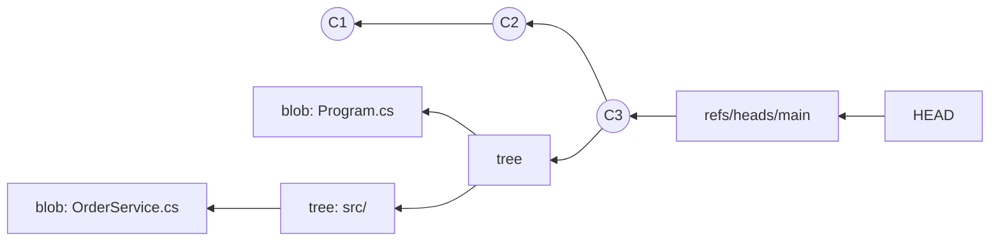

# Objects, commits, and everyday commands
[← Overview](00-overview.md)

## Why it matters
- A developer "loses" a day of work after `git reset --hard`; it was in the reflog the whole time, but nobody on the team knew how Git stores commits.
- A 4,000-line commit titled "fixes" mixes an EF Core migration, a refactor, and a bug fix. The bug fix can't be reverted alone, so the incident lasts an hour longer.
- `git add .` stages `appsettings.Development.json` with a real password because nobody reviews what is staged.

## Concepts

### The object model
| Object | Holds | Named by |
|:--|:--|:--|
| blob | file contents (no name, no mode) | SHA of contents |
| tree | directory listing: names → blobs/trees, modes | SHA of the listing |
| commit | one root tree, parent commit(s), author, committer, message | SHA of all of that |
| annotated tag | target object, tagger, message, optional signature | SHA |

A **ref** is a name pointing at a commit: `refs/heads/main`, `refs/tags/v1.4.0`, `refs/remotes/origin/main`. `HEAD` points at the current branch (or directly at a commit: "detached HEAD").



Consequences:
- Commits are snapshots, not diffs. A diff is computed when you ask for it.
- Changing any byte in history changes every later hash. That is why rewriting shared history breaks other people.
- Branches are cheap: creating one writes 41 bytes.

### Look inside
```bash
git cat-file -t HEAD          # commit
git cat-file -p HEAD          # tree, parent, author, message
git cat-file -p 'HEAD^{tree}' # the root directory listing
git rev-parse main origin/main
git log --oneline --graph --decorate --all
```

### Atomic commits and messages
One commit = one logical change that builds and passes tests on its own. For a .NET change that usually means: code + its tests + its migration in one commit, and a pure rename or formatting pass in a separate commit.

Conventional Commits:
```text
feat(orders): add cancel endpoint

POST /orders/{id}/cancel returns 409 when the order has shipped.
Adds the OrderCancelled migration.

Refs: #142
```
| Type | Use | SemVer effect |
|:--|:--|:--|
| `feat` | new behavior | minor |
| `fix` | bug fix | patch |
| `refactor`, `perf`, `test`, `docs`, `build`, `ci`, `chore` | no user-facing change | none |
| `feat!` or `BREAKING CHANGE:` footer | breaking API change | major |

Subject: imperative, ≤ 72 characters, no period. Body: what and why, not how.

### Everyday commands done right
| Task | Command | Instead of |
|:--|:--|:--|
| new branch | `git switch -c feat/cancel-order` | `git checkout -b` |
| change branch | `git switch main` | `git checkout main` |
| discard a file's edits | `git restore src/Api/Program.cs` | `git checkout -- file` |
| unstage | `git restore --staged file` | `git reset file` |
| stage by hunk | `git add -p` | `git add .` |
| park work | `git stash push -m "wip: cancel" -u` | committing half-done work |
| get it back | `git stash pop` / `git stash apply stash@{1}` | |
| see what you're committing | `git diff --staged` | trusting yourself |

## Example
A small .NET change split into atomic commits.

`terminal`
```bash
dotnet new webapi -n Shop.Api -o src/Shop.Api
git switch -c feat/health-endpoint

# edit Program.cs (endpoint) and appsettings.json (unrelated log level tweak)
git add -p src/Shop.Api/Program.cs          # stage only the endpoint hunks
git diff --staged                           # review
git commit -m "feat(api): add /health endpoint"

git add src/Shop.Api/appsettings.json
git commit -m "chore(api): lower default log level to Warning"

git log --oneline -2
```

## Production patterns
- Review `git diff --staged` before every commit; it is the cheapest code review there is.
- Keep generated files out of feature commits (`dotnet format` runs, migration snapshots are fine to include with the migration they belong to).
- Use Conventional Commits so release notes and versions can be generated (lesson 05).
- Turn on helpful defaults once: `git config --global push.autoSetupRemote true`, `rebase.updateRefs true`, `merge.conflictStyle zdiff3`, `rerere.enabled true`.

## Mistakes
Wrong: one commit for everything.
```bash
git add . && git commit -m "updates"
```
Right: stage by intent, describe the why.
```bash
git add -p && git commit -m "fix(orders): reject cancel after shipment"
```

Wrong: `git stash` with untracked files left behind, then switching branches.
```bash
git stash          # new files stay in the working tree
```
Right:
```bash
git stash push -u -m "wip: cancel endpoint"
```

## Check yourself
1. You amend a commit you already pushed. Why does the remote now reject your push?
2. What does `git restore --staged Program.cs` change: the working tree, the index, or both?
3. Which Conventional Commit type would make a release tool bump the major version?

<details><summary>Answers</summary>

1. Amending creates a new commit with a new hash; your branch no longer contains the remote's commit, so a plain push is not a fast-forward.
2. Only the index. The file's edits stay in the working tree.
3. Any type with `!` (`feat!:`) or a `BREAKING CHANGE:` footer.
</details>

## Sources
- [Pro Git — Git Internals](https://git-scm.com/book/en/v2/Git-Internals-Git-Objects)
- [Conventional Commits 1.0.0](https://www.conventionalcommits.org/en/v1.0.0/)
- [git-switch](https://git-scm.com/docs/git-switch) · [git-restore](https://git-scm.com/docs/git-restore) · [git-stash](https://git-scm.com/docs/git-stash)
