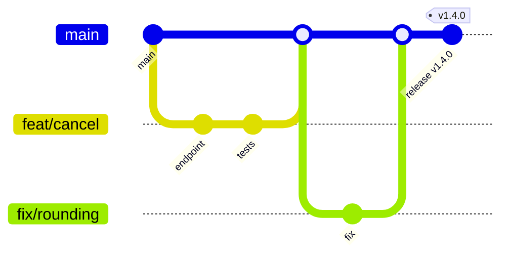

# Trunk-based work, merging, and conflicts
[← Overview](00-overview.md)

## Why it matters
- A feature branch lives for five weeks. Merging it takes two days, breaks the EF Core migration order, and ships a bug nobody reviewed because the PR had 90 files.
- Someone rebases a branch two colleagues build on and force-pushes; their next pull duplicates every commit.
- A conflict in `Directory.Packages.props` is "resolved" by keeping both lines; restore fails with a duplicate `PackageVersion` error on `main`.

## Concepts

### Trunk-based development
`main` is always releasable. Work happens on short-lived branches (hours to two days), merged through small PRs. Unfinished features hide behind flags (see 04-shipping/04-deployments), not long branches.



| Model | Branch life | Fits |
|:--|:--|:--|
| ⭐ Trunk-based | hours–2 days | continuous delivery, most product teams |
| GitHub flow | days | same idea, PR per feature |
| GitFlow (`develop`, release branches) | weeks | shipped software with several supported versions; slow for web apps |

### Merge vs rebase vs squash
| Strategy | History on main | Use when | Cost |
|:--|:--|:--|:--|
| Merge commit | keeps branch commits + a merge node | branch commits are meaningful and clean | noisy graph |
| Rebase and merge | linear, every commit kept | commits are atomic and each builds | needs disciplined commits |
| ⭐ Squash and merge | one commit per PR | most teams; PR = unit of change | loses intermediate commits |

Rule: **never rewrite history that someone else has based work on.** Rebasing your own unpushed (or solo) branch is fine. Use `--force-with-lease --force-if-includes` when you must push a rewritten branch.

Keeping your branch current:
```bash
git fetch
git rebase origin/main      # your branch only
# or, if the branch is shared:
git merge origin/main
```

### Conflicts
With `merge.conflictStyle = zdiff3` you see the common ancestor too:
```text
<<<<<<< ours
    <PackageVersion Include="Microsoft.EntityFrameworkCore" Version="10.0.2" />
||||||| base
    <PackageVersion Include="Microsoft.EntityFrameworkCore" Version="10.0.1" />
=======
    <PackageVersion Include="Microsoft.EntityFrameworkCore" Version="10.0.1" />
    <PackageVersion Include="Hangfire.Core" Version="1.8.x" />
>>>>>>> theirs
```
Result should take both intents: the newer EF Core version and the new Hangfire line, each package once.

Workflow:
1. `git status` — see unmerged paths.
2. Edit, or `git checkout --ours/--theirs <file>` for whole-file choices.
3. Build and test: `dotnet build && dotnet test`. A conflict-free merge can still be broken.
4. `git add --resolved` (Git 2.56+: stages only formerly conflicted files, refuses if markers remain) or `git add <file>`.
5. `git rebase --continue` / `git merge --continue`.

`rerere` (reuse recorded resolution) remembers how you resolved a hunk and reapplies it next time, useful when re-rebasing a branch.

### .NET files that conflict often
| File | Tip |
|:--|:--|
| `Directory.Packages.props` | keep entries sorted; one package per line; resolve, then `dotnet restore` |
| `.slnx` | XML, small, sorted; far fewer conflicts than old `.sln`; re-add with `dotnet sln add` if unsure |
| EF Core `*ModelSnapshot.cs` | never hand-merge; take main's, then re-create your migration (`dotnet ef migrations remove` / `add`) |
| `packages.lock.json` | take either side, then `dotnet restore --force-evaluate` |

## Example
`terminal`
```bash
git switch -c feat/order-notes
# ... commits ...
git fetch
git rebase origin/main
# conflict in Directory.Packages.props
git diff                          # shows ours / base / theirs
code Directory.Packages.props     # resolve
dotnet restore && dotnet build && dotnet test
git add --resolved
git rebase --continue
git push --force-with-lease --force-if-includes
```

## Production patterns
- Merge to `main` at least daily. Small PRs merge faster and break less.
- Pick one merge strategy per repo in the ruleset (most teams: squash only) so history stays consistent.
- After resolving a conflict, always build and run the tests before continuing.
- Regenerate, don't merge, generated files: EF Core snapshots, lock files, OpenAPI documents.

## Mistakes
Wrong: force-pushing over a shared branch.
```bash
git push --force
```
Right:
```bash
git push --force-with-lease --force-if-includes   # refuses if someone else pushed
```

Wrong: hand-merging an EF Core model snapshot.
Right: take `main`'s snapshot, then `dotnet ef migrations remove` and `dotnet ef migrations add <Name>` on top.

## Check yourself
1. Why does squash-and-merge make `git revert` of a feature simple?
2. What extra information does `zdiff3` show that the default style does not?
3. Your rebase produced no conflicts. Why do you still run `dotnet test`?

<details><summary>Answers</summary>

1. The whole PR is one commit on `main`; reverting it is one `git revert <sha>`.
2. The base version (common ancestor) between the two sides.
3. Textually clean merges can still be semantically wrong (a renamed method, a changed signature used by new code).
</details>

## Sources
- [trunkbaseddevelopment.com](https://trunkbaseddevelopment.com/)
- [git-rebase](https://git-scm.com/docs/git-rebase) · [git-rerere](https://git-scm.com/docs/git-rerere) · [git-merge conflictStyle](https://git-scm.com/docs/git-config#Documentation/git-config.txt-mergeconflictStyle)
- [GitHub — About merge methods](https://docs.github.com/en/repositories/configuring-branches-and-merges-in-your-repository/configuring-pull-request-merges/about-merge-methods-on-github)
- [EF Core — Migrations in team environments](https://learn.microsoft.com/ef/core/managing-schemas/migrations/teams)
