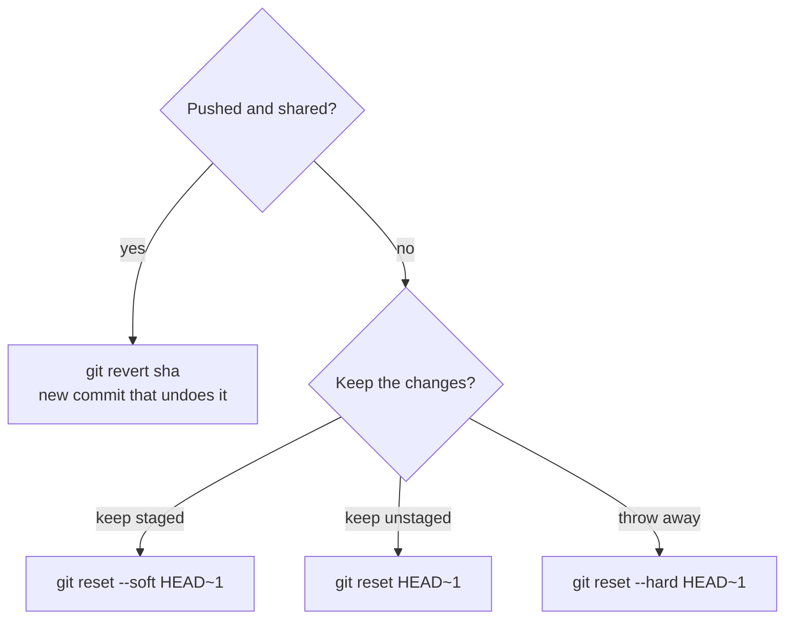

# Cleaning, undoing, and investigating history
[← Overview](00-overview.md)

## Why it matters
- A PR has 23 commits named "wip", "fix", "fix again". The reviewer can't follow it and approves without reading.
- Someone runs `git reset --hard origin/main` on `main` after a bad merge and force-pushes; the team loses two merged PRs.
- A rounding bug appeared "sometime in the last 300 commits". Without `bisect` it takes a day; with it, nine builds.

## Concepts

### Cleaning a branch before review
Only on your own branch, before others build on it.
| Goal | Command |
|:--|:--|
| fix an older commit | `git commit --fixup=<sha>` then `git rebase -i --autosquash origin/main` |
| reword, reorder, drop, squash | `git rebase -i origin/main` (in this environment, use `GIT_SEQUENCE_EDITOR` or your IDE) |
| reword one commit without a full rebase | `git history reword <sha>` (experimental, 2.54+) |
| drop one commit | `git history drop <sha>` (experimental, 2.56+) |
| keep stacked branches pointing right | `rebase.updateRefs = true` |

Set `rebase.autoSquash = true` and fixups are applied automatically.

### Undo: pick the command by what you want to keep

| Command | Moves branch | Index | Working tree |
|:--|:--|:--|:--|
| `reset --soft X` | to X | kept | kept |
| `reset --mixed X` (default) | to X | reset | kept |
| `reset --hard X` | to X | reset | reset (uncommitted work lost) |
| `revert X` | adds a new commit | — | — |
| `restore file` | no | no | file reset |

### The reflog: your safety net
Every move of `HEAD` is recorded locally for ~90 days.
```bash
git reflog
# a1b2c3d HEAD@{0}: reset: moving to HEAD~3
# 9f8e7d6 HEAD@{1}: commit: feat(orders): add cancel endpoint
git branch rescue 9f8e7d6      # or: git reset --hard HEAD@{1}
```
Dropped stashes can be found with `git fsck --lost-found` (dangling commits).

### Investigating history
| Question | Command |
|:--|:--|
| when did this string appear or disappear? | `git log -S 'RoundingMode.ToEven' --oneline` |
| when did lines matching a regex change? | `git log -G 'Math\.Round\(' -p` |
| history of one method | `git log -L :CalculateTotal:src/Shop.Domain/Order.cs` |
| who last changed each line, ignoring formatting commits | `git blame -w -C --ignore-revs-file .git-blame-ignore-revs file` |
| which commit broke the test? | `git bisect` |

`.git-blame-ignore-revs` lists commits like "run dotnet format on solution"; GitHub's blame view honors it too.

### bisect with a .NET test
`check.sh`
```bash
#!/usr/bin/env sh
dotnet test tests/Shop.Domain.Tests --filter "FullyQualifiedName~OrderTotalTests" --nologo -v q
```
```bash
git bisect start
git bisect bad HEAD
git bisect good v1.3.0
git bisect run ./check.sh      # exit 0 = good, 1–124 = bad, 125 = skip (e.g. doesn't build)
git bisect reset
```
Return 125 when the build itself fails, so bisect skips commits that don't compile.

## Example
Cleaning a branch, then recovering from a mistake.

`terminal`
```bash
git log --oneline origin/main..HEAD
# 4c3 fix typo
# 7a1 add tests
# e90 add cancel endpoint
git commit --fixup=e90                # staged change belongs in e90
git rebase -i --autosquash origin/main

git reset --hard HEAD~2               # oops
git reflog                            # find the commit before the reset
git reset --hard HEAD@{1}             # back
```

## Production patterns
- `revert` on shared branches; `reset` only on your own.
- Keep commits buildable so `bisect` works; squash-merging PRs guarantees it on `main`.
- Add a `.git-blame-ignore-revs` file the day you run a bulk `dotnet format`.
- Before any risky rewrite: `git branch backup/feat-x`. It costs nothing.

## Mistakes
Wrong: undoing a pushed commit on `main` by rewriting.
```bash
git reset --hard HEAD~1 && git push --force
```
Right:
```bash
git revert <sha> && git push
```

Wrong: bisecting with a script that fails on unrelated build errors (marks them bad).
Right: exit 125 when `dotnet build` fails, so those commits are skipped.

## Check yourself
1. Which reset mode keeps your changes staged?
2. You dropped a stash by mistake. Where can you find it?
3. What does `git log -S` search for that `git log --grep` does not?

<details><summary>Answers</summary>

1. `--soft`.
2. As a dangling commit: `git fsck --lost-found` (or the stash's sha printed by `git stash drop`).
3. Changes in file contents (added or removed occurrences of a string); `--grep` searches commit messages.
</details>

## Sources
- [git-reset](https://git-scm.com/docs/git-reset) · [git-reflog](https://git-scm.com/docs/git-reflog) · [git-bisect](https://git-scm.com/docs/git-bisect)
- [git-log -S / -G / -L](https://git-scm.com/docs/git-log)
- [git-history (experimental)](https://git-scm.com/docs/git-history)
- [GitHub — Ignore commits in blame view](https://docs.github.com/en/repositories/working-with-files/using-files/viewing-and-understanding-files#ignore-commits-in-the-blame-view)
