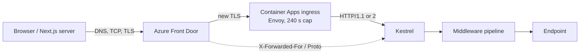

# HTTP & Networking — Overview
[← Topic](../README.md)

**TECH:** HTTP semantics (RFC 9110), ASP.NET Core 10 on Kestrel, curl, Chrome DevTools, `.http` files
**LEVEL:** intermediate (mid-level, new to C# and .NET)

## Why this matters in production
- Most "random" production errors are HTTP problems: 502s from mismatched keep-alive timeouts, CORS failures after a domain change, cookies dropped by `SameSite`.
- Behind Azure Container Apps or Front Door, your app sees the proxy's IP and `http` unless forwarded headers are configured. Redirects, auth callbacks, and rate limits then break.
- Wrong status codes make clients retry what they shouldn't (a non-idempotent POST) or stop retrying what they could.
- Kestrel is a capable edge server, but its defaults (30 MB bodies, 130 s keep-alive) must match the infrastructure in front of it.

## Mental model
A request crosses several hops. Each hop has its own timeouts, headers, and TLS session.

## Prerequisites
- .NET 10 SDK, `dotnet new webapi` works, and `dotnet dev-certs https --trust` has been run on the host.
- curl 8 (in WSL2 or Git Bash) and Chrome.
- Read [01-git](../../01-git/README.md) lesson 02 for repo setup.

## Lesson map
| Lesson | Checklist items |
|:--|:--|
| [01 · A request end to end, methods, status codes, headers](01-request-semantics.md) | 1, 2, 3 |
| [02 · Kestrel, HTTP versions, and TLS](02-kestrel-versions-tls.md) | 4, 5, 14 |
| [03 · Cookies and CORS in ASP.NET Core](03-cookies-cors.md) | 6, 7 |
| [04 · HTTP caching, compression, and content negotiation](04-caching-compression.md) | 8, 9 |
| [05 · Proxies, forwarded headers, timeouts, and keep-alive](05-proxies-timeouts.md) | 10, 11 |
| [06 · Debugging tools and real-time options](06-debugging-realtime.md) | 12, 13, 15, 16 |
| [Cheatsheet](cheatsheet.md) | all |

## Suggested order
1. 01 → 06. Lessons 03 and 05 are the ones you will come back to when something breaks in production.
2. Then [03-testing](../../03-testing/README.md) (testing endpoints) and [03-backend/02-api-design](../../../03-backend/02-api-design/README.md).
3. Ready to build: `/learn csharp/01-foundations/02-http-networking mode=tasks`.

## Version notes
- .NET 10 adds `TypedResults.ServerSentEvents` for SSE endpoints (built on `System.Net.ServerSentEvents`).
- .NET 10 marks `ForwardedHeadersOptions.KnownNetworks` obsolete (warning ASPDEPR005); use `KnownIPNetworks` with `System.Net.IPNetwork`.
- Since .NET 8, container images listen on port 8080 by default (`ASPNETCORE_HTTP_PORTS`), and run as a non-root user.
- HTTP/3 in Kestrel is opt-in and needs `libmsquic` on Linux.
- Response compression middleware ships Brotli and Gzip only; zstd is usually done at the CDN.

## Sources
- [RFC 9110 — HTTP Semantics](https://www.rfc-editor.org/rfc/rfc9110)
- [Kestrel web server in ASP.NET Core](https://learn.microsoft.com/aspnet/core/fundamentals/servers/kestrel)
- [Configure ASP.NET Core to work with proxy servers and load balancers](https://learn.microsoft.com/aspnet/core/host-and-deploy/proxy-load-balancer)
- [ASP.NET Core 10 breaking changes](https://learn.microsoft.com/aspnet/core/breaking-changes/10/overview)
- [Ingress in Azure Container Apps](https://learn.microsoft.com/azure/container-apps/ingress-overview)
