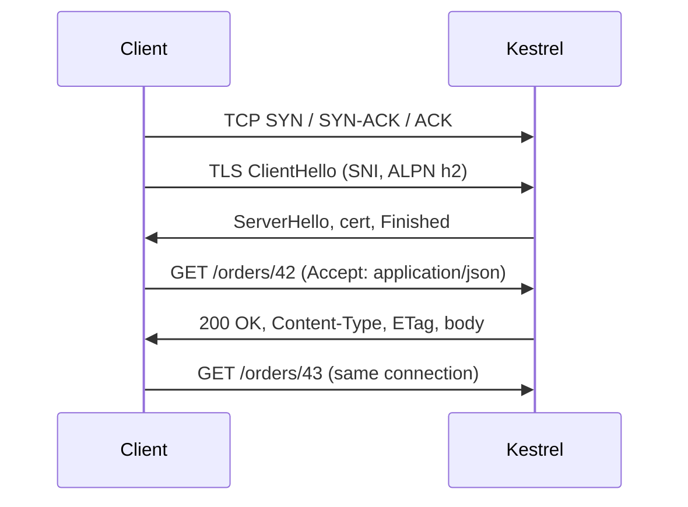

# A request end to end, methods, status codes, headers
[← Overview](00-overview.md)

## Why it matters
- A mobile client retries a timed-out `POST /orders`; the API had already created the order. The customer is charged twice.
- An endpoint returns `200 { "error": "not found" }`; monitoring sees zero errors during an outage.
- p99 latency is 900 ms, but the handler takes 40 ms. The rest is a new TLS handshake per request because a client disposes `HttpClient` every call.

## Concepts

### What happens on a request
| Step | Typical cost | What can go wrong |
|:--|:--|:--|
| DNS lookup | 0–100 ms (cached: ~0) | stale records, slow resolvers |
| TCP handshake | 1 RTT | packet loss, SYN floods |
| TLS 1.3 handshake | 1 RTT (0 on resumption) | expired cert, wrong SNI |
| Request sent, server works | your code | thread-pool starvation, slow DB |
| Response transfer | size / bandwidth | big JSON, no compression |

Connection reuse (keep-alive, HTTP/2 multiplexing) removes the first three steps for later requests. In .NET, reuse comes from long-lived `HttpClient` instances (`IHttpClientFactory`, see 03-backend/08-reliability).



### Methods: safety and idempotency
| Method | Safe | Idempotent | Typical use |
|:--|:--|:--|:--|
| GET, HEAD | ✓ | ✓ | read |
| OPTIONS | ✓ | ✓ | CORS preflight |
| PUT | ✗ | ✓ | replace a resource at a known URL |
| DELETE | ✗ | ✓ | delete |
| POST | ✗ | ✗ | create, actions; make it safe to retry with an `Idempotency-Key` |
| PATCH | ✗ | ✗ (can be made so) | partial update |

Safe = no state change the client asked for. Idempotent = doing it twice has the same effect as once. Retries, proxies, and browsers rely on these.

### Status codes people get wrong
| Code | Meaning | ASP.NET Core |
|:--|:--|:--|
| 200 | OK with body | `TypedResults.Ok(dto)` |
| 201 | created; include `Location` | `TypedResults.Created($"/orders/{id}", dto)` |
| 202 | accepted, processing later | `TypedResults.Accepted(statusUrl)` |
| 204 | success, no body | `TypedResults.NoContent()` |
| 400 | malformed request | `TypedResults.BadRequest()` / validation problem |
| 401 | not authenticated | `TypedResults.Unauthorized()` / auth middleware |
| 403 | authenticated, not allowed | `TypedResults.Forbid()` |
| 404 | not found (or hidden) | `TypedResults.NotFound()` |
| 409 | conflicts with current state | `TypedResults.Conflict()` |
| 412 | `If-Match` precondition failed | `TypedResults.StatusCode(412)` |
| 422 | well-formed but invalid | `TypedResults.UnprocessableEntity()` |
| 429 | rate limited; send `Retry-After` | rate limiting middleware |
| 500 | bug | exception handler |
| 502 / 503 / 504 | bad upstream / unavailable / upstream timeout | usually the proxy |

Errors use Problem Details (RFC 9457) everywhere: `builder.Services.AddProblemDetails()`.

### Headers that matter
| Header | Direction | Note |
|:--|:--|:--|
| `Content-Type` | both | `application/json; charset=utf-8`, `application/problem+json` |
| `Accept` | request | what the client can read |
| `Authorization` | request | `Bearer <token>`; never log it |
| `Location` | response | with 201, 202, 3xx |
| `Retry-After` | response | with 429 and 503 |
| `Cache-Control`, `ETag` | response | lesson 04 |
| `traceparent` | both | W3C trace context, set by .NET automatically |
| `X-Forwarded-For`, `X-Forwarded-Proto` | request | lesson 05 |

## Example
`src/Shop.Api/Program.cs`
```csharp
using Microsoft.AspNetCore.Http.HttpResults;

var builder = WebApplication.CreateBuilder(args);
builder.Services.AddProblemDetails();
var app = builder.Build();

app.UseExceptionHandler();
app.UseStatusCodePages();

var orders = new Dictionary<int, Order>();

app.MapGet("/orders/{id:int}", Results<Ok<Order>, NotFound> (int id) =>
    orders.TryGetValue(id, out var o) ? TypedResults.Ok(o) : TypedResults.NotFound());

app.MapPost("/orders", (CreateOrder req) =>
{
    var order = new Order(orders.Count + 1, req.Sku, req.Quantity);
    orders[order.Id] = order;
    return TypedResults.Created($"/orders/{order.Id}", order);
});

app.Run();

record CreateOrder(string Sku, int Quantity);
record Order(int Id, string Sku, int Quantity);
```
`terminal`
```bash
curl -i -X POST localhost:5000/orders -H 'Content-Type: application/json' -d '{"sku":"COF-1","quantity":2}'
# HTTP/1.1 201 Created
# Location: /orders/1
curl -i localhost:5000/orders/99
# HTTP/1.1 404 Not Found
# Content-Type: application/problem+json
```

## Production patterns
- Return the most specific status code; monitoring, retries, and clients depend on it.
- `TypedResults` + `Results<T1, T2>` make the possible responses part of the signature, and OpenAPI picks them up.
- Make POSTs retry-safe with idempotency keys (03-backend/02-api-design).
- Reuse connections: one `HttpClient` per downstream via `IHttpClientFactory`, never `new HttpClient()` per call.

## Mistakes
Wrong: errors hidden in a 200.
```csharp
return Results.Ok(new { error = "not found" });
```
Right:
```csharp
return TypedResults.NotFound();
```

Wrong: 401 when the user is logged in but lacks the role.
Right: 403 (`TypedResults.Forbid()`); 401 means "authenticate first".

## Check yourself
1. Why is PUT idempotent but POST is not?
2. Which header must accompany a 201?
3. A request takes 40 ms on the server and 300 ms for the client. Name two network causes.

<details><summary>Answers</summary>

1. PUT sets the resource at a known URL to the given state; repeating it leaves the same state. POST asks the server to create or act, which can happen again on each call.
2. `Location`, pointing to the new resource.
3. No connection reuse (new TCP + TLS handshake each time), DNS latency, a large uncompressed body, or a distant region.
</details>

## Sources
- [RFC 9110 — Methods and status codes](https://www.rfc-editor.org/rfc/rfc9110)
- [RFC 9457 — Problem Details](https://www.rfc-editor.org/rfc/rfc9457)
- [Minimal APIs — Create responses](https://learn.microsoft.com/aspnet/core/fundamentals/minimal-apis/responses)
- [MDN — HTTP overview](https://developer.mozilla.org/docs/Web/HTTP/Overview)
