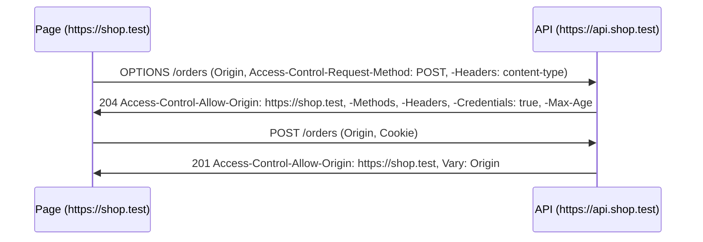

# Cookies and CORS in ASP.NET Core
[← Overview](00-overview.md)

## Why it matters
- The session cookie has no `HttpOnly`; one XSS bug in the frontend lets an attacker read it and take over accounts.
- The API moves from `api.shop.test` to `shop.test/api`; the CORS policy still allows the old origin and every request from the Next.js app fails.
- `AllowAnyOrigin()` plus credentials: ASP.NET Core refuses to start the policy, so someone "fixes" it by reflecting any `Origin` header. Now any website can call the API with the user's cookies.

## Concepts

### Cookie attributes
| Attribute | Effect | Default to use |
|:--|:--|:--|
| `HttpOnly` | JavaScript can't read it | on for session/auth cookies |
| `Secure` | sent only over HTTPS | always on |
| `SameSite=Lax` | not sent on cross-site subrequests (POST from another site) | default for auth cookies |
| `SameSite=Strict` | not even on top-level cross-site navigation | sensitive admin apps |
| `SameSite=None` | always sent (requires `Secure`) | only for real cross-site embeds |
| `Path=/` | which paths receive it | `/` |
| `Domain` | share with subdomains | omit (host-only) |
| `Max-Age` / `Expires` | persistence | session cookie if omitted |
| `__Host-` prefix | browser enforces `Secure`, `Path=/`, no `Domain` | ⭐ for session cookies |

"Same-site" means same registrable domain (`app.shop.com` and `api.shop.com` are same-site). "Same-origin" also requires the same scheme, host, and port. CORS is about origins; `SameSite` is about sites.

### Setting cookies in ASP.NET Core
```csharp
ctx.Response.Cookies.Append("__Host-prefs", "theme=dark", new CookieOptions
{
    HttpOnly = true,
    Secure = true,
    SameSite = SameSiteMode.Lax,
    Path = "/",
    MaxAge = TimeSpan.FromDays(30),
    IsEssential = true,
});
```
The cookie authentication handler (03-backend/04-auth) sets its own cookie; configure it through `CookieAuthenticationOptions.Cookie` with the same rules.

### CORS in one picture
CORS lets a browser page on origin A read responses from origin B. The server decides; the browser enforces. Non-browser clients ignore it, so CORS is **not** an authorization mechanism.


| Request kind | Preflight? |
|:--|:--|
| GET/HEAD/POST with only simple headers and `text/plain`, form types | no |
| JSON body (`application/json`), `Authorization` header, PUT/PATCH/DELETE | yes |

### CORS policies in ASP.NET Core
```csharp
builder.Services.AddCors(o => o.AddPolicy("web", p => p
    .WithOrigins(builder.Configuration.GetSection("Cors:Origins").Get<string[]>()!)
    .WithMethods("GET", "POST", "PUT", "DELETE")
    .WithHeaders("Content-Type", "Authorization", "Idempotency-Key")
    .AllowCredentials()
    .SetPreflightMaxAge(TimeSpan.FromMinutes(10))));

app.UseCors("web");          // before authentication, authorization, and endpoints
```
- `AllowAnyOrigin()` and `AllowCredentials()` together are rejected by design.
- The middleware adds `Vary: Origin` so caches don't mix responses.
- Per endpoint: `.RequireCors("web")` or `[EnableCors("web")]` / `[DisableCors]`.
- `WithExposedHeaders("Location", "ETag")` if the frontend must read those headers.

### Does the Next.js frontend even need CORS?
| Setup | CORS needed? |
|:--|:--|
| Next.js server components call the API server-to-server | no (not a browser) |
| Browser calls `https://api.shop.test` directly | yes, with credentials if cookies |
| Browser calls `/api/*` on the same origin, proxied to ASP.NET Core | no; often the simplest choice |

## Example
`src/Shop.Api/Program.cs`
```csharp
var builder = WebApplication.CreateBuilder(args);

builder.Services.AddCors(o => o.AddPolicy("web", p => p
    .WithOrigins("https://localhost:3000")
    .WithMethods("GET", "POST")
    .WithHeaders("Content-Type")
    .AllowCredentials()));

var app = builder.Build();
app.UseCors("web");

app.MapPost("/prefs", (HttpContext ctx) =>
{
    ctx.Response.Cookies.Append("__Host-prefs", "dark", new CookieOptions
    {
        HttpOnly = true, Secure = true, SameSite = SameSiteMode.Lax, Path = "/",
    });
    return TypedResults.NoContent();
});

app.Run();
```
`terminal`
```bash
curl -si -X OPTIONS https://localhost:7043/prefs -k \
  -H 'Origin: https://localhost:3000' \
  -H 'Access-Control-Request-Method: POST' \
  -H 'Access-Control-Request-Headers: content-type' | grep -i access-control
```

## Production patterns
- Origins come from configuration per environment, never `*` for credentialed APIs.
- Prefer a same-origin setup (Next.js rewrites `/api` to the API) to avoid CORS and third-party-cookie issues entirely.
- `__Host-` prefix + `HttpOnly` + `Secure` + `SameSite=Lax` for every session cookie.
- Pair `SameSite` with antiforgery or `Origin` checks for state-changing requests (01-foundations/06-security).

## Mistakes
Wrong: reflect whatever origin arrives.
```csharp
p.SetIsOriginAllowed(_ => true).AllowCredentials();
```
Right: an explicit allowlist from configuration.
```csharp
p.WithOrigins(allowedOrigins).AllowCredentials();
```

Wrong: `UseCors()` after `MapControllers()` / after authorization, so preflights get 401.
Right: `app.UseCors("web")` before `UseAuthentication()` and `UseAuthorization()`.

## Check yourself
1. Are `https://app.shop.com` and `https://api.shop.com` the same site? The same origin?
2. Why doesn't CORS protect an API from a script running on a server?
3. Which request triggers a preflight: `GET` with `Accept: application/json`, or `POST` with `Content-Type: application/json`?

<details><summary>Answers</summary>

1. Same site (same registrable domain), different origins (different hosts).
2. CORS is enforced by browsers. Other clients don't send preflights and ignore the response headers.
3. The JSON `POST`. `Accept` is a simple header; `application/json` as `Content-Type` is not.
</details>

## Sources
- [Enable CORS in ASP.NET Core](https://learn.microsoft.com/aspnet/core/security/cors)
- [MDN — CORS](https://developer.mozilla.org/docs/Web/HTTP/CORS)
- [MDN — Set-Cookie](https://developer.mozilla.org/docs/Web/HTTP/Headers/Set-Cookie)
- [RFC 6265bis — Cookies](https://datatracker.ietf.org/doc/draft-ietf-httpbis-rfc6265bis/)
- [web.dev — SameSite cookies explained](https://web.dev/articles/samesite-cookies-explained)
