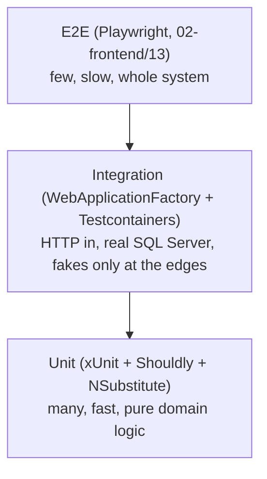

# Testing — Overview
[← Topic](../README.md)

**TECH:** xUnit v3 · Shouldly · NSubstitute · `FakeTimeProvider` · WebApplicationFactory · Testcontainers for .NET (SQL Server 2025) · Microsoft.Testing.Platform
**LEVEL:** intermediate (mid-level, new to C# and .NET)

## Why this matters in production
- Tests are what let you change code on a Friday: refactors, package upgrades, and .NET version bumps become boring.
- Integration tests against a real SQL Server catch the bugs unit tests can't: wrong migrations, missing indexes, LINQ that EF Core can't translate.
- A slow or flaky suite gets ignored; then it stops protecting anything.
- FluentAssertions 8+ needs a paid licence for commercial use, which is why this stack uses Shouldly.

## Mental model
Test the behavior at the cheapest level that can catch the bug.

For an ASP.NET Core API, the middle layer gives the most value per test: one HTTP request runs routing, validation, auth, EF Core, and SQL.

## Prerequisites
- .NET 10 SDK; Docker Desktop with WSL2 running (Testcontainers needs it).
- [02-http-networking](../../02-http-networking/README.md) lesson 01 (status codes).
- xUnit v3 template: `dotnet new install xunit.v3.templates`.

## Lesson map
| Lesson | Checklist items |
|:--|:--|
| [01 · Why we test, good tests, and xUnit v3 basics](01-why-good-tests-xunit.md) | 1, 2, 3, 15 |
| [02 · Test doubles with NSubstitute and TimeProvider](02-test-doubles.md) | 4, 5 |
| [03 · Async code, errors, edge cases, and test data](03-async-errors-data.md) | 6, 9 |
| [04 · Integration tests: WebApplicationFactory and Testcontainers](04-integration-tests.md) | 7, 8, 14 |
| [05 · Coverage, flaky tests, TDD, legacy code, and CI](05-coverage-flaky-tdd-ci.md) | 10, 11, 12, 13 |
| [Cheatsheet](cheatsheet.md) | all |

## Suggested order
1. 01 → 05. Lesson 04 is the core of backend testing in this stack.
2. Then [05-code-quality](../../05-code-quality/README.md) and [04-ci-cd](../../04-ci-cd/README.md) to run all of it on every PR.
3. Ready to build: `/learn csharp/01-foundations/03-testing mode=tasks`.

## Version notes
- xUnit v3 (3.x) test projects are executables. `IAsyncLifetime` now returns `ValueTask`; `TestContext.Current` gives the cancellation token and output helper; assembly fixtures and dynamic skips (`Assert.Skip`) are new. 4.0 is in prerelease.
- xUnit v3 supports both VSTest and Microsoft.Testing.Platform (MTP). On the .NET 10 SDK, `global.json` can switch `dotnet test` to MTP.
- ASP.NET Core 10 generates `public partial class Program` for top-level-statement apps, so `WebApplicationFactory<Program>` works without adding it by hand.
- Testcontainers.MsSql 4.14; use the `mcr.microsoft.com/mssql/server:2025-latest` image to match production.
- FluentAssertions 8+ is commercial (also seen; 7.x stays Apache 2.0). Moq is also seen; this stack uses NSubstitute.

## Sources
- [xUnit.net v3 — What's new](https://xunit.net/docs/getting-started/v3/whats-new)
- [Integration tests in ASP.NET Core](https://learn.microsoft.com/aspnet/core/test/integration-tests)
- [Testcontainers for .NET — MSSQL module](https://dotnet.testcontainers.org/modules/mssql/)
- [Microsoft.Testing.Platform overview](https://learn.microsoft.com/dotnet/core/testing/microsoft-testing-platform-intro)
- [Shouldly](https://docs.shouldly.org/) · [NSubstitute](https://nsubstitute.github.io/)
