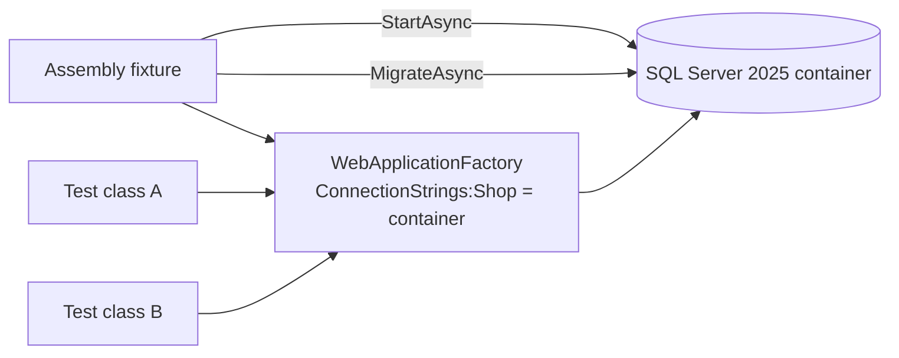

# Integration tests: WebApplicationFactory and Testcontainers
[← Overview](00-overview.md)

## Why it matters
- Unit tests pass, but the endpoint returns 500 in staging: a missing DI registration, wrong middleware order, or a LINQ query EF Core can't translate.
- Tests use EF Core's in-memory provider; it ignores constraints and transactions, so a unique-index violation only shows up in production.
- Every test class starts its own SQL Server container; the suite takes 9 minutes and runs out of memory in CI.

## Concepts

### WebApplicationFactory
`WebApplicationFactory<Program>` boots the real app in memory (TestServer): real `Program.cs`, DI, middleware, routing, auth, and serialization. You get an `HttpClient` that talks to it without a network port.

| Hook | Use |
|:--|:--|
| `builder.UseEnvironment("Testing")` | environment-specific config |
| `builder.UseSetting("ConnectionStrings:Shop", cs)` | override configuration |
| `builder.ConfigureTestServices(s => …)` | replace services after the app registered them |
| `factory.CreateClient()` | `HttpClient` with base address and cookies |
| `factory.Services.CreateScope()` | resolve `DbContext` to arrange/assert data |
| `WithWebHostBuilder(...)` | a variant of the factory for one test |

In .NET 10, a source generator emits `public partial class Program` for top-level-statement apps, so `Program` is visible to the test project.

### Testcontainers for SQL Server
Start a real SQL Server 2025 container from the test, get its connection string, dispose it at the end.
```csharp
var sql = new MsSqlBuilder()
    .WithImage("mcr.microsoft.com/mssql/server:2025-latest")
    .Build();
await sql.StartAsync();
var cs = sql.GetConnectionString();
```
Needs Docker running. The SQL Server image is big (~1.5 GB) and takes a few seconds to start, so share one container per test assembly or collection.

### Sharing setup in xUnit v3
| Scope | Mechanism | Lifetime |
|:--|:--|:--|
| per test | constructor / `IAsyncLifetime` on the test class | each test |
| per class | `IClassFixture<T>` | all tests in a class |
| per collection | `[CollectionDefinition]` + `ICollectionFixture<T>` + `[Collection("name")]` | classes in the collection, run serially |
| ⭐ per assembly | `[assembly: AssemblyFixture(typeof(T))]` (v3) | whole test project |

`IAsyncLifetime` in v3: `ValueTask InitializeAsync()` plus `ValueTask DisposeAsync()`.

Parallelism: each test class is its own collection by default; collections run in parallel, tests inside one collection run one after another. Tests sharing a database must either be in one collection or isolate their data.

### Isolating data between tests
| Strategy | How | Trade-off |
|:--|:--|:--|
| unique data per test | new IDs, unique SKUs per test | fast; works with parallel tests |
| transaction per test, rolled back | begin a transaction, run, roll back | the app must use the same connection; awkward over HTTP |
| reset tables between tests | `DELETE` in FK order (or a small reset helper) | simple; tests in one collection |
| database per test class | `CREATE DATABASE shop_<guid>` + migrate | strong isolation; slower |

Apply EF Core migrations once at fixture start: `await db.Database.MigrateAsync()`. That also tests the migrations.



## Example
`tests/Shop.Api.IntegrationTests/ApiFixture.cs`
```csharp
using Microsoft.AspNetCore.Hosting;
using Microsoft.AspNetCore.Mvc.Testing;
using Microsoft.EntityFrameworkCore;
using Microsoft.Extensions.DependencyInjection;
using Shop.Api.Data;
using Testcontainers.MsSql;

[assembly: AssemblyFixture(typeof(Shop.Api.IntegrationTests.ApiFixture))]

namespace Shop.Api.IntegrationTests;

public sealed class ApiFixture : IAsyncLifetime
{
    private readonly MsSqlContainer _sql = new MsSqlBuilder()
        .WithImage("mcr.microsoft.com/mssql/server:2025-latest")
        .Build();

    public WebApplicationFactory<Program> Factory { get; private set; } = null!;

    public async ValueTask InitializeAsync()
    {
        await _sql.StartAsync();
        Factory = new WebApplicationFactory<Program>().WithWebHostBuilder(b =>
        {
            b.UseEnvironment("Testing");
            b.UseSetting("ConnectionStrings:Shop", _sql.GetConnectionString());
        });

        using var scope = Factory.Services.CreateScope();
        await scope.ServiceProvider.GetRequiredService<ShopDb>().Database.MigrateAsync();
    }

    public async ValueTask DisposeAsync()
    {
        await Factory.DisposeAsync();
        await _sql.DisposeAsync();
    }
}
```
`tests/Shop.Api.IntegrationTests/OrdersEndpointTests.cs`
```csharp
using System.Net;
using System.Net.Http.Json;
using Shouldly;

namespace Shop.Api.IntegrationTests;

public class OrdersEndpointTests(ApiFixture api)
{
    private readonly HttpClient _client = api.Factory.CreateClient();

    [Fact]
    public async Task Post_then_get_returns_the_order()
    {
        var ct = TestContext.Current.CancellationToken;
        var sku = $"COF-{Guid.NewGuid():N}"[..12];       // unique data: safe in parallel

        var created = await _client.PostAsJsonAsync("/orders", new { sku, quantity = 2 }, ct);
        created.StatusCode.ShouldBe(HttpStatusCode.Created);

        var fetched = await _client.GetFromJsonAsync<OrderDto>(created.Headers.Location, ct);
        fetched.ShouldNotBeNull();
        fetched.Sku.ShouldBe(sku);
    }

    [Fact]
    public async Task Post_with_zero_quantity_is_a_validation_problem()
    {
        var response = await _client.PostAsJsonAsync("/orders", new { sku = "COF-1", quantity = 0 },
            TestContext.Current.CancellationToken);

        response.StatusCode.ShouldBe(HttpStatusCode.BadRequest);
        response.Content.Headers.ContentType?.MediaType.ShouldBe("application/problem+json");
    }

    private sealed record OrderDto(int Id, string Sku, int Quantity);
}
```

## Production patterns
- One SQL Server container per test assembly; unique data per test so classes still run in parallel.
- Replace only true externals in `ConfigureTestServices` (payments, email, clock); keep EF Core, validation, and auth real.
- Run migrations in the fixture, not `EnsureCreated()`, so the migration path is tested.
- Pin the container image tag to what production runs (SQL Server 2025 ↔ Azure SQL compatibility).

## Mistakes
Wrong: EF Core in-memory provider for "integration" tests.
```csharp
s.AddDbContext<ShopDb>(o => o.UseInMemoryDatabase("test"));   // no SQL, no constraints, no transactions
```
Right: Testcontainers SQL Server with the real provider.

Wrong: a container per test class (`IClassFixture<MsSqlFixture>` on 40 classes).
Right: an assembly fixture (or one collection fixture) and per-test data isolation.

## Check yourself
1. What does `ConfigureTestServices` do that `ConfigureServices` in the test doesn't?
2. Why run `MigrateAsync()` rather than `EnsureCreatedAsync()` in the fixture?
3. Two test classes share a database and both delete all orders before each test. What goes wrong under default xUnit parallelism?

<details><summary>Answers</summary>

1. It runs after the app's own registrations, so your replacements win.
2. `EnsureCreated` builds the schema from the model and skips migrations; `Migrate` runs the same migrations production will.
3. The classes run in parallel, so one class deletes the other's data mid-test. Put them in one collection, or use unique data instead of deleting.
</details>

## Sources
- [Integration tests in ASP.NET Core](https://learn.microsoft.com/aspnet/core/test/integration-tests)
- [Testcontainers for .NET — MSSQL](https://dotnet.testcontainers.org/modules/mssql/)
- [xUnit.net — Shared context (fixtures)](https://xunit.net/docs/shared-context)
- [xUnit.net v3 — Assembly fixtures](https://xunit.net/docs/getting-started/v3/whats-new)
- [EF Core — Testing against your production database system](https://learn.microsoft.com/ef/core/testing/testing-with-the-database)
