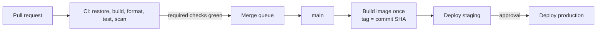

# CI/CD — Overview
[← Topic](../README.md)

**TECH:** GitHub Actions for a repo with a .NET 10 solution (`api/`) and a pnpm Next.js app (`web/`), Docker Buildx, OIDC to Azure; reading Azure Pipelines YAML
**LEVEL:** intermediate (mid-level, new to C# and .NET)

## Why this matters in production
- CI is the gate that keeps `main` releasable: build, format, tests, and security scans on every PR.
- A slow pipeline (20+ minutes) makes people batch changes, which makes every change riskier.
- Workflows run with access to secrets and cloud credentials. A careless `pull_request_target` or a script injection is a supply-chain incident.
- Many .NET employers run Azure Pipelines. You should be able to read one and map it to Actions.

## Mental model

CI answers "is this change safe to merge?". CD answers "how does the merged commit reach users?". The same image moves through every environment.

## Prerequisites
- [01-git](../../01-git/README.md) (rulesets, required checks), [03-testing](../../03-testing/README.md) (what the pipeline runs).
- A GitHub repo with Actions enabled. For lesson 04, an Azure subscription (free tier is fine).

## Lesson map
| Lesson | Checklist items |
|:--|:--|
| [01 · Pipelines and GitHub Actions anatomy](01-pipelines-actions-anatomy.md) | 1, 2 |
| [02 · A fast PR pipeline for .NET and pnpm](02-fast-pr-pipeline.md) | 3, 4, 5, 13 |
| [03 · Matrix builds, reuse, and required checks](03-matrix-reuse-required-checks.md) | 6, 10, 11 |
| [04 · Secrets, OIDC to Azure, and hardened workflows](04-secrets-oidc-hardening.md) | 7, 8 |
| [05 · Images, environments, promotion, and Azure Pipelines](05-images-environments-azure-pipelines.md) | 9, 12, 14 |
| [Cheatsheet](cheatsheet.md) | all |

## Suggested order
1. 01 → 05.
2. Deployments in depth come later in [04-shipping/04-deployments](../../../04-shipping/04-deployments/README.md).
3. Ready to build: `/learn csharp/01-foundations/04-ci-cd mode=tasks`.

## Version notes
- `actions/checkout@v5` and `actions/setup-dotnet@v5` run on Node 24. `setup-dotnet` reads `global.json` and can cache NuGet packages when lock files exist.
- .NET 10 SDK: `dotnet test` can run on Microsoft.Testing.Platform (opt-in via `global.json`), and NuGet audits transitive packages by default (`NuGetAuditMode=all` for `net10.0`).
- `merge_group` is the trigger for merge queue runs; required checks must run on it too.
- Azure login from Actions uses OIDC (workload identity federation) with `azure/login@v2`; no client secrets.

## Sources
- [GitHub Actions documentation](https://docs.github.com/en/actions)
- [actions/setup-dotnet](https://github.com/actions/setup-dotnet)
- [Security hardening for GitHub Actions](https://docs.github.com/en/actions/security-for-github-actions/security-guides/security-hardening-for-github-actions)
- [Use GitHub Actions to connect to Azure (OIDC)](https://learn.microsoft.com/azure/developer/github/connect-from-azure-openid-connect)
- [Azure Pipelines YAML schema](https://learn.microsoft.com/azure/devops/pipelines/yaml-schema/)
