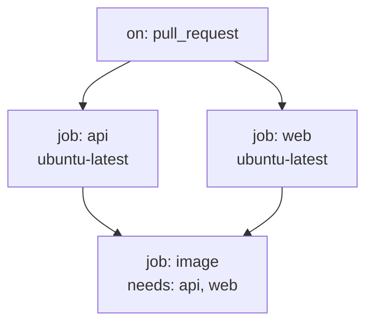

# Pipelines and GitHub Actions anatomy
[← Overview](00-overview.md)

## Why it matters
- "It works on my machine" ships a build that only compiles with a preview SDK installed locally. CI on a clean runner would have caught it.
- A team calls their manual Friday release "continuous delivery"; every release is a 3-hour event with a checklist.
- A workflow triggered on `push` to every branch and every tag runs 4× more than needed and burns the Actions budget.

## Concepts

### CI, continuous delivery, continuous deployment
| Practice | Means | Gate to production |
|:--|:--|:--|
| Continuous integration | merge small changes to `main` often; each is built and tested automatically | — |
| Continuous delivery | every green `main` commit **can** be released by pressing a button | human approval |
| Continuous deployment | every green `main` commit **is** released automatically | automated checks only |

A pipeline exists to give fast, trustworthy feedback and a repeatable path to production. If people bypass it, it has failed.

### Anatomy of a workflow
| Part | What it is | Example |
|:--|:--|:--|
| workflow | YAML file in `.github/workflows/` | `ci.yml` |
| trigger (`on`) | events that start it | `pull_request`, `push`, `merge_group`, `workflow_dispatch`, `schedule` |
| job | set of steps on one runner; jobs run in parallel unless `needs` | `build-api` |
| runner | VM or container that runs a job | `ubuntu-latest`, `windows-latest`, self-hosted |
| step | a shell command (`run`) or an action (`uses`) | `dotnet test` |
| action | reusable unit (JS, Docker, composite) | `actions/setup-dotnet@v5` |
| contexts | data available in expressions | `${{ github.sha }}`, `${{ runner.os }}` |
| artifacts | files passed between jobs or kept after the run | test results, publish output |
| outputs | small values passed between steps/jobs | image tag |



### Triggers worth knowing
| Trigger | Use |
|:--|:--|
| `pull_request` (types: opened, synchronize, reopened) | ⭐ CI for PRs; runs with read-only token for forks |
| `push: branches: [main]` | post-merge build and deploy |
| `merge_group` | ⭐ merge queue runs |
| `workflow_dispatch` | manual run with inputs |
| `schedule: - cron: '0 3 * * 1'` | nightly/weekly scans |
| `push: tags: ['v*']` | releases |
| `paths` / `paths-ignore` | skip unrelated changes (careful with required checks) |
| `pull_request_target` | runs with base-repo secrets; dangerous with untrusted code (lesson 04) |

### Expressions and conditions
```yaml
if: github.event_name == 'push' && github.ref == 'refs/heads/main'
run: echo "sha=${{ github.sha }}"
```
Default shell on Linux runners is `bash -e` (fails on first error). Use `shell: pwsh` for PowerShell steps on any OS.

## Example
`.github/workflows/ci.yml`
```yaml
name: ci

on:
  pull_request:
  merge_group:
  push:
    branches: [main]

permissions:
  contents: read

jobs:
  api:
    runs-on: ubuntu-latest
    steps:
      - uses: actions/checkout@v5
      - uses: actions/setup-dotnet@v5
        with:
          global-json-file: global.json
      - run: dotnet build -c Release
      - run: dotnet test -c Release --no-build

  web:
    runs-on: ubuntu-latest
    defaults:
      run:
        working-directory: web
    steps:
      - uses: actions/checkout@v5
      - uses: pnpm/action-setup@v4
      - uses: actions/setup-node@v5
        with:
          node-version: 24
          cache: pnpm
          cache-dependency-path: web/pnpm-lock.yaml
      - run: pnpm install --frozen-lockfile
      - run: pnpm build
```

## Production patterns
- One CI workflow with clearly named jobs; job names become the required checks.
- Trigger on `pull_request`, `merge_group`, and `push` to `main`. Avoid `push` on all branches (duplicate runs with PRs).
- Set `permissions: contents: read` at the top; grant more per job only when needed.
- Keep build logic in scripts or `dotnet`/`pnpm` commands that also run locally; YAML should orchestrate, not contain logic.

## Mistakes
Wrong: no trigger for merge queue.
```yaml
on: [pull_request]
```
Right: required checks also need `merge_group`, or queued PRs wait forever.
```yaml
on:
  pull_request:
  merge_group:
```

Wrong: relying on whatever SDK the runner image has.
Right: `setup-dotnet` with `global-json-file: global.json`, so CI and laptops use the same SDK.

## Check yourself
1. What is the difference between continuous delivery and continuous deployment?
2. Two jobs in one workflow: do they run in sequence or in parallel by default?
3. Why should required checks run on `merge_group`?

<details><summary>Answers</summary>

1. Delivery: every green commit is releasable, a human decides when. Deployment: every green commit is released automatically.
2. In parallel, unless one declares `needs` on the other.
3. The merge queue creates a temporary branch and waits for required checks on it; if they never run there, the PR never merges.
</details>

## Sources
- [Understanding GitHub Actions](https://docs.github.com/en/actions/get-started/understand-github-actions)
- [Events that trigger workflows](https://docs.github.com/en/actions/reference/workflows-and-actions/events-that-trigger-workflows)
- [Workflow syntax](https://docs.github.com/en/actions/reference/workflows-and-actions/workflow-syntax)
- [Martin Fowler — Continuous Integration](https://martinfowler.com/articles/continuousIntegration.html)
