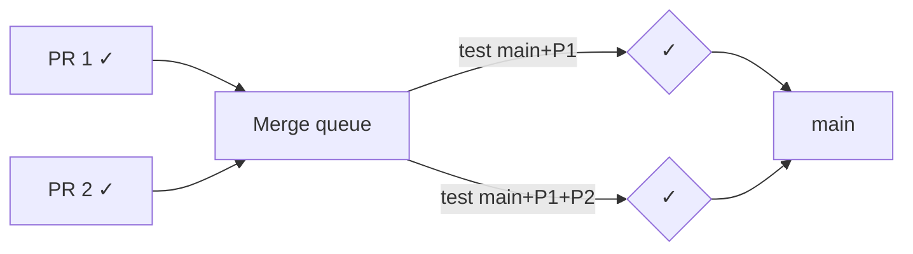

# Matrix builds, reuse, and required checks
[← Overview](00-overview.md)

## Why it matters
- Five repos copy the same 120-line .NET CI workflow; a security fix has to be made five times and two copies are forgotten.
- A required check is renamed in YAML; GitHub waits forever for the old name and nobody can merge.
- PRs are green individually but `main` breaks when two of them merge within a minute of each other.

## Concepts

### Matrix builds
Run one job definition over several combinations.
```yaml
strategy:
  fail-fast: false
  matrix:
    os: [ubuntu-latest, windows-latest]
    project: [Shop.Domain.Tests, Shop.Api.Tests]
runs-on: ${{ matrix.os }}
```
| Option | Use |
|:--|:--|
| `include` / `exclude` | add or remove combinations |
| `fail-fast: false` | see all failures, not just the first |
| `max-parallel` | limit concurrency |
| matrix for test sharding | split slow test projects across runners |

For a web API deployed to Linux containers, one OS is usually enough. Matrix the things you actually ship: OS for a library or CLI, test shards for speed.

### Job dependencies and concurrency
| Feature | Example |
|:--|:--|
| `needs: [api, web]` | run after both succeed |
| `if: always()` / `if: failure()` | run even if dependencies failed (reports, notifications) |
| job outputs | `outputs: tag: ${{ steps.meta.outputs.tag }}` then `needs.build.outputs.tag` |
| workflow `concurrency` | one deploy per environment at a time |

```yaml
concurrency:
  group: deploy-production
  cancel-in-progress: false     # queue deploys, never cancel one halfway
```

### Reuse: reusable workflows vs composite actions
| | Reusable workflow | Composite action |
|:--|:--|:--|
| file | `.github/workflows/dotnet-ci.yml` with `on: workflow_call` | `.github/actions/setup-dotnet-env/action.yml` |
| contains | whole jobs (own runners, permissions, secrets) | steps inside a caller's job |
| called with | `jobs.x.uses: ./.github/workflows/dotnet-ci.yml` | `steps: - uses: ./.github/actions/setup-dotnet-env` |
| inputs/secrets | `inputs`, `secrets` (or `secrets: inherit`) | `inputs` only |
| good for | the standard CI/CD pipeline shared across repos | repeated setup steps (toolchain + cache) |

Cross-repo: `uses: my-org/platform/.github/workflows/dotnet-ci.yml@<sha>`.

### Required checks and merge queue
- Ruleset on `main` → "Require status checks to pass" → choose job names (`ci / api`, `ci / web`).
- Check names come from the **job name**; renaming a job requires updating the ruleset.
- Skipped jobs (`if:` false) count as passing; jobs that never start (filtered out by `paths`) block. Avoid `paths` filters on required workflows, or use a small "gate" job that always runs.
- Merge queue: PRs are tested in order against `main` + the PRs ahead of them, then merged. Workflows need `on: merge_group`.



## Example
`.github/actions/setup-dotnet-env/action.yml`
```yaml
name: setup-dotnet-env
description: .NET SDK from global.json with NuGet cache
runs:
  using: composite
  steps:
    - uses: actions/setup-dotnet@v5
      with:
        global-json-file: global.json
        cache: true
        cache-dependency-path: '**/packages.lock.json'
    - run: dotnet restore --locked-mode
      shell: bash
```
`.github/workflows/dotnet-ci.yml`
```yaml
name: dotnet-ci
on:
  workflow_call:
    inputs:
      test-filter:
        type: string
        default: ''
permissions:
  contents: read
jobs:
  build-test:
    runs-on: ubuntu-latest
    timeout-minutes: 15
    steps:
      - uses: actions/checkout@v5
      - uses: ./.github/actions/setup-dotnet-env
      - run: dotnet build --no-restore -c Release
      - run: dotnet test --no-build -c Release ${FILTER:+--filter "$FILTER"}
        env:
          FILTER: ${{ inputs.test-filter }}     # via env, never `${{ }}` inside the script (lesson 04)
```
`.github/workflows/ci.yml`
```yaml
name: ci
on: { pull_request: {}, merge_group: {}, push: { branches: [main] } }
permissions:
  contents: read
jobs:
  api:
    uses: ./.github/workflows/dotnet-ci.yml
    with:
      test-filter: Category!=Integration
  gate:
    if: always()
    needs: [api]
    runs-on: ubuntu-latest
    steps:
      - run: test "${{ needs.api.result }}" = "success"
```
Make `gate` the single required check; add jobs behind it without touching the ruleset.

## Production patterns
- A single "gate" job as the required check keeps rulesets stable as the pipeline grows.
- Shared pipelines live in one platform repo as reusable workflows, referenced by SHA or tag.
- Composite actions for setup; reusable workflows for full jobs.
- Turn on the merge queue once `main` breaks from "green + green = red" merges.

## Mistakes
Wrong: `paths` filter on a required workflow.
```yaml
on:
  pull_request:
    paths: ['api/**']      # PRs touching only web/ never get the check → blocked
```
Right: always run the workflow and skip inside it, or use a gate job.

Wrong: cancelling production deploys with `cancel-in-progress: true`.
Right: `cancel-in-progress: false` for deploy concurrency groups.

## Check yourself
1. When would you pick a composite action over a reusable workflow?
2. What happens to a required check if its job is skipped with `if: false`?
3. What does the merge queue test that a normal PR check does not?

<details><summary>Answers</summary>

1. When you need to share steps inside the caller's job (same runner, same workspace), like toolchain setup.
2. A skipped job reports success, so it does not block. A job that never runs at all does block.
3. The PR combined with the latest `main` and the PRs queued ahead of it.
</details>

## Sources
- [Using a matrix for your jobs](https://docs.github.com/en/actions/how-tos/write-workflows/choose-what-workflows-do/run-job-variations)
- [Reusing workflows](https://docs.github.com/en/actions/how-tos/reuse-automations/reuse-workflows)
- [Creating a composite action](https://docs.github.com/en/actions/tutorials/create-actions/create-a-composite-action)
- [Managing a merge queue](https://docs.github.com/en/repositories/configuring-branches-and-merges-in-your-repository/configuring-pull-request-merges/managing-a-merge-queue)
