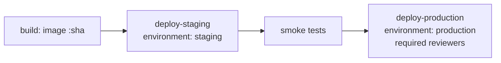

# Images, environments, promotion, and Azure Pipelines
[← Overview](00-overview.md)

## Why it matters
- Staging and production each build their own image from `main`. A base-image update lands between the two builds; production runs code nobody tested.
- Images are tagged `latest`; a rollback "redeploys latest" and gets the broken version again.
- You join a .NET team whose pipelines are all `azure-pipelines.yml`. You need to change a deploy step on day two.

## Concepts

### Build once, tag immutably, promote
| Practice | How |
|:--|:--|
| ⭐ build once per commit | one job on `main` builds and pushes the image |
| ⭐ immutable tags | `shop-api:<git-sha>` (plus `:1.4.0` on release tags); never deploy `latest` |
| deploy by digest | `shop-api@sha256:…` is exactly what was tested |
| layer cache | Buildx with `cache-from/to: type=gha` |
| provenance and SBOM | `provenance: mode=max`, `sbom: true`; also `actions/attest-build-provenance` |
| scan before deploy | Trivy / Defender for Containers on the pushed image |

Two ways to build .NET images: a Dockerfile (04-shipping/01-containers) or `dotnet publish /t:PublishContainer` straight to a registry. Both are fine; pick one per repo.

### Environments, approvals, promotion
GitHub **environments** (`staging`, `production`) give each deploy job:
- protection rules: required reviewers, wait timer, allowed branches/tags;
- environment secrets and variables;
- an OIDC subject (`environment:production`) for Azure federation;
- deployment history and the URL of what is running.



### Reading Azure Pipelines YAML
| Azure Pipelines | GitHub Actions equivalent |
|:--|:--|
| `trigger:` / `pr:` | `on: push` / `on: pull_request` |
| `pool: vmImage: ubuntu-latest` | `runs-on: ubuntu-latest` |
| `stages:` → `jobs:` → `steps:` | workflows/jobs (`needs` chains) → steps |
| `- task: UseDotNet@2` | `actions/setup-dotnet` |
| `- task: DotNetCoreCLI@2` (`command: test`) | `run: dotnet test` |
| `- script:` / `- pwsh:` / `- bash:` | `run:` (with `shell:`) |
| `variables:` / variable groups | `env:` / `vars` / environment variables |
| `$(Build.SourceVersion)` | `${{ github.sha }}` |
| `template:` (step/job/stage templates) | composite actions / reusable workflows |
| service connection (workload identity federation) | `azure/login` with OIDC |
| `- task: AzureCLI@2` | `azure/login` + `run: az ...` |
| `environment: production` + approvals and checks | GitHub environments + required reviewers |
| `deployment` job with `strategy: runOnce/rolling/canary` | deploy job + your rollout steps |
| `PublishPipelineArtifact` / `DownloadPipelineArtifact` | `actions/upload-artifact` / `download-artifact` |
| `condition: succeeded()` | `if: success()` |

## Example
`.github/workflows/cd.yml`
```yaml
name: cd
on:
  push:
    branches: [main]
permissions:
  contents: read
concurrency:
  group: cd
  cancel-in-progress: false

jobs:
  image:
    runs-on: ubuntu-latest
    environment: build
    permissions: { contents: read, id-token: write }
    outputs:
      image: ${{ steps.ref.outputs.image }}
    steps:
      - uses: actions/checkout@v5
      - uses: azure/login@v2
        with:
          client-id: ${{ vars.AZURE_CLIENT_ID }}
          tenant-id: ${{ vars.AZURE_TENANT_ID }}
          subscription-id: ${{ vars.AZURE_SUBSCRIPTION_ID }}
      - run: az acr login --name "$ACR"
        env: { ACR: '${{ vars.ACR_NAME }}' }
      - uses: docker/setup-buildx-action@v3
      - uses: docker/build-push-action@v6
        with:
          context: .
          file: src/Shop.Api/Dockerfile
          push: true
          tags: ${{ vars.ACR_NAME }}.azurecr.io/shop-api:${{ github.sha }}
          cache-from: type=gha
          cache-to: type=gha,mode=max
          provenance: mode=max
          sbom: true
      - id: ref
        run: echo "image=${{ vars.ACR_NAME }}.azurecr.io/shop-api:${{ github.sha }}" >> "$GITHUB_OUTPUT"

  staging:
    needs: image
    uses: ./.github/workflows/deploy-env.yml
    with: { environment: staging, image: '${{ needs.image.outputs.image }}' }

  production:
    needs: [image, staging]
    uses: ./.github/workflows/deploy-env.yml
    with: { environment: production, image: '${{ needs.image.outputs.image }}' }
```
The same pipeline read in Azure Pipelines:
```yaml
trigger: { branches: { include: [main] } }
pool: { vmImage: ubuntu-latest }
stages:
  - stage: build
    jobs:
      - job: image
        steps:
          - task: UseDotNet@2
            inputs: { useGlobalJson: true }
          - task: AzureCLI@2
            inputs:
              azureSubscription: sc-shop-build        # service connection (workload identity federation)
              scriptType: bash
              scriptLocation: inlineScript
              inlineScript: az acr build -r $(acrName) -t shop-api:$(Build.SourceVersion) -f src/Shop.Api/Dockerfile .
  - stage: production
    dependsOn: build
    jobs:
      - deployment: deploy
        environment: production                   # approvals and checks live on the environment
        strategy:
          runOnce:
            deploy:
              steps:
                - task: AzureCLI@2
                  inputs:
                    azureSubscription: sc-shop-prod
                    scriptType: bash
                    scriptLocation: inlineScript
                    inlineScript: az containerapp update -n ca-shop-api -g rg-shop --image $(acrName).azurecr.io/shop-api:$(Build.SourceVersion)
```

## Production patterns
- Image tag = commit SHA; release tags add a SemVer alias, never replace the SHA tag.
- Staging gets every `main` commit automatically; production needs approval plus green smoke tests.
- `cancel-in-progress: false` and one concurrency group per environment for deploys.
- When reading an Azure Pipelines file, find the service connections and environments first; they hold the permissions and approvals.

## Mistakes
Wrong: rebuilding for each environment.
```yaml
deploy-prod:
  steps: [ { run: docker build -t shop-api:latest . }, ... ]
```
Right: build once, pass the image reference between jobs, deploy that reference everywhere.

Wrong: `:latest` in production manifests.
Right: `:<sha>` or `@sha256:<digest>`.

## Check yourself
1. Why should staging and production deploy the same image digest?
2. What three things does a GitHub environment add to a deploy job?
3. In Azure Pipelines, what replaces the `azure/login` + OIDC setup?

<details><summary>Answers</summary>

1. So production runs exactly what was tested; rebuilding can pull different base layers or packages.
2. Protection rules (approvals, branch restrictions), environment-scoped secrets/variables, and an OIDC subject (plus deployment history).
3. A service connection (ideally using workload identity federation) referenced by `azureSubscription:` in tasks.
</details>

## Sources
- [docker/build-push-action](https://github.com/docker/build-push-action)
- [Cache management with GitHub Actions (Docker)](https://docs.docker.com/build/ci/github-actions/cache/)
- [Managing environments for deployment](https://docs.github.com/en/actions/how-tos/deploy/configure-and-manage-deployments/manage-environments)
- [Azure Pipelines — YAML schema](https://learn.microsoft.com/azure/devops/pipelines/yaml-schema/)
- [Azure Pipelines — Workload identity federation service connections](https://learn.microsoft.com/azure/devops/pipelines/library/connect-to-azure)
- [Migrate from Azure Pipelines to GitHub Actions](https://docs.github.com/en/actions/tutorials/migrate-to-github-actions/manual-migrations/migrate-from-azure-pipelines)
