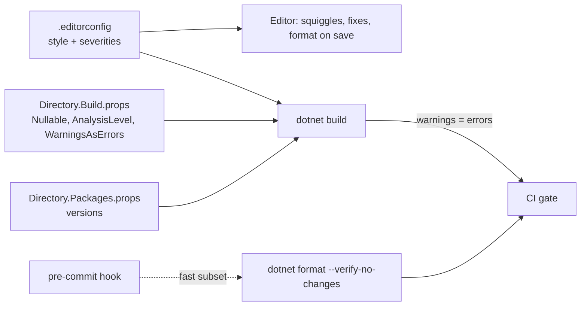

# Code Quality & Tooling — Overview
[← Topic](../README.md)

**TECH:** C# 14 nullable reference types · Roslyn .NET analyzers (`AnalysisLevel`) · `.editorconfig` · `dotnet format` · Central Package Management · `Directory.Build.props` · `.slnx`; ESLint + Prettier stay for `web/`
**LEVEL:** intermediate (mid-level, new to C# and .NET)

## Why this matters in production
- `NullReferenceException` is still the most common .NET crash in production logs. Nullable reference types turn most of them into compile-time warnings.
- Analyzers catch un-awaited tasks, undisposed connections, and culture bugs (`"I".ToLower()` in Turkish) before review.
- Formatting fights in review waste time; one `.editorconfig` and `dotnet format` end them.
- Package versions spread across 12 `.csproj` files drift apart; Central Package Management keeps one list.

## Mental model

The compiler and analyzers are one system: the same rules run in the editor, the build, and CI.

## Prerequisites
- [01-git](../../01-git/README.md) lesson 02 (repo files), [04-ci-cd](../../04-ci-cd/README.md) lesson 02 (CI pipeline).
- VS Code with the C# Dev Kit, or Visual Studio 2026 Community.

## Lesson map
| Lesson | Checklist items |
|:--|:--|
| [01 · Why tooling, and shared build settings](01-why-tooling-build-settings.md) | 1, 13, 14 |
| [02 · Nullable reference types and type-safe boundaries](02-nullable-boundaries.md) | 2, 3 |
| [03 · Roslyn analyzers and the rules that catch real bugs](03-analyzers-real-bugs.md) | 4, 5 |
| [04 · Formatting, editor setup, hooks, and CI gates](04-format-editor-hooks-ci.md) | 6, 7, 8, 9 |
| [05 · Code review, dead code, and tech debt](05-review-deadcode-debt.md) | 10, 11, 12 |
| [Cheatsheet](cheatsheet.md) | all |

## Suggested order
1. 01 → 05. Do lesson 01 before you create the first real project in this stack.
2. Then [06-security](../../06-security/README.md); its scanners plug into the same gates.
3. Ready to build: `/learn csharp/01-foundations/05-code-quality mode=tasks`.

## Version notes
- .NET 10 SDK: `dotnet new sln` creates `.slnx` by default; `dotnet sln migrate` converts old `.sln` files. Noun-first commands (`dotnet package add`, `dotnet package list`, `dotnet reference add`) were added alongside the old forms.
- `AnalysisLevel` follows the SDK; `latest-recommended` turns on the recommended rule set as warnings.
- CSharpier 1.0 changed the CLI to `csharpier format` and `csharpier check`.
- C# 14 adds the `field` keyword and extension members; C# 15 (with .NET 11, Nov 2026) adds union types. This stack stays on C# 14.

## Sources
- [Code analysis in .NET](https://learn.microsoft.com/dotnet/fundamentals/code-analysis/overview)
- [Nullable reference types](https://learn.microsoft.com/dotnet/csharp/nullable-references)
- [dotnet format](https://learn.microsoft.com/dotnet/core/tools/dotnet-format)
- [Central Package Management](https://learn.microsoft.com/nuget/consume-packages/central-package-management)
- [CSharpier](https://csharpier.com/)
