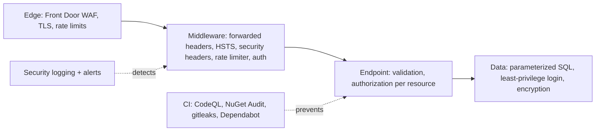

# Security Fundamentals — Overview
[← Topic](../README.md)

**TECH:** ASP.NET Core 10 security building blocks (authorization, antiforgery, rate limiting, HSTS), NetEscapades.AspNetCore.SecurityHeaders, EF Core parameterization, System.Text.Json, NuGet Audit + lock files + package source mapping, Dependabot, CodeQL, gitleaks
**LEVEL:** intermediate (mid-level, new to C# and .NET)

## Why this matters in production
- Broken access control is still the #1 web risk: one missing ownership check exposes every customer's orders.
- .NET is safe by default in many places (parameterized EF Core queries, Razor encoding, no `BinaryFormatter`), and the bugs live exactly where people leave those defaults.
- Supply-chain failures are new at #3 in the OWASP Top 10:2025; most of your code is NuGet and npm packages.
- Security that only exists in a checklist doesn't survive deadlines. It has to be in middleware, analyzers, and CI gates.

## Mental model
Defense in depth: several independent layers, each assuming the one before can fail.

## Prerequisites
- [02-http-networking](../../02-http-networking/README.md) (cookies, CORS, HSTS), [04-ci-cd](../../04-ci-cd/README.md) (workflows), [05-code-quality](../../05-code-quality/README.md) (analyzers).
- Authentication itself is in [03-backend/04-auth](../../../03-backend/04-auth/README.md); this topic covers the cross-cutting basics.

## Lesson map
| Lesson | Checklist items |
|:--|:--|
| [01 · Threat modeling and the OWASP Top 10:2025 for ASP.NET Core](01-threat-modeling-owasp.md) | 1, 2 |
| [02 · Injection, safe deserialization, SSRF, paths, and uploads](02-injection-deserialization-ssrf.md) | 3, 9, 14 |
| [03 · Access control, XSS, and CSRF](03-access-control-xss-csrf.md) | 4, 5, 6 |
| [04 · Security headers and rate limiting](04-headers-rate-limiting.md) | 7, 8 |
| [05 · Secrets, supply chain, CodeQL, and security operations](05-secrets-supply-chain-ops.md) | 10, 11, 12, 13 |
| [Cheatsheet](cheatsheet.md) | all |

## Suggested order
1. 01 → 05.
2. Then [07-config-environments](../../07-config-environments/README.md) (secrets in config) and 03-backend/04-auth and 05-validation-abuse.
3. Ready to build: `/learn csharp/01-foundations/06-security mode=tasks`.

## Version notes
- OWASP Top 10:2025 (final Jan 2026): A01 Broken Access Control (now includes SSRF), A02 Security Misconfiguration, A03 Software Supply Chain Failures (new), A04 Cryptographic Failures, A05 Injection, A06 Insecure Design, A07 Authentication Failures, A08 Software or Data Integrity Failures, A09 Security Logging and Alerting Failures, A10 Mishandling of Exceptional Conditions (new).
- `BinaryFormatter` was removed from .NET 9+ (calls throw). Remaining risk is in third-party serializers with type-name handling.
- .NET 10 projects audit transitive NuGet dependencies by default (`NuGetAuditMode=all`).
- NetEscapades.AspNetCore.SecurityHeaders 1.x configures policies with `AddSecurityHeaderPolicies()`.
- CodeQL analyzes C# without a build (`build-mode: none`), which simplifies setup.

## Sources
- [OWASP Top 10:2025](https://owasp.org/Top10/2025/0x00_2025-Introduction/)
- [ASP.NET Core security overview](https://learn.microsoft.com/aspnet/core/security/)
- [OWASP .NET Security Cheat Sheet](https://cheatsheetseries.owasp.org/cheatsheets/DotNet_Security_Cheat_Sheet.html)
- [NetEscapades.AspNetCore.SecurityHeaders](https://github.com/andrewlock/NetEscapades.AspNetCore.SecurityHeaders)
- [Auditing NuGet packages](https://learn.microsoft.com/nuget/concepts/auditing-packages)
