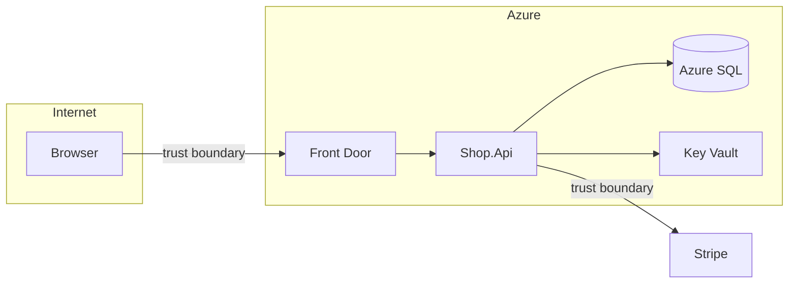

# Threat modeling and the OWASP Top 10:2025 for ASP.NET Core
[← Overview](00-overview.md)

## Why it matters
- A team adds "export all orders as CSV" for admins. Nobody asks who else can call the endpoint; it has no authorization attribute.
- An unhandled exception returns a full stack trace with the SQL connection string to an anonymous user.
- Security is discussed after launch, when a design flaw (trusting a client-side price) costs a rewrite instead of a sentence in a design doc.

## Concepts

### Threat modeling in four questions
1. **What are we building?** A diagram with components, data flows, and **trust boundaries** (browser ↔ API, API ↔ database, API ↔ Stripe).
2. **What can go wrong?** Walk each flow with STRIDE.
3. **What are we going to do about it?** Mitigate, accept, or transfer; write it down.
4. **Did we do a good job?** Check the mitigations exist (tests, reviews, scans).



| STRIDE | Threat | Typical .NET mitigation |
|:--|:--|:--|
| Spoofing | pretending to be someone | ASP.NET Core Identity, JWT validation, managed identity |
| Tampering | changing data in transit or at rest | HTTPS, signed webhooks, `rowversion`, Data Protection |
| Repudiation | denying an action | audit logs with user id and trace id |
| Information disclosure | leaking data | authorization, ProblemDetails without internals, encryption |
| Denial of service | exhausting resources | rate limiter, Kestrel limits, timeouts, Front Door WAF |
| Elevation of privilege | doing more than allowed | policies, resource checks, least-privilege DB logins |

**Assets** worth naming: customer PII, payment references, credentials and tokens, admin functions, availability during campaigns.

### OWASP Top 10:2025 mapped to ASP.NET Core
| # | Risk | Where it shows up | ASP.NET Core defense |
|:--|:--|:--|:--|
| A01 | Broken Access Control (incl. SSRF) | missing `[Authorize]`, IDOR, open redirects, server fetching user URLs | fallback authorization policy, resource-based checks, URL allowlists |
| A02 | Security Misconfiguration | Developer exception page in prod, verbose errors, permissive CORS, default creds | environment-specific config, `UseExceptionHandler`, header policies |
| A03 | Software Supply Chain Failures | vulnerable or malicious NuGet/npm packages, unpinned actions | lock files, NuGet Audit, source mapping, Dependabot, SHA-pinned actions |
| A04 | Cryptographic Failures | home-made crypto, weak hashes, secrets in code | Data Protection API, Identity password hasher, TLS, Key Vault |
| A05 | Injection | `FromSqlRaw` with concatenation, `Process.Start` strings, LDAP/XPath | EF Core/Dapper parameters, `ArgumentList`, encoding |
| A06 | Insecure Design | trusting client prices, no limits on business actions | threat modeling, server-side rules, rate limits per action |
| A07 | Authentication Failures | credential stuffing, weak sessions, no MFA | Identity lockout, rate limiting, passkeys/TOTP, secure cookies |
| A08 | Software or Data Integrity Failures | unsigned webhooks, insecure deserialization, unsigned updates | webhook signatures, `System.Text.Json` with allowlisted polymorphism |
| A09 | Security Logging and Alerting Failures | no record of failed logins or access denials | structured security events + alerts (lesson 05) |
| A10 | Mishandling of Exceptional Conditions | fail-open checks, leaked exceptions, swallowed errors | fail closed, ProblemDetails, no empty `catch` |

### Secure defaults to switch on in every app
| Default | Code |
|:--|:--|
| deny by default | `AddAuthorizationBuilder().SetFallbackPolicy(new AuthorizationPolicyBuilder().RequireAuthenticatedUser().Build())` |
| generic errors to clients | `AddProblemDetails()` + `UseExceptionHandler()`; developer page only in Development |
| HTTPS + HSTS | `UseHttpsRedirection()`, `UseHsts()` (02-http-networking) |
| security headers | lesson 04 |
| rate limiting | lesson 04 |
| no server banner | `ConfigureKestrel(k => k.AddServerHeader = false)` |

## Example
`src/Shop.Api/Program.cs` (secure-by-default skeleton)
```csharp
using Microsoft.AspNetCore.Authorization;

var builder = WebApplication.CreateBuilder(args);
builder.WebHost.ConfigureKestrel(k => k.AddServerHeader = false);

builder.Services.AddProblemDetails();
builder.Services.AddAuthentication().AddJwtBearer();
builder.Services.AddAuthorizationBuilder()
    .SetFallbackPolicy(new AuthorizationPolicyBuilder().RequireAuthenticatedUser().Build())
    .AddPolicy("admin", p => p.RequireRole("admin"));

var app = builder.Build();

if (app.Environment.IsDevelopment())
    app.UseDeveloperExceptionPage();
else
{
    app.UseExceptionHandler();
    app.UseHsts();
}
app.UseHttpsRedirection();
app.UseAuthentication();
app.UseAuthorization();

app.MapGet("/health", () => "ok").AllowAnonymous();          // explicit opt-out
app.MapGet("/admin/orders/export", () => "csv").RequireAuthorization("admin");
app.MapGet("/orders", () => "mine");                          // fallback policy: authenticated only

app.Run();
```

## Production patterns
- Do a 30-minute threat model for every new feature that crosses a trust boundary; keep it next to the design doc.
- Fallback authorization policy on day one; anonymous endpoints are explicit (`AllowAnonymous()`).
- Map each OWASP item to a concrete control and a test or scan in CI.
- Review "what fails open?" for every security check: auth handler errors, feature flags, external lookups.

## Mistakes
Wrong: opt-in authorization.
```csharp
app.MapGet("/admin/export", Export);            // forgot RequireAuthorization → public
```
Right: fallback policy requires authentication everywhere; admins add a role policy.

Wrong: leaking internals.
```csharp
catch (Exception ex) { return Results.Problem(ex.ToString()); }
```
Right: log the exception with a trace id; return a generic ProblemDetails.

## Check yourself
1. Which STRIDE category does a missing ownership check on `/orders/{id}` fall under?
2. Which two categories are new in the OWASP Top 10:2025?
3. What does a fallback authorization policy change?

<details><summary>Answers</summary>

1. Elevation of privilege (and information disclosure): a user acts on data they don't own.
2. A03 Software Supply Chain Failures and A10 Mishandling of Exceptional Conditions.
3. Endpoints without any authorization metadata require it (e.g. an authenticated user) instead of being public.
</details>

## Sources
- [OWASP Top 10:2025](https://owasp.org/Top10/2025/0x00_2025-Introduction/)
- [Threat Modeling Manifesto](https://www.threatmodelingmanifesto.org/)
- [Microsoft — STRIDE threats](https://learn.microsoft.com/azure/security/develop/threat-modeling-tool-threats)
- [Authorization policies and fallback policy](https://learn.microsoft.com/aspnet/core/security/authorization/policies)
- [Handle errors in ASP.NET Core](https://learn.microsoft.com/aspnet/core/fundamentals/error-handling)
