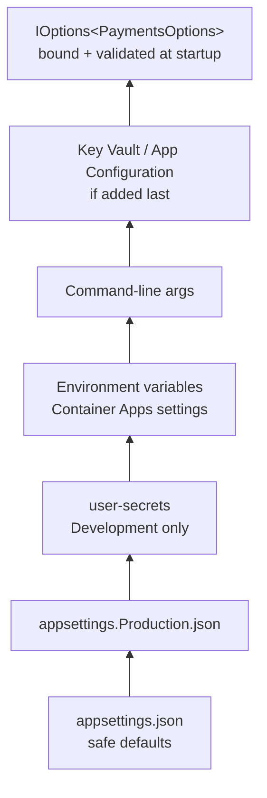

# Config & Environments — Overview
[← Topic](../README.md)

**TECH:** `Microsoft.Extensions.Configuration` providers · Options pattern (`IOptions<T>`, `ValidateOnStart`) · `dotnet user-secrets` · Azure Key Vault and App Configuration with managed identity · Microsoft.FeatureManagement · Docker Compose
**LEVEL:** intermediate (mid-level, new to C# and .NET)

## Why this matters in production
- A typo in an environment variable name (`ConnectionString__Shop`) and the app starts with an empty connection string, then fails on the first request, at 2 a.m.
- "Works in staging" because staging has a setting production doesn't; nobody can see the difference.
- A secret rotated in Key Vault is ignored until the next deploy, so the old one has to stay valid for weeks.
- `NEXT_PUBLIC_API_URL` is baked into the frontend image; the same image can't be promoted from staging to production.

## Mental model
Configuration is a **layered key/value dictionary**. Each provider adds keys; later providers override earlier ones. Your code reads typed, validated **options objects**, never the raw dictionary.

## Prerequisites
- [06-security](../../06-security/README.md) lesson 05 (secrets), [02-http-networking](../../02-http-networking/README.md) lesson 02 (Kestrel endpoints).
- Docker Desktop with WSL2 for lesson 04.

## Lesson map
| Lesson | Checklist items |
|:--|:--|
| [01 · Twelve-factor config, environments, and how ASP.NET Core loads configuration](01-config-providers-environments.md) | 1, 2, 3, 13 |
| [02 · Typed, validated options](02-typed-validated-options.md) | 4, 5 |
| [03 · Secrets, Key Vault, and App Configuration](03-secrets-keyvault-appconfig.md) | 6, 7, 12 |
| [04 · Local environments with Docker Compose](04-docker-compose-local.md) | 8 |
| [05 · Feature flags, frontend config, and changing config safely](05-flags-frontend-changes.md) | 9, 10, 11 |
| [Cheatsheet](cheatsheet.md) | all |

## Suggested order
1. 01 → 05.
2. Then [08-documentation](../../08-documentation/README.md); config keys belong in the README and runbooks.
3. Ready to build: `/learn csharp/01-foundations/07-config-environments mode=tasks`.

## Version notes
- `WebApplication.CreateBuilder` loads, in order: `appsettings.json`, `appsettings.{Environment}.json`, user secrets (Development), environment variables, command line.
- The options validation source generator (`[OptionsValidator]`, .NET 8+) and the configuration binding source generator (`EnableConfigurationBindingGenerator`) avoid reflection and work with Native AOT.
- Microsoft.FeatureManagement 4.x supports the newer `feature_management` schema shared with Azure App Configuration; the older `FeatureManagement` section still works.
- Docker Compose v2 (`docker compose`) reads `compose.yaml`; `develop.watch` syncs code into containers.

## Sources
- [Configuration in ASP.NET Core](https://learn.microsoft.com/aspnet/core/fundamentals/configuration/)
- [Options pattern in ASP.NET Core](https://learn.microsoft.com/aspnet/core/fundamentals/configuration/options)
- [The Twelve-Factor App — Config](https://12factor.net/config)
- [Azure App Configuration .NET provider](https://learn.microsoft.com/azure/azure-app-configuration/reference-dotnet-provider)
- [Docker Compose file reference](https://docs.docker.com/reference/compose-file/)
