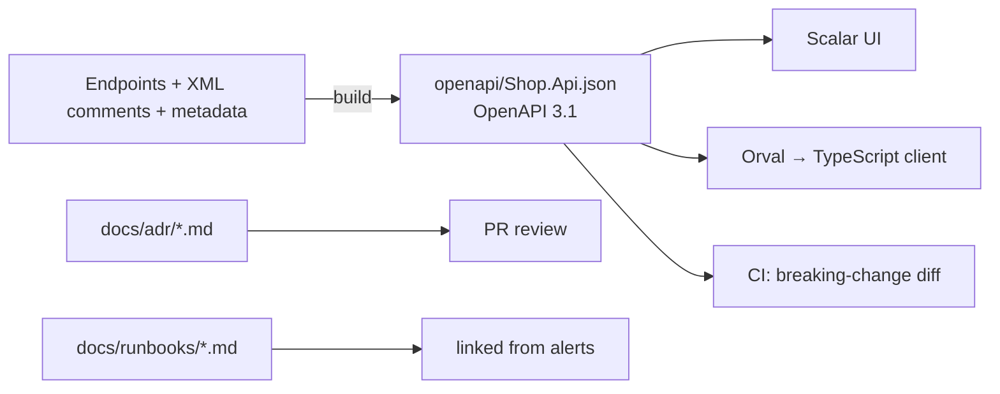

# Documentation — Overview
[← Topic](../README.md)

**TECH:** Markdown on GitHub · ADRs · runbooks · Keep a Changelog · Microsoft.AspNetCore.OpenApi (OpenAPI 3.1 by default in .NET 10) · Scalar.AspNetCore · XML doc comments · build-time OpenAPI generation and diffing
**LEVEL:** intermediate (mid-level, new to C# and .NET)

## Why this matters in production
- The OpenAPI document is the contract the Next.js frontend is generated from (Orval). If it's wrong, the frontend is wrong.
- During an incident, the runbook is the difference between a 10-minute rollback and an hour of guessing.
- A year from now, nobody remembers why SQL Server was chosen over PostgreSQL or why the API uses cookies. ADRs remember.
- A README that gets a new developer running in 15 minutes saves days per hire.

## Mental model
Docs are code: they live in the repo, are reviewed in PRs, and are checked in CI. Some are **generated** (OpenAPI, release notes); the rest are written for a specific reader and purpose.

## Prerequisites
- [01-git](../../01-git/README.md) (PRs, releases), [02-http-networking](../../02-http-networking/README.md) (status codes), [05-code-quality](../../05-code-quality/README.md) (`GenerateDocumentationFile`).

## Lesson map
| Lesson | Checklist items |
|:--|:--|
| [01 · Why docs, the four kinds, READMEs, and Markdown](01-kinds-readme-markdown.md) | 1, 2, 3 |
| [02 · ADRs, runbooks, and changelogs](02-adrs-runbooks-changelogs.md) | 4, 8, 10 |
| [03 · OpenAPI 3.1 with Microsoft.AspNetCore.OpenApi and Scalar](03-openapi-scalar.md) | 5, 6, 12 |
| [04 · Documenting API behavior and XML doc comments](04-api-behavior-xml-comments.md) | 7, 9 |
| [05 · Keeping docs current: build-time OpenAPI and CI checks](05-docs-current-build-time.md) | 11, 13 |
| [Cheatsheet](cheatsheet.md) | all |

## Suggested order
1. 01 → 05.
2. Then [03-backend/02-api-design](../../../03-backend/02-api-design/README.md), which builds on the OpenAPI setup, and [02-frontend/10-forms](../../../02-frontend/10-forms/README.md), which consumes it.
3. Ready to build: `/learn csharp/01-foundations/08-documentation mode=tasks`.

## Version notes
- .NET 10: `AddOpenApi()` generates **OpenAPI 3.1** with JSON Schema 2020-12 by default; YAML output is supported; XML doc comments flow into the document automatically when `GenerateDocumentationFile` is on.
- .NET 10 moves to Microsoft.OpenApi 2.x: transformer code uses `using Microsoft.OpenApi;` and interfaces like `IOpenApiSecurityScheme`. `WithOpenApi()` is obsolete; use `WithSummary`, `WithDescription`, transformers.
- Swashbuckle is no longer in the templates; Scalar.AspNetCore (2.x) is the common UI. Also seen: Swagger UI, ReDoc.
- `Microsoft.Extensions.ApiDescription.Server` writes the document to disk at build time.

## Sources
- [OpenAPI support in ASP.NET Core](https://learn.microsoft.com/aspnet/core/fundamentals/openapi/overview)
- [Diátaxis documentation framework](https://diataxis.fr/)
- [Architecture Decision Records](https://adr.github.io/)
- [Scalar for ASP.NET Core](https://scalar.com/products/api-references/integrations/aspnetcore/integration)
- [Keep a Changelog](https://keepachangelog.com/en/1.1.0/)
