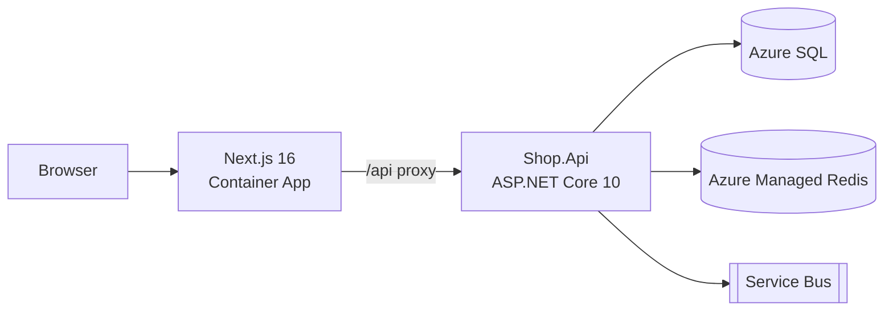

# Why docs, the four kinds, READMEs, and Markdown
[← Overview](00-overview.md)

## Why it matters
- The README starts with the history of the project and ends with "ask Sam for the connection string". A new hire needs four days and three people to run the API.
- One giant `docs/guide.md` mixes tutorials, reference tables, and design discussions; nobody can find anything, so nobody updates it.
- A diagram in a binary Visio file is out of date the week after it's drawn, because nobody can diff or edit it in a PR.

## Concepts

### The four kinds (Diátaxis)
| Kind | Reader wants to | Example in this repo | Style |
|:--|:--|:--|:--|
| Tutorial | learn by doing | "Run the API and place your first order" | step by step, guaranteed to work |
| How-to guide | solve a specific task | "Add an EF Core migration", "Rotate the Stripe key" | goal-oriented, assumes knowledge |
| Reference | look something up | OpenAPI docs, config keys table, cheatsheets | complete, dry, structured |
| Explanation | understand why | ADRs, architecture overview | discursive, context and trade-offs |

Mixing kinds is the main reason docs fail. Each page should be one kind.

### A README that gets someone running in 15 minutes
```markdown
# Shop

Coffee shop API (ASP.NET Core 10) and storefront (Next.js 16).

## Quick start
Prerequisites: .NET 10 SDK, Node 24 + pnpm, Docker Desktop.

    cp .env.example .env
    docker compose up -d                       # SQL Server 2025, Redis, Azurite
    dotnet user-secrets set "ConnectionStrings:Shop" "..." --project src/Shop.Api
    dotnet ef database update --project src/Shop.Api
    dotnet watch --project src/Shop.Api        # https://localhost:7043/scalar
    pnpm -C web install && pnpm -C web dev     # http://localhost:3000

## Tests
    dotnet test              # needs Docker for integration tests
    pnpm -C web test

## Project layout
| Path | What |
|:--|:--|
| `src/Shop.Api` | HTTP API |
| `src/Shop.Domain` | domain model |
| `web/` | Next.js app |
| `docs/adr` | decisions |
| `docs/runbooks` | on-call |

## Configuration
Every key with its default and where it comes from: see [docs/configuration.md](docs/configuration.md).

## Contributing
Branching, commit style, PR checklist: [CONTRIBUTING.md](CONTRIBUTING.md).
```
Test it: a teammate on a clean machine follows it word for word. Every stumble is a README bug.

### Markdown done well on GitHub
| Feature | Syntax | Use |
|:--|:--|:--|
| headings | `#`, `##` (one `#` per file) | structure, auto-generated outline |
| relative links | `[Runbook](docs/runbooks/db-failover.md)` | work in GitHub, IDEs, and forks |
| tables | `\| a \| b \|` | reference data |
| code blocks with language | ` ```csharp ` | syntax highlighting |
| alerts | `> [!WARNING]` (`NOTE`, `TIP`, `IMPORTANT`, `CAUTION`) | call-outs |
| collapsible | `<details><summary>…</summary>…</details>` | long output, answers |
| task lists | `- [ ] item` | checklists |
| ⭐ Mermaid | ` ```mermaid ` | diagrams as text, reviewable in PRs |
| anchors | `[x](#quick-start)` | in-page links |
| footnotes | `[^1]` | sources |

Mermaid diagram kinds you'll use: `flowchart`, `sequenceDiagram`, `erDiagram`, `stateDiagram-v2`, `gitGraph`, and C4 diagrams (`C4Context`, experimental).

## Example
`docs/architecture.md` (explanation, with a diagram that lives in the PR diff)
````markdown
# Architecture

> [!NOTE]
> Decisions behind this are in [docs/adr](adr/).



The API owns all business rules and auth. Next.js renders pages and proxies `/api` so the browser stays same-origin (see [ADR-0004](adr/0004-same-origin-api-proxy.md)).
````

## Production patterns
- One README per deployable (`src/Shop.Api/README.md`) plus the root README for the whole repo.
- A `docs/configuration.md` reference table: key, default, required?, secret?, where set per environment.
- Diagrams as Mermaid next to the text they explain.
- Write for a named reader ("new backend engineer", "on-call at 3 a.m.") and cut everything they don't need.

## Mistakes
Wrong: a README that describes instead of instructs.
```markdown
The project uses SQL Server and Redis and some other services, which you need to set up.
```
Right: copy-pasteable commands, prerequisites with versions, expected result.

Wrong: absolute links to `github.com/org/repo/blob/main/...` inside the repo.
Right: relative links, so they work on branches, forks, and in editors.

## Check yourself
1. Which Diátaxis kind is an ADR? And the cheatsheet?
2. Why prefer Mermaid over an exported PNG?
3. What is the test for a good quick start?

<details><summary>Answers</summary>

1. ADR: explanation. Cheatsheet: reference.
2. It's text: reviewed in PRs, diffable, editable by anyone, and rendered by GitHub.
3. Someone on a clean machine follows it exactly and has the app running, without asking anyone.
</details>

## Sources
- [Diátaxis](https://diataxis.fr/)
- [GitHub — Basic writing and formatting syntax](https://docs.github.com/en/get-started/writing-on-github/getting-started-with-writing-and-formatting-on-github/basic-writing-and-formatting-syntax)
- [GitHub — Creating Mermaid diagrams](https://docs.github.com/en/get-started/writing-on-github/working-with-advanced-formatting/creating-diagrams)
- [Mermaid documentation](https://mermaid.js.org/)
- [Make a README](https://www.makeareadme.com/)
