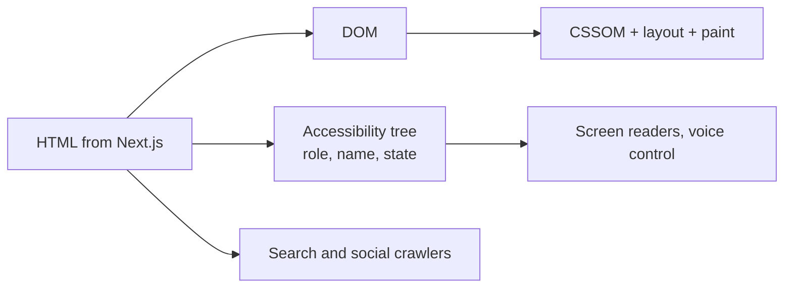

# HTML — Overview
[← Topic](../README.md)

**TECH:** HTML (Living Standard), as rendered by Next.js 16 / React 19.2 in this stack
**LEVEL:** intermediate (mid-level, new to C# and .NET; frontend matches the TypeScript stack)

## Why this matters in production
- HTML is the accessibility tree, the SEO signal, and the no-JavaScript fallback at once. React components end up as HTML; bad HTML can't be fixed with more JavaScript.
- Native elements (`<button>`, `<dialog>`, `
`, form validation) give keyboard support and screen reader semantics for free; custom `
` widgets have to rebuild all of it.
- Image dimensions, loading hints, and script order decide Core Web Vitals before any framework code runs.

## Mental model
The browser turns HTML into two trees: the **DOM** (for scripts and styles) and the **accessibility tree** (roles, names, states for assistive tech). Each element you choose decides what both trees contain.

## Prerequisites
- None beyond a browser. Lessons use plain HTML; the same rules apply to JSX in [04-framework](../../04-framework/README.md).

## Lesson map
| Lesson | Checklist items |
|:--|:--|
| [01 · Semantic structure, document essentials, and tables](01-semantic-structure.md) | 1, 2, 6, 10 |
| [02 · Interactive elements, forms, and progressive enhancement](02-interactive-forms.md) | 3, 4, 9 |
| [03 · Media, loading order, and metadata](03-media-loading-metadata.md) | 5, 7, 8 |
| [Cheatsheet](cheatsheet.md) | all |

## Suggested order
1. 01 → 03.
2. Then [02-css](../../02-css/README.md) and [08-accessibility](../../08-accessibility/README.md).
3. Ready to build: `/learn csharp/02-frontend/01-html mode=tasks`.

## Version notes
- `<dialog>` with `showModal()`, the `popover` attribute, `inert`, and `<search>` are Baseline across current browsers.
- Invoker commands (`commandfor` / `command` on buttons) let buttons open dialogs and popovers without JavaScript in current Chromium and Firefox; check Baseline status before relying on them.
- `fetchpriority` and `loading="lazy"` for images and iframes are Baseline.

## Sources
- [HTML Living Standard](https://html.spec.whatwg.org/multipage/)
- [MDN — HTML elements reference](https://developer.mozilla.org/docs/Web/HTML/Element)
- [web.dev — Learn HTML](https://web.dev/learn/html)
- [Baseline](https://web.dev/baseline)
