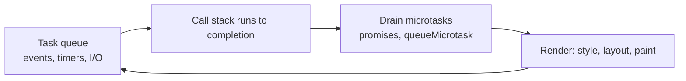

# JavaScript — Overview
[← Topic](../README.md)

**TECH:** modern JavaScript (ES2025) and TypeScript 6.0 in the Next.js frontend, with notes on how ideas map to C#
**LEVEL:** intermediate (mid-level, new to C# and .NET; frontend matches the TypeScript stack)

## Why this matters in production
- The frontend talks to a C# API. Money, dates, and IDs cross that boundary, and JavaScript numbers and dates behave differently from C# `decimal` and `DateTimeOffset`.
- Most frontend bugs come from a few language rules: reference equality, closures over stale values, unhandled promise rejections, and the event loop.
- TypeScript types are erased at runtime; data from the API must still be validated (Zod, generated by Orval).

## Mental model
One thread runs your JavaScript. Work is queued: the call stack runs to completion, then **all microtasks** (promise callbacks), then the browser may render, then the next **task** (timers, events, network callbacks).

In C#, `await` can resume on another thread-pool thread; in the browser, everything resumes on the one main thread, which is why long synchronous work freezes the page.

## Prerequisites
- [01-html](../../01-html/README.md); TypeScript basics from the TypeScript stack if you've done it.

## Lesson map
| Lesson | Checklist items |
|:--|:--|
| [01 · Values, equality, scope, closures, and modern syntax](01-values-scope-syntax.md) | 1, 2, 6 |
| [02 · The event loop, promises, async/await, and errors](02-event-loop-async-errors.md) | 3, 4, 7 |
| [03 · Modules, the DOM, browser APIs, and memory](03-modules-dom-apis-memory.md) | 5, 8, 9, 12 |
| [04 · TypeScript for app code; dates, numbers, and money](04-typescript-dates-money.md) | 10, 11 |
| [Cheatsheet](cheatsheet.md) | all |

## Suggested order
1. 01 → 04. Lesson 04's money and date section matters most for talking to the C# API.
2. Then [04-framework](../../04-framework/README.md).
3. Ready to build: `/learn csharp/02-frontend/03-javascript mode=tasks`.

## Version notes
- ES2025: iterator helpers (`.map/.filter/.take` on iterators), new `Set` methods (`union`, `intersection`, `difference`…), `Promise.try`, RegExp modifiers, import attributes (`with { type: "json" }`).
- `Object.groupBy`, `Array.prototype.toSorted/toReversed/with`, `structuredClone`, `AbortSignal.timeout/any` are Baseline.
- Temporal is shipping in Firefox and Chromium-based browsers; check Baseline for Safari before relying on it without a polyfill.
- TypeScript 6.0 is the transition release before the Go-based TypeScript 7 (it deprecates legacy options); keep `strict` on and prefer erasable, type-only syntax (`erasableSyntaxOnly`).

## Sources
- [MDN — JavaScript](https://developer.mozilla.org/docs/Web/JavaScript)
- [ECMAScript 2025 specification](https://tc39.es/ecma262/2025/)
- [TypeScript handbook](https://www.typescriptlang.org/docs/handbook/intro.html)
- [MDN — Event loop](https://developer.mozilla.org/docs/Web/JavaScript/Event_loop)
