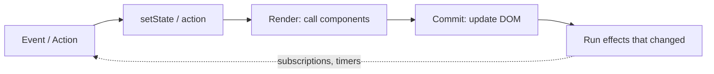

# Framework (React) — Overview
[← Topic](../README.md)

**TECH:** React 19.2 with TypeScript, built with Vite 8 for this topic (Next.js 16 comes in [06-rendering](../../06-rendering/README.md)), talking to the ASP.NET Core API through a dev proxy
**LEVEL:** intermediate (mid-level, new to C# and .NET; frontend matches the TypeScript stack)

## Why this matters in production
- React is the most hired frontend library; every other frontend topic in this module builds on its model.
- Most React bugs are misplaced state and unnecessary effects: stale data, double fetches, render loops.
- React 19 Actions and the React Compiler change what "idiomatic" looks like: fewer `useEffect`s, fewer manual `useMemo`s.

## Mental model
A component is a function from **props and state** to UI. React calls it to render, compares the result with the previous one, and updates the DOM. State changes schedule a re-render; effects synchronize with things **outside** React (network subscriptions, the DOM, timers).

Think of it like a pure C# function `View Render(State s)`: same input, same output, no side effects during rendering.

## Prerequisites
- [03-javascript](../../03-javascript/README.md) (closures, immutability, modules).
- The ASP.NET Core API running locally (`https://localhost:7043`) for the proxy examples.

## Lesson map
| Lesson | Checklist items |
|:--|:--|
| [01 · React's model: components, props, state, lists](01-react-model.md) | 1, 2, 5 |
| [02 · Effects and the core hooks](02-effects-hooks.md) | 3, 4, 8 |
| [03 · Composition, project structure, and error boundaries](03-composition-structure-errors.md) | 6, 11, 13 |
| [04 · Actions, transitions, and Suspense](04-actions-transitions-suspense.md) | 7, 9 |
| [05 · The React Compiler and Vite 8](05-compiler-vite.md) | 10, 12 |
| [Cheatsheet](cheatsheet.md) | all |

## Suggested order
1. 01 → 05.
2. Then [05-state-management](../../05-state-management/README.md) (server state with TanStack Query) and [10-forms](../../10-forms/README.md).
3. Ready to build: `/learn csharp/02-frontend/04-framework mode=tasks`.

## Version notes
- React 19: Actions (`useActionState`, `useFormStatus`, `useOptimistic`), `use()`, `ref` as a normal prop, document metadata in components, `<form action={fn}>`.
- React 19.2: `<Activity>` (keep hidden UI mounted with state) and `useEffectEvent` (stable callbacks that read latest props/state inside effects).
- React Compiler 1.0 (stable): automatic memoization at build time; Next.js 16 enables it with `reactCompiler: true`.
- Vite 8 uses the Rolldown bundler; `@vitejs/plugin-react` provides Fast Refresh.

## Sources
- [react.dev — Learn](https://react.dev/learn)
- [React 19 release](https://react.dev/blog/2024/12/05/react-19)
- [React 19.2 release](https://react.dev/blog/2025/10/01/react-19-2)
- [React Compiler](https://react.dev/learn/react-compiler)
- [Vite guide](https://vite.dev/guide/)
