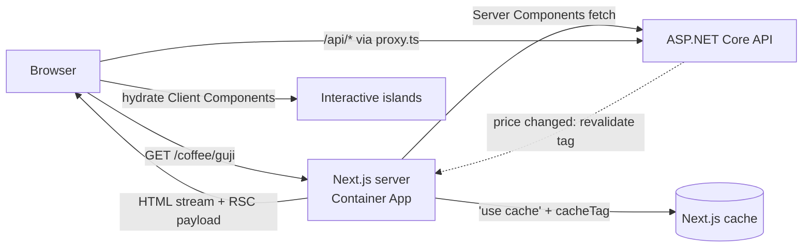

# Rendering Strategies — Overview
[← Topic](../README.md)

**TECH:** Next.js 16 App Router as the **frontend only**: it renders pages and proxies `/api` to the ASP.NET Core API, which owns business logic, data, and auth
**LEVEL:** intermediate (mid-level, new to C# and .NET; frontend matches the TypeScript stack)

## Why this matters in production
- Rendering choice decides speed, SEO, and cost: product pages must be fast and indexable; account pages must be per-user and never cached for others.
- Next.js has its own server. Calls from Server Components to the ASP.NET Core API happen server-to-server, with their own auth forwarding, timeouts, and caching rules.
- Caching mistakes are the worst kind: stale prices, or worse, one customer's data shown to another.

## Mental model

Server Components run only on the Next.js server and can call the API directly. Client Components run in the browser (and are pre-rendered on the server) and use TanStack Query against `/api`.

## Prerequisites
- [04-framework](../../04-framework/README.md), [05-state-management](../../05-state-management/README.md).
- [01-foundations/07-config-environments](../../../01-foundations/07-config-environments/README.md) lesson 05 (`proxy.ts`, runtime env).

## Lesson map
| Lesson | Checklist items |
|:--|:--|
| [01 · Rendering strategies; static vs dynamic](01-rendering-strategies.md) | 1, 8 |
| [02 · App Router, Server and Client Components, hydration](02-app-router-components.md) | 2, 3, 9 |
| [03 · Fetching from ASP.NET Core and caching in Next.js 16](03-data-caching.md) | 4, 5 |
| [04 · Streaming, Server Functions, route handlers, and proxy.ts](04-streaming-functions-proxy.md) | 6, 7, 10 |
| [05 · Metadata, SEO, and self-hosting](05-metadata-self-hosting.md) | 11, 12 |
| [Cheatsheet](cheatsheet.md) | all |

## Suggested order
1. 01 → 05.
2. Then [07-performance](../../07-performance/README.md) and [11-security](../../11-security/README.md).
3. Ready to build: `/learn csharp/02-frontend/06-rendering mode=tasks`.

## Version notes
- Next.js 16: Cache Components (`cacheComponents: true`) with `'use cache'`, `cacheLife`, `cacheTag`; `revalidateTag(tag, profile)` and the new `updateTag(tag)` (read-your-writes in Server Actions); Partial Prerendering is part of Cache Components.
- `middleware.ts` is renamed `proxy.ts` and runs on the Node.js runtime.
- Turbopack is the default bundler for `next dev` and `next build`.
- `params`, `searchParams`, `cookies()`, and `headers()` are async (await them).
- `fetch` is not cached by default (since 15); caching is explicit.

## Sources
- [Next.js docs — App Router](https://nextjs.org/docs/app)
- [Next.js 16 release](https://nextjs.org/blog/next-16)
- [Next.js — Cache Components](https://nextjs.org/docs/app/getting-started/cache-components)
- [Next.js — Self-hosting](https://nextjs.org/docs/app/guides/self-hosting)
- [react.dev — Server Components](https://react.dev/reference/rsc/server-components)
