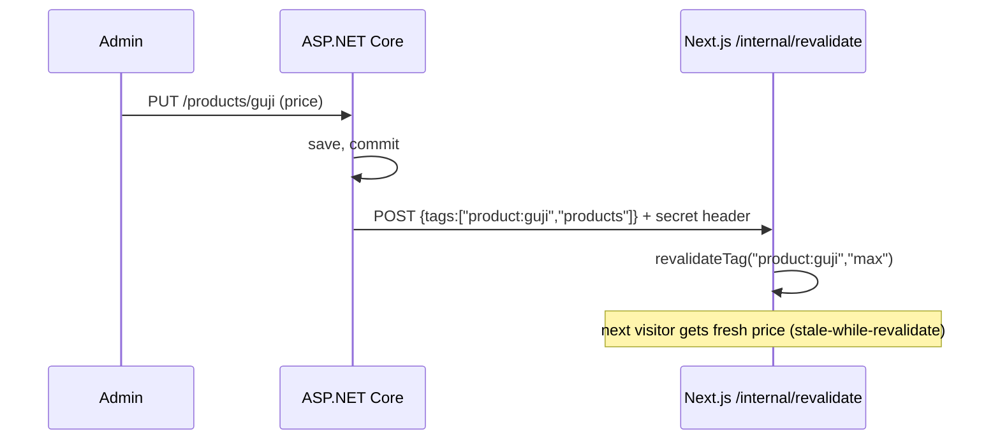

# Fetching from ASP.NET Core and caching in Next.js 16
[← Overview](00-overview.md)

## Why it matters
- A Server Component calls the API without forwarding the user's cookie; the API returns 401 and the account page renders "Please sign in" for signed-in users.
- A per-user `GET /me` is wrapped in `'use cache'`; the first user's name is shown to everyone until the cache expires.
- A product price changes in the admin; the storefront shows the old price for an hour because the only invalidation is a 3600-second TTL.

## Concepts

### Calling the API from Server Components
Server Components run on the Next.js server, so they call ASP.NET Core **directly** (internal URL), not through `/api`.
| Concern | Practice |
|:--|:--|
| base URL | `process.env.API_URL` (server-only, runtime) |
| ⭐ auth for user data | forward the incoming `Cookie` header (cookie auth) or an access token from the session |
| correlation | forward `traceparent` so traces join across Next.js and ASP.NET Core (03-backend/10-observability) |
| timeouts | `AbortSignal.timeout(5000)` on every call |
| errors | map Problem Details; `notFound()` for 404 |
| deduplication | `React.cache(fn)` dedupes identical calls within one request |
| typing | Orval's generated functions (`getProduct(slug)`) with a server-side fetcher |

Public data (catalog) doesn't need user credentials; call it anonymously so it can be cached.

### Caching with Cache Components
| API | Does |
|:--|:--|
| ⭐ `'use cache'` | cache the return value of an async function or component; arguments are part of the key |
| ⭐ `cacheLife("hours")` | profile: how long it's fresh/stale/expired (`seconds`, `minutes`, `hours`, `days`, `weeks`, `max`, or custom in config) |
| ⭐ `cacheTag("product:guji", "products")` | label entries for invalidation |
| `revalidateTag(tag, "max")` | mark tagged entries stale; next request serves stale and refreshes in the background |
| `updateTag(tag)` | in a Server Action: expire and refresh now, so the user sees their own write |
| `revalidatePath(path)` | invalidate by route |
| `refresh()` | refresh uncached data in the current page from a Server Action |
| `React.cache` | per-request memoization (not persistent) |

Cached functions can't read `cookies()`/`headers()` inside; pass the values they depend on as arguments, and never cache per-user responses in the shared cache.

### Invalidation driven by the API
When the C# API changes a product, it tells Next.js which tag to revalidate.

In C#, send this from a background job after the transaction commits (outbox, 03-backend/07-background-jobs) so a slow Next.js doesn't slow the admin request.

## Example
`web/src/server/api.ts`
```ts
import "server-only";
import { cookies, headers } from "next/headers";

const base = process.env.API_URL!;

export async function serverFetch<T>(path: string, opts: { auth?: boolean } = {}): Promise<T> {
  const h = new Headers({ Accept: "application/json" });
  if (opts.auth) h.set("cookie", (await cookies()).toString());           // forward the user's session cookie
  const traceparent = (await headers()).get("traceparent");
  if (traceparent) h.set("traceparent", traceparent);

  const res = await fetch(`${base}${path}`, { headers: h, signal: AbortSignal.timeout(5000) });
  if (res.status === 404) throw new NotFoundError(path);
  if (!res.ok) throw new Error(`API ${res.status} for ${path}`);
  return res.json() as Promise<T>;
}
```
`web/src/server/catalog.ts`
```ts
import "server-only";
import { cacheLife, cacheTag } from "next/cache";

export async function getProduct(slug: string) {
  "use cache";
  cacheLife("hours");
  cacheTag(`product:${slug}`, "products");
  const res = await fetch(`${process.env.API_URL}/products/${encodeURIComponent(slug)}`, { signal: AbortSignal.timeout(5000) });
  if (res.status === 404) return null;
  return (await res.json()) as ProductDto;        // public data: no cookies inside a cached function
}

export async function getMyOrders() {
  return serverFetch<OrderSummaryDto[]>("/orders", { auth: true });   // per user: not cached
}
```
`web/src/app/internal/revalidate/route.ts`
```ts
import { revalidateTag } from "next/cache";
import { timingSafeEqual } from "node:crypto";

export async function POST(req: Request) {
  const secret = Buffer.from(req.headers.get("x-revalidate-secret") ?? "");
  const expected = Buffer.from(process.env.REVALIDATE_SECRET!);
  if (secret.length !== expected.length || !timingSafeEqual(secret, expected)) return new Response(null, { status: 401 });

  const { tags } = (await req.json()) as { tags: string[] };
  for (const tag of tags.slice(0, 20)) revalidateTag(tag, "max");
  return Response.json({ revalidated: tags.length });
}
```
Keep `/internal/*` out of the `/api` proxy matcher, and reachable only from the API's network (Container Apps internal ingress or an allowlist).

## Production patterns
- Two fetch paths: public cached functions (no credentials) and per-user uncached ones (forward cookie).
- Tags per entity and per collection (`product:guji`, `products`); the API revalidates them after commit.
- Every server-side call has a timeout and forwards `traceparent`.
- Revalidation endpoints authenticate with a secret (from Key Vault) and limit input.

## Mistakes
Wrong: caching per-user data.
```ts
export async function getMe() { "use cache"; return serverFetch("/me", { auth: true }); }
```
Right: don't cache it (or use a per-user/private cache strategy deliberately; never the shared one).

Wrong: Server Components calling `/api/...` on the Next.js origin (a loopback HTTP hop through the proxy).
Right: call `API_URL` directly from the server.

## Check yourself
1. Why can't a `'use cache'` function call `cookies()`?
2. What is the difference between `revalidateTag` and `updateTag`?
3. Why should the C# API send revalidation after the transaction commits?

<details><summary>Answers</summary>

1. The cache is shared across requests; request-specific inputs would leak or make entries wrong. Pass needed values as arguments instead.
2. `revalidateTag` marks entries stale (served stale while refreshing in the background); `updateTag`, in a Server Action, expires them immediately so the user sees their own change.
3. Otherwise Next.js might refetch before the change is visible in the database and cache the old value again.
</details>

## Sources
- [Next.js — Fetching data](https://nextjs.org/docs/app/getting-started/fetching-data)
- [Next.js — use cache](https://nextjs.org/docs/app/api-reference/directives/use-cache)
- [Next.js — cacheLife](https://nextjs.org/docs/app/api-reference/functions/cacheLife) · [cacheTag](https://nextjs.org/docs/app/api-reference/functions/cacheTag)
- [Next.js — revalidateTag](https://nextjs.org/docs/app/api-reference/functions/revalidateTag) · [updateTag](https://nextjs.org/docs/app/api-reference/functions/updateTag)
- [react.dev — cache](https://react.dev/reference/react/cache)
