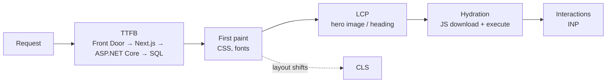

# Performance — Overview
[← Topic](../README.md)

**TECH:** Core Web Vitals measured with Lighthouse, DevTools, and the `web-vitals` library; Next.js 16 and React 19.2 optimizations; Azure Front Door as the CDN; the ASP.NET Core API's latency as part of TTFB
**LEVEL:** intermediate (mid-level, new to C# and .NET; frontend matches the TypeScript stack)

## Why this matters in production
- Slow pages lose sales: each extra second of load measurably lowers conversion, and Core Web Vitals feed into search ranking.
- For server-rendered pages, TTFB includes the ASP.NET Core API call. A slow SQL query shows up as a slow frontend.
- Most frontend slowness is self-inflicted: big images, render-blocking fonts, too much JavaScript, third-party tags.

## Mental model

Measure in the field (real users, p75), diagnose in the lab (Lighthouse, Performance panel), fix the biggest phase first.

## Prerequisites
- [01-html](../../01-html/README.md) lesson 03, [06-rendering](../../06-rendering/README.md).

## Lesson map
| Lesson | Checklist items |
|:--|:--|
| [01 · Core Web Vitals, measuring, and budgets](01-web-vitals-measuring.md) | 1, 2, 11 |
| [02 · The loading path: TTFB, images, fonts, CDN caching](02-loading-path-images-fonts.md) | 3, 5, 6, 10 |
| [03 · JavaScript cost and third-party scripts](03-javascript-cost.md) | 4, 12 |
| [04 · Runtime: INP, CLS, and React rendering](04-runtime-inp-cls-react.md) | 7, 8, 9 |
| [Cheatsheet](cheatsheet.md) | all |

## Suggested order
1. 01 → 04.
2. Backend side of TTFB: [03-backend/09-scalability](../../../03-backend/09-scalability/README.md).
3. Ready to build: `/learn csharp/02-frontend/07-performance mode=tasks`.

## Version notes
- Core Web Vitals: LCP ≤ 2.5 s, INP ≤ 200 ms, CLS ≤ 0.1, at the 75th percentile of page loads. INP replaced FID in 2024.
- `web-vitals` 5 reports `onLCP`, `onINP`, `onCLS`, `onFCP`, `onTTFB` (FID removed), with attribution builds for debugging.
- Next.js 16: `next/image`, `next/font`, `next/script`, React Compiler (`reactCompiler: true`), Turbopack builds.

## Sources
- [web.dev — Web Vitals](https://web.dev/articles/vitals)
- [web.dev — Optimize LCP](https://web.dev/articles/optimize-lcp) · [INP](https://web.dev/articles/optimize-inp) · [CLS](https://web.dev/articles/optimize-cls)
- [GoogleChrome/web-vitals](https://github.com/GoogleChrome/web-vitals)
- [Next.js — Optimizing](https://nextjs.org/docs/app/guides/production-checklist)
