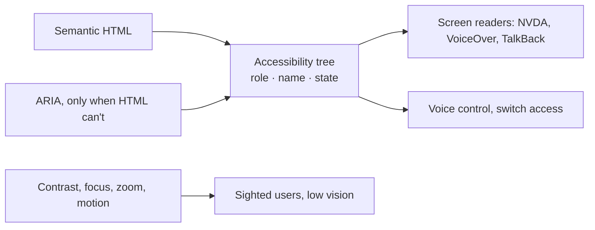

# Accessibility — Overview
[← Topic](../README.md)

**TECH:** semantic HTML and React 19.2, WAI-ARIA where needed, automated checks with axe-core in Playwright, manual testing with keyboard and screen readers
**LEVEL:** intermediate (mid-level, new to C# and .NET; frontend matches the TypeScript stack)

## Why this matters in production
- Around one in six people has a disability; many more use zoom, keyboard navigation, captions, or high contrast at some point.
- The European Accessibility Act has applied to e-commerce sold in the EU since June 2025; ADA lawsuits in the US target inaccessible shops every year. WCAG 2.2 AA is the usual legal yardstick.
- Accessible pages are also more robust: better SEO, testable with role-based selectors, usable on small screens.

## Mental model
Assistive technology reads the **accessibility tree**: for every element, a **role** (button, link, heading), a **name** ("Add Ethiopia Guji to cart"), and **states** (expanded, checked, disabled). Your job is to make that tree accurate, operable by keyboard, and perceivable (contrast, text alternatives, captions).

## Prerequisites
- [01-html](../../01-html/README.md) and [02-css](../../02-css/README.md) (focus styles, reflow).

## Lesson map
| Lesson | Checklist items |
|:--|:--|
| [01 · Why accessibility; semantics, the accessibility tree, images](01-why-semantics-images.md) | 1, 2, 8 |
| [02 · Keyboard, focus management, and forms](02-keyboard-focus-forms.md) | 3, 4, 6 |
| [03 · ARIA, custom components, and visual design](03-aria-components-visual.md) | 5, 7, 9 |
| [04 · Testing and process](04-testing-process.md) | 10, 11, 12 |
| [Cheatsheet](cheatsheet.md) | all |

## Suggested order
1. 01 → 04.
2. Then [09-ux-states](../../09-ux-states/README.md) and [10-forms](../../10-forms/README.md).
3. Ready to build: `/learn csharp/02-frontend/08-accessibility mode=tasks`.

## Version notes
- WCAG 2.2 (2023) adds focus not obscured, target size (minimum 24×24 CSS px), dragging alternatives, consistent help, redundant entry, and accessible authentication (no cognitive tests like puzzles for login).
- The EAA references EN 301 549, which maps to WCAG 2.1 AA; aiming at 2.2 AA covers it.
- `@axe-core/playwright` runs axe inside Playwright tests; automated tools find roughly a third of issues, so manual testing stays necessary.

## Sources
- [WCAG 2.2](https://www.w3.org/TR/WCAG22/)
- [WAI-ARIA Authoring Practices Guide (APG)](https://www.w3.org/WAI/ARIA/apg/)
- [European Accessibility Act (Directive 2019/882)](https://eur-lex.europa.eu/eli/dir/2019/882/oj)
- [axe-core](https://github.com/dequelabs/axe-core)
