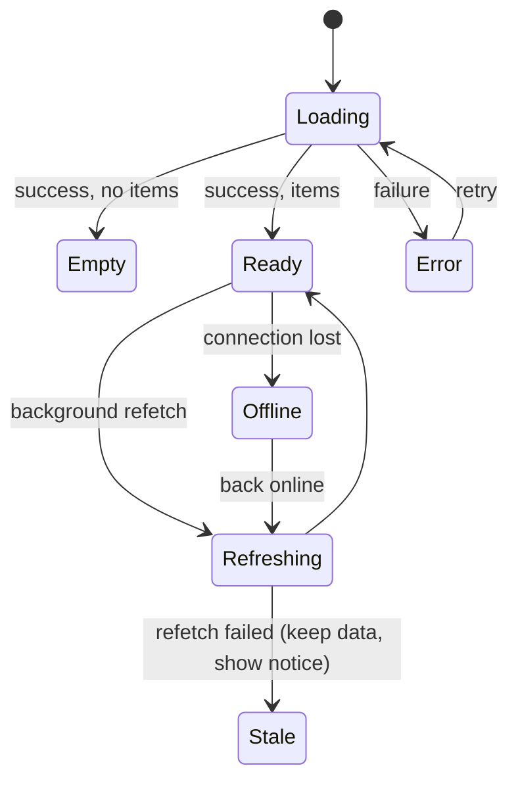

# UX States & Error Handling — Overview
[← Topic](../README.md)

**TECH:** React 19.2 + TanStack Query v5 states, Tailwind 4 skeletons and feedback components, Sentry for reporting; errors arrive from ASP.NET Core as Problem Details with a `traceId`
**LEVEL:** intermediate (mid-level, new to C# and .NET; frontend matches the TypeScript stack)

## Why this matters in production
- Real networks are slow and flaky. Screens designed only for the "data loaded" state fail for many users every day.
- A generic "Something went wrong" with no next step generates support tickets; a message with a reference ID that matches the API's trace lets support find the cause in Application Insights in seconds.
- Double submits, lost input, and silent failures are UX bugs with business cost (duplicate orders, abandoned carts).

## Mental model
Every view over remote data is a small state machine:

Design and build each state on purpose.

## Prerequisites
- [05-state-management](../../05-state-management/README.md), [08-accessibility](../../08-accessibility/README.md) lesson 03 (live regions).

## Lesson map
| Lesson | Checklist items |
|:--|:--|
| [01 · Screen states, loading UX, empty states, and Suspense](01-states-loading-empty.md) | 1, 2, 4, 8 |
| [02 · Errors, feedback, and reporting](02-errors-feedback-reporting.md) | 3, 6, 10 |
| [03 · Optimistic UI, offline, and destructive actions](03-optimistic-offline-destructive.md) | 5, 7, 9 |
| [Cheatsheet](cheatsheet.md) | all |

## Suggested order
1. 01 → 03.
2. Then [10-forms](../../10-forms/README.md) and [13-testing-monitoring](../../13-testing-monitoring/README.md).
3. Ready to build: `/learn csharp/02-frontend/09-ux-states mode=tasks`.

## Version notes
- TanStack Query v5: `isPending` (no data yet) vs `isFetching` (any request), `isPlaceholderData`, `useSuspenseQuery`, `throwOnError`.
- React 19: `useOptimistic`, Actions with pending state; Next.js `loading.tsx` / `error.tsx` per route segment.
- Sentry JavaScript SDK 10 for Next.js (`@sentry/nextjs`).

## Sources
- [TanStack Query — Queries (status)](https://tanstack.com/query/latest/docs/framework/react/guides/queries)
- [Nielsen Norman Group — Error message guidelines](https://www.nngroup.com/articles/error-message-guidelines/)
- [react.dev — useOptimistic](https://react.dev/reference/react/useOptimistic)
- [Sentry — Next.js](https://docs.sentry.io/platforms/javascript/guides/nextjs/)
