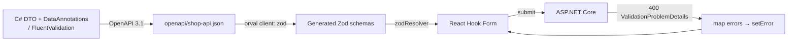

# Forms & Validation — Overview
[← Topic](../README.md)

**TECH:** React Hook Form 7 with Zod 4 schemas **generated by Orval** from the ASP.NET Core API's OpenAPI document; server-side validation errors arrive as `ValidationProblemDetails` and are mapped to fields
**LEVEL:** intermediate (mid-level, new to C# and .NET; frontend matches the TypeScript stack)

## Why this matters in production
- Forms are where money is made (checkout, sign-up) and lost (abandonment). Lost input, unclear errors, and double submits cost real orders.
- In the TypeScript stack, one Zod schema was shared by the form and the API. Here the API is C#: its DataAnnotations/FluentValidation rules become OpenAPI constraints, and Orval turns those into Zod. The server stays the authority; the client gives fast feedback.
- Accessible forms are a legal requirement (08-accessibility) and the biggest conversion lever.

## Mental model

Client validation is a convenience; server validation is the rule. Both describe the same contract.

## Prerequisites
- [01-html](../../01-html/README.md) lesson 02 (native forms), [08-accessibility](../../08-accessibility/README.md) lesson 02, [05-state-management](../../05-state-management/README.md) lesson 02 (Orval).

## Lesson map
| Lesson | Checklist items |
|:--|:--|
| [01 · Form fundamentals, React Hook Form, accessibility, and submission UX](01-fundamentals-rhf.md) | 1, 2, 7, 8 |
| [02 · Zod from OpenAPI, server errors, and keeping rules in sync](02-zod-openapi-server-errors.md) | 3, 6, 12 |
| [03 · Dynamic fields, controlled inputs, and uploads](03-dynamic-fields-uploads.md) | 4, 5, 10 |
| [04 · Multi-step forms, drafts, and testing](04-multistep-drafts-testing.md) | 9, 11 |
| [Cheatsheet](cheatsheet.md) | all |

## Suggested order
1. 01 → 04.
2. Server side of the same rules: [03-backend/05-validation-abuse](../../../03-backend/05-validation-abuse/README.md).
3. Ready to build: `/learn csharp/02-frontend/10-forms mode=tasks`.

## Version notes
- React Hook Form 7.6x with `@hookform/resolvers` 5 supports Zod 4 (`zodResolver`).
- Zod 4: faster, smaller, `z.email()`/`z.uuid()` top-level formats, `z.infer`, `.check()`; Orval 8 generates Zod 4 by default.
- ASP.NET Core returns `ValidationProblemDetails` (`errors` dictionary) for failed DataAnnotations/FluentValidation checks; .NET 10's built-in Minimal API validation produces the same shape.

## Sources
- [React Hook Form — Get started](https://react-hook-form.com/get-started)
- [Zod 4](https://zod.dev/)
- [Orval — Zod](https://orval.dev/docs/guides/zod)
- [ASP.NET Core — Validation (Minimal APIs)](https://learn.microsoft.com/aspnet/core/fundamentals/minimal-apis#validation)
