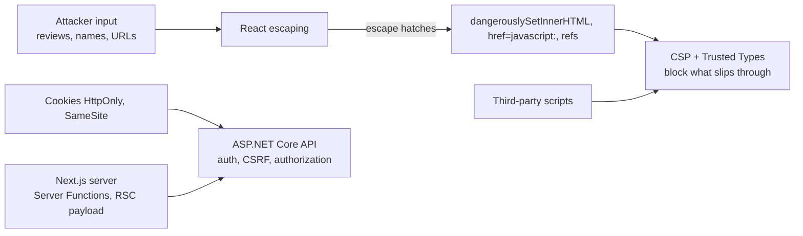

# Frontend Security — Overview
[← Topic](../README.md)

**TECH:** React 19.2 and Next.js 16 security features, Content Security Policy with nonces set in `proxy.ts`, Trusted Types, DOMPurify; session cookies issued by the ASP.NET Core API
**LEVEL:** intermediate (mid-level, new to C# and .NET; frontend matches the TypeScript stack)

## Why this matters in production
- One XSS in the storefront can read anything the page can: cart, addresses, and any token stored in JavaScript-readable places.
- The Next.js server is part of the attack surface: Server Functions and route handlers are public endpoints, and Server Components can leak server data into the client payload.
- Third-party scripts run with your origin's full privileges; a compromised analytics tag is a compromised checkout.

## Mental model

The API enforces authentication and authorization; the frontend's job is to not open new holes (XSS, data exposure, open redirects) and to contain damage (CSP, cookies, SRI).

## Prerequisites
- [01-foundations/06-security](../../../01-foundations/06-security/README.md) (OWASP, CSRF, headers), [06-rendering](../../06-rendering/README.md).

## Lesson map
| Lesson | Checklist items |
|:--|:--|
| [01 · The browser threat model and XSS in React](01-threats-xss.md) | 1, 2, 4 |
| [02 · Content Security Policy and security headers in Next.js](02-csp-headers.md) | 3, 9 |
| [03 · Tokens, cookies, and securing Server Functions](03-tokens-server-functions.md) | 5, 6 |
| [04 · Data exposure, third parties, redirects, and secrets](04-exposure-thirdparty-secrets.md) | 7, 8, 10, 11 |
| [Cheatsheet](cheatsheet.md) | all |

## Suggested order
1. 01 → 04.
2. Then [12-cross-cutting](../../12-cross-cutting/README.md) (consent) and [03-backend/04-auth](../../../03-backend/04-auth/README.md).
3. Ready to build: `/learn csharp/02-frontend/11-security mode=tasks`.

## Version notes
- Next.js 16 renames middleware to `proxy.ts`; nonce-based CSP is set there and read by Next.js from the `Content-Security-Policy` request header. Nonces make pages dynamic (no static caching).
- React 19 escapes text and attribute values; `javascript:` URLs in `href` are blocked (warned in dev, sanitized in production builds).
- Trusted Types are supported in Chromium-based browsers; check Baseline for current Safari and Firefox status (the directive is ignored where unsupported, so it's safe to add).
- `server-only` and React's experimental taint APIs (`taintObjectReference`, `taintUniqueValue`) help keep server data out of client payloads.

## Sources
- [OWASP — XSS Prevention Cheat Sheet](https://cheatsheetseries.owasp.org/cheatsheets/Cross_Site_Scripting_Prevention_Cheat_Sheet.html)
- [Next.js — Content Security Policy](https://nextjs.org/docs/app/guides/content-security-policy)
- [Next.js — Data security](https://nextjs.org/docs/app/guides/data-security)
- [MDN — Trusted Types API](https://developer.mozilla.org/docs/Web/API/Trusted_Types_API)
