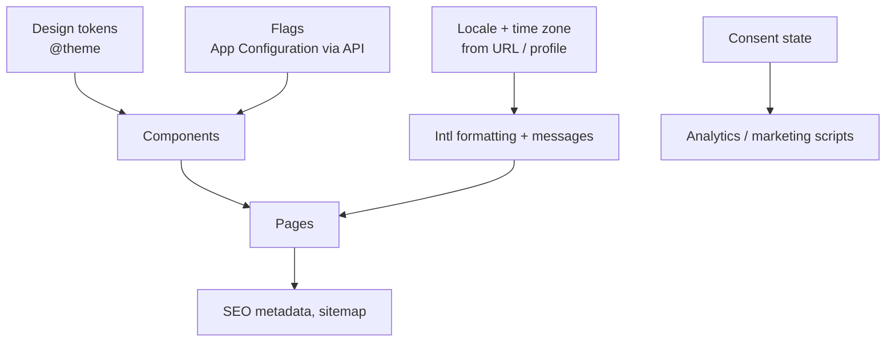

# Cross-Cutting Frontend — Overview
[← Topic](../README.md)

**TECH:** React 19.2 + Next.js 16 + Tailwind 4 design tokens; `Intl` for i18n; Next.js metadata for SEO; feature flags served by the ASP.NET Core side (Azure App Configuration); consent-aware analytics
**LEVEL:** intermediate (mid-level, new to C# and .NET; frontend matches the TypeScript stack)

## Why this matters in production
- These concerns touch every screen. Getting them wrong once means fixing them everywhere: hardcoded colors, hardcoded English strings, dates formatted three different ways.
- A shop selling into several countries needs locales, currencies, and time zones handled consistently between the C# API and the frontend.
- Analytics without consent is a legal problem in the EU; flags without cleanup become permanent complexity.

## Mental model

## Prerequisites
- [02-css](../../02-css/README.md), [03-javascript](../../03-javascript/README.md) lesson 04 (Intl, dates), [06-rendering](../../06-rendering/README.md).

## Lesson map
| Lesson | Checklist items |
|:--|:--|
| [01 · Responsive layouts, design tokens, components, theming](01-design-system-theming.md) | 1, 2, 3, 10 |
| [02 · Internationalization, dates, numbers, and currencies](02-i18n-dates-currencies.md) | 4, 5 |
| [03 · SEO, browser support, and offline basics](03-seo-browsers-offline.md) | 6, 9, 11 |
| [04 · Feature flags, analytics, and consent](04-flags-analytics-consent.md) | 7, 8 |
| [Cheatsheet](cheatsheet.md) | all |

## Suggested order
1. 01 → 04.
2. Then [13-testing-monitoring](../../13-testing-monitoring/README.md).
3. Ready to build: `/learn csharp/02-frontend/12-cross-cutting mode=tasks`.

## Version notes
- Tailwind 4 tokens in `@theme` are CSS variables at runtime, which makes theming a variable swap.
- `Intl` covers numbers, currencies, dates, relative times, plurals, lists, collation, and segmentation; Temporal is arriving in browsers (check Baseline).
- Next.js 16 has no built-in i18n routing in the App Router; locale routing is a `[locale]` segment plus `proxy.ts` detection (libraries like next-intl help).
- Baseline gives a shared definition of "supported in all major browsers".

## Sources
- [Tailwind CSS — Theme variables](https://tailwindcss.com/docs/theme)
- [Next.js — Internationalization](https://nextjs.org/docs/app/guides/internationalization)
- [MDN — Intl](https://developer.mozilla.org/docs/Web/JavaScript/Reference/Global_Objects/Intl)
- [web.dev — Baseline](https://web.dev/baseline)
