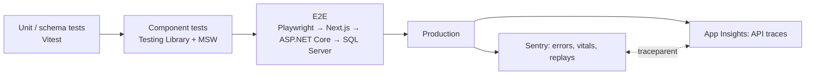

# Frontend Testing & Monitoring — Overview
[← Topic](../README.md)

**TECH:** Vitest 4 + Testing Library + MSW for component tests, Playwright for E2E against the real ASP.NET Core API, Sentry for frontend errors, performance, and replays (backend telemetry is Application Insights, joined by W3C trace context)
**LEVEL:** intermediate (mid-level, new to C# and .NET; frontend matches the TypeScript stack)

## Why this matters in production
- The frontend is where users see failures; a broken "Place order" button is invisible to backend dashboards.
- Component tests with mocked HTTP are fast; E2E tests against the real API catch contract and integration bugs (cookies, CSRF, CORS, Problem Details shapes).
- Monitoring closes the loop: errors with release, route, and a trace that continues into the C# API.

## Mental model

## Prerequisites
- [01-foundations/03-testing](../../../01-foundations/03-testing/README.md) (testing principles, the API's tests), [10-forms](../../10-forms/README.md) lesson 04, [09-ux-states](../../09-ux-states/README.md) lesson 02.

## Lesson map
| Lesson | Checklist items |
|:--|:--|
| [01 · Strategy, component tests, and Vitest browser mode](01-strategy-component-tests.md) | 1, 2, 5 |
| [02 · Mocking the network with MSW; hooks and TanStack Query](02-msw-hooks-query.md) | 3, 4 |
| [03 · Playwright E2E, visual checks, flakiness, and CI](03-playwright-e2e-ci.md) | 6, 7, 8, 12 |
| [04 · Sentry monitoring, performance, replays, and alerting](04-sentry-monitoring.md) | 9, 10, 11 |
| [Cheatsheet](cheatsheet.md) | all |

## Suggested order
1. 01 → 04.
2. Then [03-backend/10-observability](../../../03-backend/10-observability/README.md) for the API side of the same traces.
3. Ready to build: `/learn csharp/02-frontend/13-testing-monitoring mode=tasks`.

## Version notes
- Vitest 4: browser mode is stable; providers ship as separate packages (`@vitest/browser-playwright`).
- MSW 2: `http.get(...)` + `HttpResponse.json(...)` handlers; Orval can generate handlers from OpenAPI.
- Playwright 1.5x: `toMatchAriaSnapshot()`, `toHaveScreenshot()`, setup projects for auth state, sharding + `merge-reports`.
- Sentry JS SDK 10 (`@sentry/nextjs`): `instrumentation-client.ts` / `instrumentation.ts` setup, source maps uploaded at build.

## Sources
- [Vitest — Browser mode](https://vitest.dev/guide/browser/)
- [Testing Library — Guiding principles](https://testing-library.com/docs/guiding-principles)
- [MSW docs](https://mswjs.io/docs/)
- [Playwright docs](https://playwright.dev/docs/intro)
- [Sentry — Next.js](https://docs.sentry.io/platforms/javascript/guides/nextjs/)
