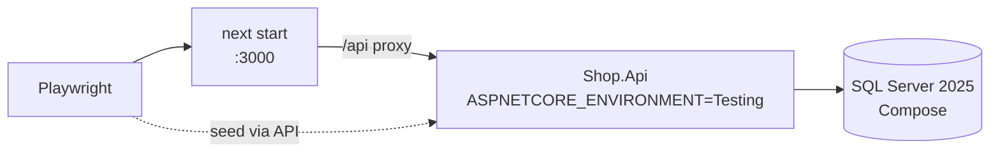

# Playwright E2E, visual checks, flakiness, and CI
[← Overview](00-overview.md)

## Why it matters
- All component tests pass with mocks, but checkout fails in staging: the API's antiforgery token wasn't forwarded through the Next.js proxy. Only an end-to-end test with the real API catches that.
- E2E tests use `waitForTimeout(3000)` everywhere; they're slow and still fail 1 run in 10.
- Every test logs in through the UI; the suite takes 25 minutes.

## Concepts

### E2E against the real stack
For E2E, run the real ASP.NET Core API with a real SQL Server (Docker Compose in CI) and the built Next.js app. Seed data through the API or a test-only seeding endpoint enabled in the `Testing` environment.


### Playwright essentials
| Feature | Use |
|:--|:--|
| ⭐ locators by role | `page.getByRole("button", { name: "Place order" })` |
| ⭐ auto-waiting + web-first assertions | `await expect(locator).toBeVisible()` retries until timeout |
| fixtures | shared setup per test (`test.extend`) |
| ⭐ auth state | a setup project logs in once and saves `storageState`; tests reuse it |
| `webServer` | start API and Next.js before tests (or rely on Compose) |
| projects | Chromium, Firefox, WebKit, mobile viewports |
| `request` fixture | call the API directly for seeding/cleanup |
| traces | `trace: "on-first-retry"`; open with `npx playwright show-trace` |
| `page.route` | stub third parties (payments sandbox, analytics) |

### Visual and accessibility-tree checks
| Assertion | Catches |
|:--|:--|
| `await expect(page).toHaveScreenshot()` | visual regressions (pixel diff, with thresholds) |
| `await expect(locator).toMatchAriaSnapshot(...)` | changes to the accessibility tree structure (roles, names) |
| axe (08-accessibility) | WCAG violations |

Screenshots differ across OS/fonts: generate baselines in the same Docker image used by CI; mask dynamic regions (dates, prices).

### Flaky E2E tests
| Cause | Fix |
|:--|:--|
| fixed sleeps | web-first assertions, wait for responses (`page.waitForResponse`) |
| shared data between tests | unique data per test (seed via API), isolated users |
| test order | each test sets up its state |
| animations | `reducedMotion: "reduce"` in config |
| third-party calls | `page.route` stubs |
| slow CI machines | sensible timeouts, retries = 1–2 with traces, then fix the root cause |

### Frontend tests in CI
| Practice | How |
|:--|:--|
| fast jobs first | lint, typecheck, Vitest |
| E2E job | Compose up (SQL Server, API), `next build && next start`, Playwright |
| sharding | `--shard=1/4` across a matrix, `blob` reporter + `merge-reports` |
| artifacts | HTML report and traces on failure |
| browsers | `npx playwright install --with-deps chromium` (cache it) |
| gating | E2E smoke on PRs; full matrix on `main`/nightly |

## Example
`web/playwright.config.ts`
```ts
import { defineConfig, devices } from "@playwright/test";

export default defineConfig({
  testDir: "./tests/e2e",
  fullyParallel: true,
  retries: process.env.CI ? 1 : 0,
  reporter: process.env.CI ? [["blob"], ["github"]] : "html",
  use: { baseURL: "http://localhost:3000", trace: "on-first-retry", contextOptions: { reducedMotion: "reduce" } },
  projects: [
    { name: "setup", testMatch: /auth\.setup\.ts/ },
    { name: "chromium", use: { ...devices["Desktop Chrome"], storageState: ".auth/user.json" }, dependencies: ["setup"] },
    { name: "mobile-safari", use: { ...devices["iPhone 15"], storageState: ".auth/user.json" }, dependencies: ["setup"] },
  ],
  webServer: { command: "pnpm start", url: "http://localhost:3000/healthz", reuseExistingServer: !process.env.CI },
});
```
`web/tests/e2e/auth.setup.ts`
```ts
import { test as setup, expect } from "@playwright/test";

setup("sign in once", async ({ page, request }) => {
  await request.post("/api/testing/users", { data: { email: "e2e@roastery.test", password: "E2e-pass-123!" } });   // Testing env only
  await page.goto("/sign-in");
  await page.getByLabel("Email").fill("e2e@roastery.test");
  await page.getByLabel("Password").fill("E2e-pass-123!");
  await page.getByRole("button", { name: "Sign in" }).click();
  await expect(page.getByRole("link", { name: "Account" })).toBeVisible();
  await page.context().storageState({ path: ".auth/user.json" });
});
```
`web/tests/e2e/checkout.spec.ts`
```ts
import { test, expect } from "@playwright/test";

test("customer can buy a bag of coffee", async ({ page }) => {
  await page.goto("/coffee/ethiopia-guji");
  await page.getByRole("button", { name: "Add to cart" }).click();
  await expect(page.getByRole("status")).toContainText("added to cart");
  await page.getByRole("link", { name: /cart/i }).click();
  await page.getByRole("link", { name: "Checkout" }).click();
  await page.getByRole("button", { name: "Place order" }).click();
  await expect(page.getByRole("heading", { name: /order #\d+ placed/i })).toBeVisible();
});
```
`.github/workflows/web-e2e.yml` (excerpt)
```yaml
e2e:
  runs-on: ubuntu-latest
  strategy: { matrix: { shard: [1, 2] } }
  steps:
    - uses: actions/checkout@v5
    - run: docker compose --profile app up -d --wait      # SQL Server + API (ASPNETCORE_ENVIRONMENT=Testing)
    - uses: pnpm/action-setup@v4
    - uses: actions/setup-node@v5
      with: { node-version: 24, cache: pnpm, cache-dependency-path: web/pnpm-lock.yaml }
    - run: pnpm -C web install --frozen-lockfile && pnpm -C web build
    - run: pnpm -C web exec playwright install --with-deps chromium webkit
    - run: pnpm -C web exec playwright test --shard=${{ matrix.shard }}/2
      env: { API_URL: http://localhost:8080 }
    - if: ${{ !cancelled() }}
      uses: actions/upload-artifact@v4
      with: { name: blob-report-${{ matrix.shard }}, path: web/blob-report, retention-days: 7 }
```

## Production patterns
- A handful of E2E journeys (browse → cart → checkout, sign-in, account edits) against the real API and database.
- Log in once per worker via `storageState`; seed data through the API's Testing-only endpoints (never enabled in production).
- Traces on retry; a flaky test is quarantined with an issue, not ignored.
- Visual tests only for stable, high-value surfaces, with baselines from the CI container.

## Mistakes
Wrong:
```ts
await page.click(".btn.btn-primary");
await page.waitForTimeout(3000);
```
Right: role locators and web-first assertions.

Wrong: test-only endpoints reachable in production.
Right: map them only when `IsEnvironment("Testing")` in ASP.NET Core, and verify in a production smoke check that they 404.

## Check yourself
1. Why run E2E against the real ASP.NET Core API instead of MSW?
2. How do you avoid logging in through the UI in every test?
3. What makes screenshot tests stable across machines?

<details><summary>Answers</summary>

1. To catch integration bugs mocks hide: cookies, antiforgery, proxying, CORS, real Problem Details shapes, database behavior.
2. A setup project logs in once and saves `storageState`; test projects depend on it and reuse the state.
3. Generating and comparing baselines in the same container image (same fonts, OS rendering), masking dynamic content, and sensible thresholds.
</details>

## Sources
- [Playwright — Best practices](https://playwright.dev/docs/best-practices)
- [Playwright — Authentication](https://playwright.dev/docs/auth)
- [Playwright — Visual comparisons](https://playwright.dev/docs/test-snapshots)
- [Playwright — Aria snapshots](https://playwright.dev/docs/aria-snapshots)
- [Playwright — Sharding](https://playwright.dev/docs/test-sharding)
