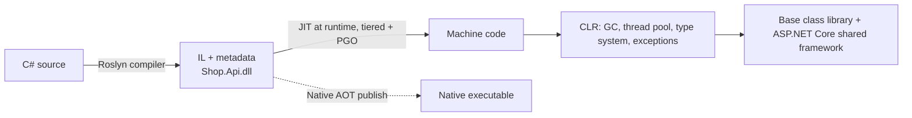

# Language & Runtime — Overview
[← Topic](../README.md)

**TECH:** C# 14 on .NET 10 LTS: the CLR (JIT, GC, thread pool), the `dotnet` CLI, the generic host, and the diagnostics tools; compared with TypeScript/Node where it helps
**LEVEL:** intermediate overall; beginner-friendly for C# specifics (you know TypeScript and have shipped code; C# is new)

## Why this matters in production
- C# looks like TypeScript, but the runtime is very different: real threads, a thread pool, value types, a generational GC, compiled IL. Most .NET production incidents (thread-pool starvation, memory growth, hung shutdowns) come from not knowing the runtime.
- The type system is stronger than TypeScript's: generics exist at runtime, structs are copied, `decimal` is exact, nullability is checked at compile time.
- .NET 8 and 9 reach end of support on 10 November 2026; .NET 10 LTS is supported until November 2028.

## Mental model

Compared with Node: no single event loop. ASP.NET Core runs requests on **thread-pool threads**; `await` frees the thread while I/O is pending. Blocking a thread is cheap once, expensive at scale.

| Node/TypeScript | .NET/C# |
|:--|:--|
| one JS thread + event loop | thread pool, many requests in parallel |
| `Promise` | `Task` / `ValueTask` |
| `AbortSignal` | `CancellationToken` |
| types erased at runtime | types and generics exist at runtime (reflection) |
| `number` (float) | `int`, `long`, `double`, ⭐ `decimal` |
| `npm` + `package.json` | NuGet + `.csproj` |
| V8 GC | generational GC (gen0/1/2, LOH) |

## Prerequisites
- .NET 10 SDK, VS Code + C# Dev Kit or Visual Studio 2026.
- [01-foundations/05-code-quality](../../../01-foundations/05-code-quality/README.md) (nullable, analyzers) is a good companion.

## Lesson map
| Lesson | Checklist items |
|:--|:--|
| [01 · How .NET runs code, the dotnet CLI, and release lines](01-runtime-cli-releases.md) | 1, 2, 15 |
| [02 · The C# type system: values, references, records, nullability, generics](02-type-system.md) | 3, 4, 5 |
| [03 · Collections, LINQ, and modern C#](03-collections-linq-modern.md) | 6, 7 |
| [04 · Async, Task, cancellation, and thread-pool starvation](04-async-threadpool.md) | 8, 9 |
| [05 · Exceptions, resource lifetimes, and memory](05-exceptions-resources-memory.md) | 10, 11 |
| [06 · The generic host, debugging, diagnostics, and runtime security](06-host-debug-diagnostics.md) | 12, 13, 14, 16 |
| [Cheatsheet](cheatsheet.md) | all |

## Suggested order
1. 01 → 06. This is the first topic in the stack's learn order.
2. Alongside: [06-design/01-paradigms-oop](../../../06-design/01-paradigms-oop/README.md) (OOP in C#) and [06-design/08-data-structures-algorithms](../../../06-design/08-data-structures-algorithms/README.md) (C# katas).
3. Ready to build: `/learn csharp/03-backend/01-language-runtime mode=tasks`.

## Version notes
- C# 14 (with .NET 10): extension members (extension properties, static extension members, operators), the `field` keyword in property accessors, null-conditional assignment (`customer?.Address = x`), `nameof` on unbound generics, implicit span conversions, partial constructors/events, user-defined compound assignment.
- .NET 10: file-based apps (`dotnet run app.cs`), noun-first CLI commands (`dotnet package add`), `.slnx` by default, faster JIT (more devirtualization, stack allocation), LINQ `LeftJoin`/`RightJoin`.
- .NET 11 (STS) releases 10 November 2026 with C# 15 (union types); this stack stays on .NET 10 LTS.

## Sources
- [.NET documentation](https://learn.microsoft.com/dotnet/)
- [What's new in C# 14](https://learn.microsoft.com/dotnet/csharp/whats-new/csharp-14)
- [What's new in .NET 10](https://learn.microsoft.com/dotnet/core/whats-new/dotnet-10/overview)
- [.NET support policy](https://dotnet.microsoft.com/platform/support/policy/dotnet-core)
- [C# language reference](https://learn.microsoft.com/dotnet/csharp/language-reference/)
