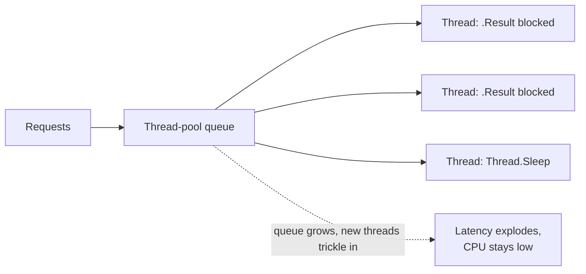

# Async, Task, cancellation, and thread-pool starvation
[← Overview](00-overview.md)

## Why it matters
- One helper calls `httpClient.GetAsync(url).Result`. Under load, latency goes from 50 ms to 30 s and requests time out, while CPU stays at 15%. That's thread-pool starvation.
- A user closes the browser during a 20-second report; the API keeps running the SQL query because nobody passed the `CancellationToken`.
- `async void` in an event handler throws; the exception crashes the process.

## Concepts

### Task and async/await
| Type | Use |
|:--|:--|
| ⭐ `Task` / `Task<T>` | asynchronous operation (like a JS `Promise`) |
| `ValueTask<T>` | avoids allocation when results are often synchronous (caches); await once, don't store |
| `IAsyncEnumerable<T>` + `await foreach` | async streams (SSE, paging) |
| `async Task` methods | ⭐ the default for I/O work |
| `async void` | only for event handlers; exceptions can't be awaited |

`await` on an incomplete task returns the thread to the pool; when the I/O completes, the rest of the method continues on a thread-pool thread. ASP.NET Core has no `SynchronizationContext`, so `ConfigureAwait(false)` isn't needed in app code (libraries still use it).

| Combinator | Like in JS |
|:--|:--|
| `Task.WhenAll(a, b)` | `Promise.all` |
| `Task.WhenAny(a, b)` | `Promise.race` |
| `Task.WhenEach(tasks)` (.NET 9) | process as each completes |
| `Parallel.ForEachAsync(items, new ParallelOptions { MaxDegreeOfParallelism = 4 }, …)` | bounded concurrency |
| `SemaphoreSlim` | throttle concurrent calls |
| `TaskCompletionSource<T>` | `Promise.withResolvers`; use `RunContinuationsAsynchronously` |

### Cancellation
`CancellationToken` is the C# `AbortSignal`.
- In endpoints, take a `CancellationToken` parameter: it fires when the client disconnects (`HttpContext.RequestAborted`) or a request timeout hits.
- Pass it to everything: EF Core (`ToListAsync(ct)`), `HttpClient` (`GetAsync(url, ct)`), `Task.Delay(ms, ct)`.
- Deadlines: `using var cts = CancellationTokenSource.CreateLinkedTokenSource(ct); cts.CancelAfter(TimeSpan.FromSeconds(5));`
- Cancellation throws `OperationCanceledException` (`TaskCanceledException` derives from it); don't log it as an error when the client left.

### The thread pool and starvation
The thread pool starts with a minimum number of threads (≈ CPU count) and adds more slowly (about one or two per second) when work queues up. Blocking a thread while waiting for I/O takes it out of service.


| Cause | Fix |
|:--|:--|
| ⭐ sync over async: `.Result`, `.Wait()`, `.GetAwaiter().GetResult()` | `await` all the way up |
| sync I/O: `File.ReadAllText`, `Stream.Read`, sync DB calls | async APIs |
| `Thread.Sleep` | `await Task.Delay` |
| long work under `lock` | shorter critical sections, `SemaphoreSlim.WaitAsync` |
| CPU-heavy work on request threads | offload to background jobs or bounded parallelism |

Detect: `dotnet-counters monitor` shows `ThreadPool Queue Length` rising and `ThreadPool Thread Count` climbing slowly; dumps show many threads blocked in `Task.Wait`/`Monitor.Enter` (lesson 06). `ThreadPool.SetMinThreads` hides the symptom; fixing the blocking call is the cure. Analyzers CA1849 and VSTHRD002 catch many cases at compile time.

## Example
`src/Shop.Api/Endpoints/Reports.cs`
```csharp
public static class ReportEndpoints
{
    public static void MapReports(this IEndpointRouteBuilder app) =>
        app.MapGet("/reports/sales", async (DateOnly from, DateOnly to, ShopDb db, IExchangeRates rates, CancellationToken ct) =>
        {
            using var cts = CancellationTokenSource.CreateLinkedTokenSource(ct);
            cts.CancelAfter(TimeSpan.FromSeconds(20));                         // our own deadline

            var salesTask = db.Orders
                .Where(o => o.PlacedOn >= from && o.PlacedOn <= to)
                .GroupBy(o => o.Currency)
                .Select(g => new { Currency = g.Key, Total = g.Sum(o => o.Total) })
                .ToListAsync(cts.Token);
            var ratesTask = rates.GetAsync(to, cts.Token);                      // independent → in parallel

            await Task.WhenAll(salesTask, ratesTask);
            var eurTotal = salesTask.Result.Sum(s => s.Total * ratesTask.Result[s.Currency]);   // safe: already completed
            return TypedResults.Ok(new { from, to, eurTotal });
        });
}
```
Bounded parallel calls to a partner API:
```csharp
await Parallel.ForEachAsync(skus, new ParallelOptions { MaxDegreeOfParallelism = 4, CancellationToken = ct },
    async (sku, token) => await stockClient.RefreshAsync(sku, token));
```

## Production patterns
- Async all the way: no `.Result`/`.Wait()` anywhere in request paths (the one exception is reading `.Result` of a task already awaited via `WhenAll`).
- Every async method that does I/O takes a `CancellationToken` as its last parameter and passes it on.
- Bound concurrency to external systems (`Parallel.ForEachAsync`, `SemaphoreSlim`, `Channel<T>`).
- A `DbContext` is not thread-safe: never run two queries on the same context at once (the example runs one EF query in parallel with an HTTP call, which is fine).
- Watch thread-pool queue length in production metrics (03-backend/10-observability).

## Mistakes
Wrong:
```csharp
public Order Get(int id) => _http.GetFromJsonAsync<Order>($"/orders/{id}").Result!;
```
Right:
```csharp
public async Task<Order?> GetAsync(int id, CancellationToken ct) => await _http.GetFromJsonAsync<Order>($"/orders/{id}", ct);
```

Wrong: `catch (Exception ex) { log.LogError(ex, "failed"); }` for client disconnects.
Right: `catch (OperationCanceledException) when (ct.IsCancellationRequested) { /* client left; don't alert */ }`.

## Check yourself
1. Why does `.Result` hurt much more under load than in a local test?
2. Where does an endpoint's `CancellationToken` come from?
3. When is `ValueTask<T>` the better return type?

<details><summary>Answers</summary>

1. Each blocked call holds a thread-pool thread; under load all threads block, the queue grows, and the pool only adds threads slowly, so latency spikes while CPU is idle.
2. ASP.NET Core binds it to `HttpContext.RequestAborted` (client disconnect), linked with request timeouts if configured.
3. When the method often completes synchronously (e.g. a cache hit), to avoid allocating a `Task`; it must be awaited only once.
</details>

## Sources
- [Asynchronous programming with async and await](https://learn.microsoft.com/dotnet/csharp/asynchronous-programming/)
- [Task cancellation](https://learn.microsoft.com/dotnet/standard/parallel-programming/task-cancellation)
- [Debug thread-pool starvation](https://learn.microsoft.com/dotnet/core/diagnostics/debug-threadpool-starvation)
- [ASP.NET Core best practices — avoid blocking calls](https://learn.microsoft.com/aspnet/core/fundamentals/best-practices#avoid-blocking-calls)
- [Stephen Toub — ConfigureAwait FAQ](https://devblogs.microsoft.com/dotnet/configureawait-faq/)
