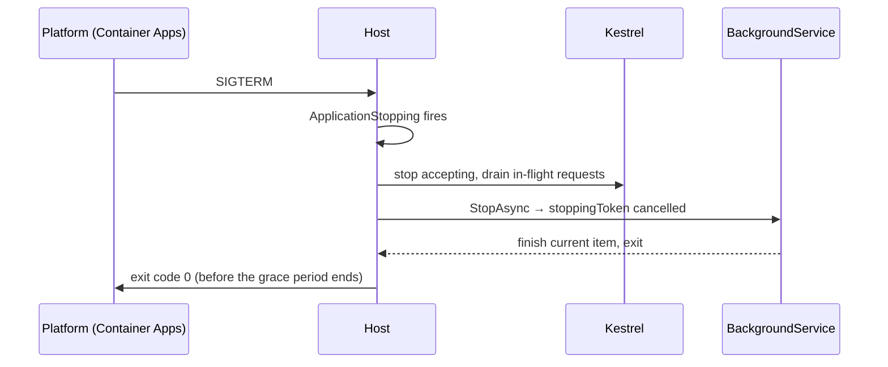

# The generic host, debugging, diagnostics, and runtime security
[← Overview](00-overview.md)

## Why it matters
- Every deploy drops in-flight requests and half-finished background jobs because the app ignores SIGTERM and gets killed after the grace period.
- A memory leak is "fixed" by restarting pods nightly for months; one `dotnet-gcdump` would have shown the 2 GB static cache.
- The API runs a .NET patch with a known Kestrel vulnerability because the base image hasn't been rebuilt since March.

## Concepts

### The generic host
`WebApplication.CreateBuilder(args)` builds a host: configuration, logging, dependency injection, hosted services, and Kestrel.
| Piece | Use |
|:--|:--|
| `builder.Services` | register services (DI) |
| `builder.Configuration` | configuration (01-foundations/07) |
| `builder.Logging` | logging providers (03-backend/10) |
| ⭐ `IHostedService` / `BackgroundService` | long-running work inside the app (queues, timers) |
| `IHostedLifecycleService` | hooks for starting/started/stopping/stopped |
| `IHostApplicationLifetime` | `ApplicationStarted`, `ApplicationStopping`, `ApplicationStopped` tokens |
| `HostOptions.ShutdownTimeout` | how long hosted services get to stop (default 30 s) |
| `BackgroundServiceExceptionBehavior` | default `StopHost`: an unhandled exception in a background service stops the app |

Graceful shutdown sequence on SIGTERM (container stop, new revision):

Keep `ShutdownTimeout` shorter than the platform's grace period; make background loops honor `stoppingToken`. Exit codes: 0 for clean exit; non-zero on startup failure (e.g. `ValidateOnStart` failed), so the platform reports a failed revision.

### Debugging
| Feature | VS Code (C# Dev Kit) | Visual Studio 2026 |
|:--|:--|:--|
| start debugging | F5 (pick the project / `launch.json`) | F5 |
| ⭐ breakpoints, conditional, hit count | ✓ | ✓ |
| logpoints / tracepoints | ✓ (log message, no stop) | ✓ |
| watches, locals, call stack | ✓ | ✓ (+ parallel stacks, tasks window) |
| break on thrown exceptions | exception breakpoints | Exception Settings |
| ⭐ Hot Reload | `dotnet watch` | Hot Reload button |
| attach to process / container | ✓ | ✓ |
| Just My Code | setting | setting |
| Source Link | step into NuGet source | ✓ |

The Tasks/Parallel Stacks windows in Visual Studio show async call chains, which makes deadlocks and starvation visible.

### Diagnostics tools
| Tool | Answers | Command |
|:--|:--|:--|
| ⭐ `dotnet-counters` | live metrics: CPU, GC, heap, thread pool, request rate, exceptions | `dotnet-counters monitor -n Shop.Api` |
| `dotnet-trace` | CPU sampling, events | `dotnet-trace collect -n Shop.Api --profile cpu-sampling` → open in VS/PerfView/speedscope |
| `dotnet-dump` | full process dump: threads, heap, stacks | `dotnet-dump collect -n Shop.Api` then `dotnet-dump analyze` (`clrthreads`, `dumpheap -stat`, `gcroot`) |
| `dotnet-gcdump` | managed heap snapshot (smaller) | `dotnet-gcdump collect -n Shop.Api` |
| `dotnet-monitor` | HTTP API/sidecar to collect the above in containers | |
| Visual Studio profiler | CPU usage, allocations, memory, async, database | Debug → Performance Profiler |
| Application Insights Profiler / Snapshot Debugger | production traces and exception snapshots | Azure |

Install with `dotnet tool install -g dotnet-counters` (same for trace/dump/gcdump). In containers, either include the tools in a debug image, use `dotnet-monitor` as a sidecar, or `kubectl/az containerapp exec` into a container with tools.

### Runtime security
| Practice | How |
|:--|:--|
| ⭐ stay patched | monthly .NET patches; rebuild images on the latest `10.0` tag; Dependabot for `global.json` and Docker base images |
| supported versions only | .NET 8/9 end support 2026-11-10 |
| package vulnerabilities | NuGet Audit (01-foundations/06) |
| trimming / Native AOT | smaller surface when appropriate |
| reflection and dynamic code | avoid loading types or assemblies by name from input |
| `unsafe` code | needs `<AllowUnsafeBlocks>`; avoid in app code |
| crypto | `System.Security.Cryptography` only; `RandomNumberGenerator`, `CryptographicOperations.FixedTimeEquals` |
| non-root containers | .NET 8+ images default to a non-root `app` user |

## Example
`src/Shop.Api/Workers/OutboxPublisher.cs`
```csharp
public sealed class OutboxPublisher(IServiceScopeFactory scopes, ILogger<OutboxPublisher> log) : BackgroundService
{
    protected override async Task ExecuteAsync(CancellationToken stoppingToken)
    {
        using var timer = new PeriodicTimer(TimeSpan.FromSeconds(2));
        while (await timer.WaitForNextTickAsync(stoppingToken))           // ends when shutdown starts
        {
            try
            {
                await using var scope = scopes.CreateAsyncScope();             // scoped DbContext per batch
                var publisher = scope.ServiceProvider.GetRequiredService<IOutboxBatchPublisher>();
                await publisher.PublishPendingAsync(batchSize: 50, stoppingToken);
            }
            catch (OperationCanceledException) when (stoppingToken.IsCancellationRequested) { }
            catch (Exception ex)
            {
                log.LogError(ex, "Outbox batch failed; retrying on next tick");   // don't let one failure stop the host
            }
        }
    }
}
```
`src/Shop.Api/Program.cs` (excerpt)
```csharp
builder.Services.Configure<HostOptions>(o => o.ShutdownTimeout = TimeSpan.FromSeconds(20));   // < platform grace (30 s)
builder.Services.AddHostedService<OutboxPublisher>();
```
Investigating starvation in a running container:
```bash
dotnet-counters monitor -n Shop.Api --counters System.Runtime,Microsoft.AspNetCore.Hosting
# watch: threadpool queue length, threadpool thread count, requests per second
dotnet-dump collect -n Shop.Api -o /tmp/api.dmp
dotnet-dump analyze /tmp/api.dmp
> clrthreads
> clrstack -all           # many threads in Task.Wait / Monitor.Enter → sync over async
```

## Production patterns
- Every `BackgroundService` loop honors `stoppingToken`, creates a scope per unit of work, and catches per-iteration errors.
- `ShutdownTimeout` below the platform grace period; readiness turns unhealthy when stopping (03-backend/08-reliability).
- A runbook for "high latency, low CPU": counters → dump → look for blocking calls.
- Base images and `global.json` updated by Dependabot; images rebuilt and redeployed monthly at least.

## Mistakes
Wrong: a background loop that ignores cancellation.
```csharp
while (true) { await DoWork(); await Task.Delay(2000); }      // killed mid-work on every deploy
```
Right: `PeriodicTimer.WaitForNextTickAsync(stoppingToken)` and pass the token into the work.

Wrong: injecting a scoped `DbContext` into a `BackgroundService` constructor.
Right: `IServiceScopeFactory` and a scope per iteration.

## Check yourself
1. What happens by default when a `BackgroundService` throws an unhandled exception?
2. Which tool do you reach for first when latency is high but CPU is low?
3. Why should `ShutdownTimeout` be shorter than the container's termination grace period?

<details><summary>Answers</summary>

1. The host stops (`BackgroundServiceExceptionBehavior.StopHost`), and the app exits.
2. `dotnet-counters` (thread-pool queue length and thread count), then `dotnet-dump` to see what threads are blocked on.
3. So the app finishes shutting down and exits cleanly before the platform sends SIGKILL.
</details>

## Sources
- [.NET Generic Host](https://learn.microsoft.com/dotnet/core/extensions/generic-host)
- [Background tasks with hosted services](https://learn.microsoft.com/aspnet/core/fundamentals/host/hosted-services)
- [Debug C# in VS Code](https://code.visualstudio.com/docs/csharp/debugging)
- [.NET diagnostic tools overview](https://learn.microsoft.com/dotnet/core/diagnostics/tools-overview)
- [dotnet-counters](https://learn.microsoft.com/dotnet/core/diagnostics/dotnet-counters) · [dotnet-dump](https://learn.microsoft.com/dotnet/core/diagnostics/dotnet-dump)
- [.NET security updates (release notes)](https://github.com/dotnet/core/tree/main/release-notes)
