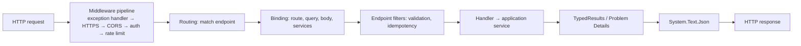

# API Design — Overview
[← Topic](../README.md)

**TECH:** ASP.NET Core 10 Minimal APIs (route groups, endpoint filters, `TypedResults`, built-in validation) first, controllers second; System.Text.Json; Problem Details; OpenAPI 3.1 consumed by Orval in the Next.js app
**LEVEL:** intermediate (mid-level, new to C# and .NET)

## Why this matters in production
- The API is the contract for the Next.js frontend, mobile apps, and partners. Changing it carelessly breaks clients you don't control.
- Retries happen (networks, proxies, users double-clicking). Without idempotency and concurrency control, retries create duplicate orders and lost updates.
- Middleware order and DI lifetimes are where ASP.NET Core apps fail in subtle ways: CORS before auth, singletons capturing scoped `DbContext`s.

## Mental model

Endpoints are thin: bind, validate, call an application service, map the result. Business rules live below (03-backend/11-architecture).

## Prerequisites
- [01-language-runtime](../../01-language-runtime/README.md), [01-foundations/02-http-networking](../../../01-foundations/02-http-networking/README.md), [01-foundations/08-documentation](../../../01-foundations/08-documentation/README.md) (OpenAPI).

## Lesson map
| Lesson | Checklist items |
|:--|:--|
| [01 · REST design, app structure, and the middleware pipeline](01-rest-structure-pipeline.md) | 1, 2 |
| [02 · Routing, binding, and dependency injection](02-routing-binding-di.md) | 3, 4 |
| [03 · Validation and Problem Details](03-validation-problem-details.md) | 5, 6 |
| [04 · DTOs, serialization, pagination, and versioning](04-dtos-json-pagination-versioning.md) | 7, 9, 10, 11 |
| [05 · Idempotency, concurrency, long-running operations, and webhooks](05-idempotency-concurrency-async-webhooks.md) | 8, 12, 13, 17 |
| [06 · Contracts, controllers, and API styles](06-contracts-controllers-styles.md) | 14, 15, 16, 18 |
| [Cheatsheet](cheatsheet.md) | all |

## Suggested order
1. 01 → 06.
2. Then [03-databases](../../03-databases/README.md) (persistence behind the endpoints) and [04-auth](../../04-auth/README.md).
3. Ready to build: `/learn csharp/03-backend/02-api-design mode=tasks`.

## Version notes
- ASP.NET Core 10: built-in Minimal API validation (`AddValidation()`, DataAnnotations, source-generated), OpenAPI 3.1 by default, `TypedResults.ServerSentEvents`, `WithOpenApi()` obsolete.
- Minimal APIs are Microsoft's recommended starting point for new APIs; controllers remain fully supported and common in existing codebases.
- FluentValidation 12 targets .NET 8+ and is still free (Apache 2.0); its automatic MVC integration package is deprecated, so validate explicitly (filters or services).
- Asp.Versioning (`Asp.Versioning.Http`) handles API versioning for Minimal APIs.

## Sources
- [Minimal APIs overview](https://learn.microsoft.com/aspnet/core/fundamentals/minimal-apis/overview)
- [Choose between controller-based APIs and minimal APIs](https://learn.microsoft.com/aspnet/core/fundamentals/apis)
- [ASP.NET Core middleware](https://learn.microsoft.com/aspnet/core/fundamentals/middleware/)
- [Microsoft REST API Guidelines](https://github.com/microsoft/api-guidelines)
- [RFC 9457 — Problem Details](https://www.rfc-editor.org/rfc/rfc9457)
